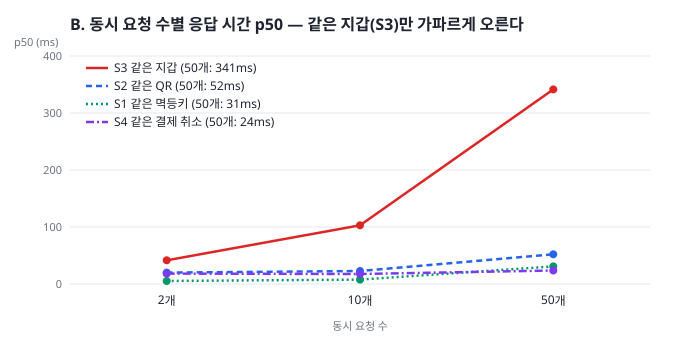
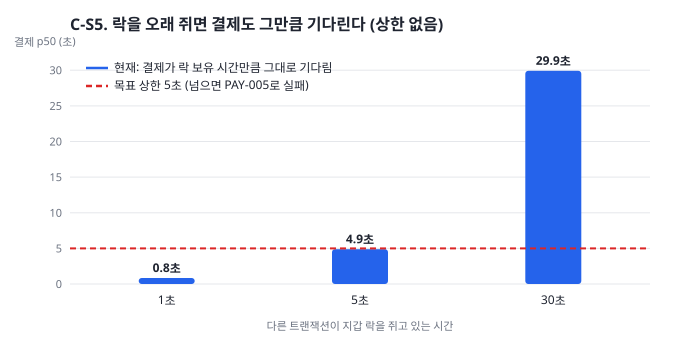
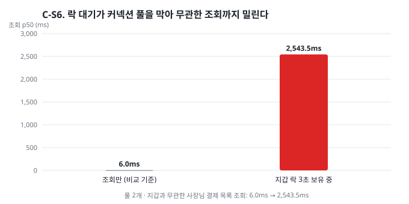
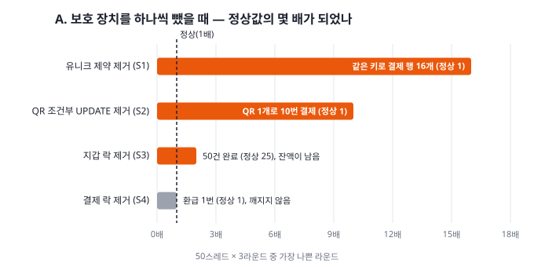

# 결제 동시성 개선 전 기준값 (#263)

락 대기 타임아웃·트랜잭션 타임아웃·정리 스케줄러를 넣기 **전에** 현재 결제 코드를 측정해 저장한 기준값이다. 개선 후 같은 하네스와 같은 조건으로 다시 재서 아래 "개선 후" 칸을 채운다.

- 측정일: 2026-11-26
- 측정 코드: `fb820fb` (= `origin/dev` `3f22e3d` + 측정 코드만 추가, 운영 코드 변경 없음, 커밋하지 않은 수정 없음)
- 원시 결과: `docs/perf/data/<시나리오>/*.json` (라운드마다 1파일, 총 97개)

## 1. 무엇을 알고 싶었나

| 구분 | 질문 | 시나리오 |
| --- | --- | --- |
| **B. 정확성 기준값** | 동시에 몰려도 돈이 정확한가, 그때 얼마나 걸리나 | S1~S4 |
| **C. 장애 기준값** | 누군가 락을 오래 쥐면 어떻게 되나 (타임아웃이 없는 지금) | S5, S6 |
| **A. 보호 장치의 효과** | 그 장치를 빼면 실제로 무엇이 깨지나 | S1~S4를 장치 하나씩 뺀 코드로 |

## 2. 측정 방법

### 하네스 (`src/test/.../support/perf/`)

| 구성 | 역할 |
| --- | --- |
| `ConcurrentRunner` | 작업 N개를 스레드에 올린 뒤 **한 신호로 동시에 출발**(`CountDownLatch`). 작업별 결과(성공 상태, 에러 코드, 예외 이름)와 소요 시간(ns) 수집, 전체 제한 시간 초과는 `TIMEOUT` |
| `RunResult` | 결과별 건수, 지연 p50·p95·최댓값(nearest-rank), 전체 소요 시간 |
| `PerfReport` | 1회 결과를 JSON 으로 저장. 커밋 해시·수정 여부·PostgreSQL 버전·풀 크기·실행 일시를 함께 남김 |
| `PerfRounds` | 예열 1회(버림) + 측정 N라운드. 라운드마다 데이터를 새로 만들고, 실행 뒤 **DB 를 직접 조회해 불변 조건**을 확인 |
| `PerfFixture` | 실제 QR 서비스로 QR 생성(Mock 아님), 캐시백 예산 투입(예산 행 락까지 거치게), 확인용 조회는 JdbcTemplate |
| `PerfHarnessTest` | 하네스 자체 검증(동시 출발, 결과 라벨, 제한 시간, 백분위, 저장). 일반 `test` 에 포함 |

### 실행

```bash
./gradlew perfTest
```

- `@Tag("perf")` 테스트만 실행하고, 일반 `./gradlew test` 에서는 제외된다(느리고 시간에 따라 흔들려서).
- 조건 변경: `-PperfThreads=2,10,50 -PperfRounds=5 -PperfVariant=<실험 이름>`, 특정 시나리오: `--tests '*S1*'`

### 환경과 한계

| 항목 | 값 |
| --- | --- |
| 머신 | Apple M1 Pro, 10코어 (앱·DB 같은 머신) |
| DB | PostgreSQL 17.12 (Docker), 테스트 DB `devpay_test` |
| 커넥션 풀 | S1~S5: 10 (운영 기본값과 같게 지정), S6: 2 (고갈 재현용) |
| 반복 | 스레드 2·10·50 × 5라운드(예열 제외). 표는 **라운드 중앙값**, [ ]는 최소~최대 |
| 호출 지점 | 서비스 메서드 직접 호출(`PaymentFacade.pay`, `PaymentCancelService.cancel`). HTTP·JWT·PIN 검증 비용은 빠져 있다 |

절대 수치는 이 머신 기준이라 운영과 다르다. **같은 조건에서 개선 전후를 비교**하는 용도로 쓴다.

### 결과 JSON 읽는 법

파일 하나 = 라운드 하나다. 파일 이름은 `<실행 시각>-<조건>-r<라운드>.json` (예: `t50-r1` = 50스레드 1라운드, `hold5s-r2` = 락 5초 보유 2라운드). 폴더 이름이 `A-` 로 시작하면 보호 장치를 뺀 실험 결과다.

| 필드 | 뜻 | 볼 때 |
| --- | --- | --- |
| `environment` | 커밋 해시, 커밋 안 한 수정 여부(`dirty`), DB 버전, 풀 크기 | 개선 전후 파일의 커밋이 다르고, `dirty: false` 인지 먼저 확인 |
| `conditions` | 스레드 수, 금액, 락 보유 시간 등 입력 조건 | 비교할 두 파일의 조건이 같은지 확인 |
| `counts` | 요청별 결과 건수. `COMPLETED`·`CANCELED` = 성공, `COM-004`·`QR-003`·`WAL-004` = 정상 거절, 예외 이름 = 서버 오류, `TIMEOUT` = 제한 시간 초과 | 예외 이름이나 `TIMEOUT` 이 있으면 문제 |
| `latencyMs` | 요청 1건의 소요 시간 분포. `p50` = 절반이 이 안에 끝남(보통 사용자), `p95` = 95%가 이 안에 끝남(느린 사용자), `max` = 가장 느린 1건 | p50 은 평소 속도, p95·max 는 꼬리 지연 |
| `groups` | 같은 라운드 안에서 역할별로 나눈 결과(`pay`, `cancel`, `read`, 락을 쥔 `holder`) | S5·S6 은 `holder` 를 빼고 `pay`·`read` 만 본다 |
| `checks` | DB 를 직접 조회한 불변 조건. `invariantsOk` 가 핵심 | **`false` 면 돈이 틀린 것**. 속도보다 먼저 본다 |
| `wallMs` | 라운드 전체가 끝나기까지 걸린 시간 | 처리량 감 잡기용 |

읽는 순서: **① `checks.invariantsOk`(정확한가) → ② `counts`(거절이 정상 코드로 났나) → ③ `latencyMs.p50`·`p95`(얼마나 걸렸나)**. 아래 표와 그래프는 같은 조건 라운드들의 **중앙값**이다(라운드마다 흔들리는 값을 한 숫자로 줄이려고).

## 3. B. 정확성 기준값 (S1~S4)

모든 시나리오, 모든 라운드(60회)에서 **불변 조건 위반 0건**.

| # | 상황 | 보호 장치 | 스레드 | 결과(라운드당) | 불변 조건 | p50 | p95 | 최대 |
| --- | --- | --- | --- | --- | --- | --- | --- | --- |
| S1 | 같은 멱등키 동시 요청 | (지갑, 멱등키) 유니크 제약 | 2 | 완료 1, COM-004 1 | 결제 행 1, 차감 1 ✅ | 5.3ms [4.8~11.6] | 17.3 | 17.3 |
| | | | 10 | 완료 1, COM-004 9 | ✅ | 7.8 [7.2~8.5] | 19.7 | 19.7 |
| | | | 50 | 완료 1, COM-004 49 | ✅ | 30.8 [20.3~40.2] | 44.2 | 50.1 |
| S2 | 같은 QR, 서로 다른 지갑 | QR 조건부 UPDATE | 2 | 완료 1, QR-003 1 | 완료 1, 차감 1 ✅ | 20.1 [14.2~36.0] | 23.0 | 23.0 |
| | | | 10 | 완료 1, QR-003 9 | ✅ | 22.7 [21.9~30.4] | 27.2 | 27.2 |
| | | | 50 | 완료 1, QR-003 49 | ✅ | 52.2 [47.9~57.5] | 60.7 | 61.0 |
| S3 | 같은 지갑, 서로 다른 QR (잔액은 절반만) | 지갑 행 비관적 락 | 2 | 완료 1, WAL-004 1 | 완료 = 잔액분, 잔액 0 ✅ | 41.5 [38.0~50.2] | 47.3 | 47.3 |
| | | | 10 | 완료 5, WAL-004 5 | ✅ | 103.0 [92.1~111.3] | 114.9 | 114.9 |
| | | | 50 | 완료 25, WAL-004 25 | ✅ | 341.4 [277.3~374.4] | 385.3 | 387.9 |
| S4 | 같은 결제 동시 취소 | 결제 행 비관적 락 + 상태 확인 | 2 | 취소 응답 2 | 환급 1, 적립 취소 1 ✅ | 18.3 [11.8~36.3] | 19.4 | 19.4 |
| | | | 10 | 취소 응답 10 | ✅ | 17.6 [12.7~20.9] | 21.3 | 21.3 |
| | | | 50 | 취소 응답 50 | ✅ | 23.7 [23.3~25.2] | 38.6 | 39.6 |

**해석**

- S1·S2·S4 는 늦게 온 요청이 **기다리지 않고 바로 거절되거나 기존 결과를 받는다**(유니크 위반, 조건부 UPDATE 0건, 상태 확인). 그래서 50스레드에서도 수십 ms.
- S3 만 스레드 수에 비례해 느려진다(50스레드 p50 341ms). 같은 지갑 요청이 **지갑 행 락 앞에 한 줄로 서서** 하나씩 처리되기 때문이다. 정확성을 위해 의도한 직렬화이고, 이 줄이 길어지거나 앞사람이 멈추면 어떻게 되는지가 C(S5·S6)다.



> 요청 수가 25배(2→50)일 때 S1·S2·S4 는 1.3~5.8배, S3 는 **8.2배** 늘었다.

## 4. C. 장애 기준값 (S5, S6)

### S5. 지갑 락을 오래 쥐면 (풀 10, 같은 지갑 결제 5건, 결제는 0.2초 늦게 출발)

| 락 보유 | 라운드 | 결제 결과 | 결제 p50 | 가장 빠른 결제 | 가장 느린 결제 | 개선 후 (적용 뒤 채움) |
| --- | --- | --- | --- | --- | --- | --- |
| 1초 | 3 | 5건 모두 완료 | 848ms | 820ms | 869ms | |
| 5초 | 3 | 5건 모두 완료 | 4,879ms | 4,839ms | 4,897ms | |
| 30초 | 1 | 5건 모두 완료 | 29,919ms | 29,880ms | 29,954ms | |



> 30초 막대가 빨간 점선(5초) 아래로 내려오면 개선된 것이다.

**해석**: 결제 응답 시간이 **락을 쥔 시간을 그대로 따라간다**(30초 보유 → 30초 대기). 지금 코드에는 락 대기 상한이 없어서, 앞 트랜잭션이 멈추면 뒤 결제도 끝없이 기다린다. 사용자 화면에서는 "결제 처리 중"이 멈춘 것처럼 보인다.
**개선 후 기대**: 락 대기 5초(`PAY-005`)가 들어가면 30초 보유에서도 결제가 약 5초에 실패로 끝나야 한다.

### S6. 락 대기가 커넥션 풀을 막으면 (풀 2, 지갑 락 3초 보유 + 같은 지갑 결제 3건 + 사장님 결제 목록 조회 5건)

| 상황 | 라운드 | 결제 목록 조회 p50 | 조회 최대 | 결제 p50 | 개선 후 |
| --- | --- | --- | --- | --- | --- |
| 조회만 (비교 기준) | 3 | **6.0ms** | 9.2ms | - | |
| 락 3초 보유 중 | 3 | **2,544ms** | 2,549ms | 2,837ms | |



**해석**: 결제 목록 조회는 지갑 락과 **아무 관계가 없는데도 약 420배 느려졌다**. 락을 쥔 트랜잭션과 락을 기다리는 결제가 커넥션 2개를 모두 붙잡아서, 조회가 커넥션을 받을 때까지(락이 풀릴 때까지) 기다렸기 때문이다. 락 대기 하나가 **풀을 통해 다른 기능으로 번지는 것**이다. 운영 풀(10)에서도 같은 지갑에 10건 이상 몰리면 같은 일이 생긴다.
**개선 후 기대**: 락 대기·트랜잭션 타임아웃으로 커넥션을 붙잡는 시간에 상한이 생겨 조회 지연도 그 상한 안으로 줄어야 한다.

## 5. A. 보호 장치를 하나씩 뺐을 때

실험 브랜치 `exp/#263-no-guards`(로컬, **머지 금지**)에서 장치 하나만 빼고 같은 시나리오를 돌렸다. 스레드 10·50 × 3라운드.

| 뺀 장치 | 시나리오 | 스레드 | 결과 | 깨진 것 | 커밋 |
| --- | --- | --- | --- | --- | --- |
| (지갑, 멱등키) 유니크 제약 | S1 같은 멱등키 | 10 | 결제 행 **7~10개**, 오류 1~3건 | 같은 키로 결제 행이 여러 개. 재조회가 `IncorrectResultSizeDataAccessException`(500) | `9166506` |
| | | 50 | 결제 행 **14~16개**, 오류 34~36건 | 〃 | |
| QR 조건부 UPDATE → 읽고 확인한 뒤 쓰기 | S2 같은 QR | 10 | 완료 **6~10건** | **QR 1개로 결제 최대 10번, 지갑 10개에서 차감** | `bb319f1` |
| | | 50 | 완료 **8~10건** | 〃 | |
| 지갑 행 비관적 락 | S3 같은 지갑 | 10 | 완료 **10건**(정상 5건) | 잔액보다 많이 결제됐는데 **잔액이 30,000~40,000원 남음** | `d3fc3b0` |
| | | 50 | 완료 **50건**(정상 25건) | 25건분 잔액으로 50건 결제, **잔액 190,000~200,000원 남음** | |
| 결제 행 비관적 락 | S4 같은 결제 취소 | 10·50 | 환급 1번, 적립 취소 1번 | **깨지지 않음** | `f3a60ef` |



> 점선 = 정상(1배). S1 16배(1행 → 16행), S2 10배(1건 → 10건), S3 2배(25건 → 50건, 잔액 190,000~200,000원 남음), S4 1배(깨지지 않음). 배수는 S1 이 가장 크지만 **실제 돈이 잘못된 것은 S2·S3** 이고, S1 은 QR 이 두 번째로 막아 차감은 1번이었다.

**해석**

- **S3 가 가장 위험하다.** 락이 없으면 여러 요청이 같은 잔액을 읽고 각자 빼서 덮어쓴다(갱신 손실, lost update). 결과적으로 결제는 다 됐는데 돈은 덜 빠져서 **돈이 생겨난다**.
- **S2**: "상태 확인 → 쓰기" 사이에 다른 요청이 끼어든다(check-then-act). 조건을 UPDATE 문 안에 넣어 DB 가 한 번에 판정하게 한 것이 해결책이다.
- **S1**: 유니크 제약이 없으면 행은 여러 개 생기지만, 이 실험에서 돈은 1번만 빠졌다. QR 조건부 UPDATE 가 **두 번째 방어선**으로 막았기 때문이다(같은 키는 같은 QR 이라서). 대신 결과 재조회가 500 으로 깨진다.
- **S4**: 결제 행 락을 빼도 깨지지 않았다. 지갑이 (거래 종류, 결제 ID)로 같은 환급을 한 번만 반영하고, 캐시백 적립 취소도 `PENDING` 일 때만 바꾸는 조건부 UPDATE 라서 **이중으로 보호**된다. 결제 행 락은 "취소 상태 전이를 한 번만" 보장하는 역할로 남는다.

## 6. 개선 후 재측정 (타임아웃·스케줄러 적용 뒤)

같은 명령(`./gradlew perfTest`)으로 다시 재서 4장 표의 "개선 후" 칸과 아래를 채운다. B(S1~S4)는 정확성이 그대로인지(위반 0건 유지), C(S5·S6)는 대기 상한이 생겼는지를 본다.

| 확인 항목 | 개선 전 | 개선 후 |
| --- | --- | --- |
| S1~S4 불변 조건 위반 | 0건 / 60라운드 | |
| S5 30초 보유 시 결제 응답 | 약 30초, 모두 완료 | |
| S6 락 보유 중 결제 목록 조회 p50 | 2,544ms | |
