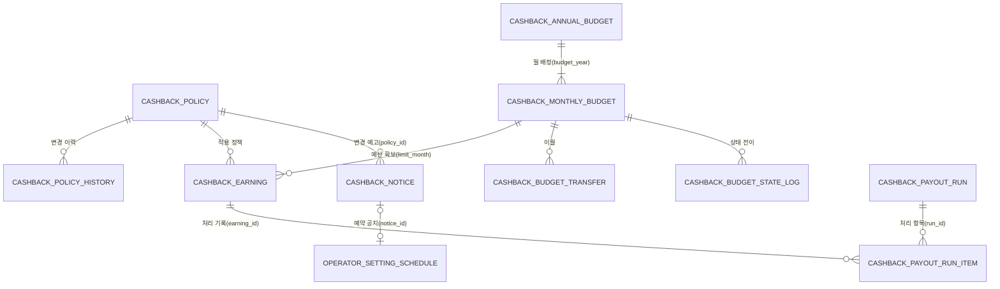

# cashback 도메인 기획 (캐시백·예산·정책)

| 항목 | 내용 |
|---|---|
| 도메인 | 캐시백·예산·정책 (패키지 `cashback`) |
| 작성 | 문환(B) · 2026-11-18 (최종 수정 2026-11-27, 지급 배치 실행 기록과 화면, 운영자 한도 설정 화면, 변경 공지와 한도 변경 예약, 홈 공지 API, 운영자 공지 수정과 설정 변경 이력 API, 이용자 공지·운영자 관리 화면 추가, 예약 중 바로 변경 거절과 홈 종료일 규칙 변경, 운영자 적립 내역 조회 API와 적립 관리 화면 추가, 소진 예측 저장과 예측 오차 공개) |
| 기준 문서 | 커밋된 [기획서](../project-spec.md), [역할 분담](../team-roles.md) |
| 상태 | 도메인 판단으로 진행 중. 기획서와 달라지는 부분은 [1절](#1-기획서-대비-변경-요약)에 모았다 |

**운영 방식**: 각자 자기 도메인은 본인 판단으로 진행하고, 진행 중 바뀐 기획은 `docs/plan/도메인-이니셜-MMDD.md`로 남겨 공유한다. 이 문서는 cashback 도메인의 개인 기획서이며, 다른 기획서가 링크하므로 파일명은 고정하고 수정일은 머리표의 "최종 수정"에 적는다([10절](#10-개발-중-결정-사항) 11-19).

**도메인 방향(초안, 팀 합의 전)**: 캐시백이 얼마나 갈지 미리 보여 주고, 약속한 캐시백은 끝까지 지킨다. 예산은 1원도 초과하지 않고 결제는 멈추지 않는다. 정합성(예산 초과 0원)은 처음부터 지키고, 판단 근거를 먼저 보여 주는 정보(결제 전 미리보기, 확정 영수증, 소진 예측)가 우리 도메인의 특징이다.

**원칙**: MVP 구현이 최우선이다. 구조를 먼저 정하고 숫자(%·금액·배율)는 설정값과 시드 데이터로 둔다.

## 1. 기획서 대비 변경 요약

| 구분 | 항목 | 기획서(커밋본) | 이 문서 | 영향 |
|---|---|---|---|---|
| 변경 | 대비금 크기 | 최근 7일 일평균 지급액 × 5일 | **월 배정의 10% 고정**. 월 시작 시 확정하고 월 중 변경하지 않음 | 운영자 화면, 중단 판정 |
| 변경 | 중단 공지 | 대비금이 소모되기 시작하면 3일 후 00:00에 적립 중단을 공지 | 남은 예산이 대비금에 닿으면 **즉시 공지하고 공지일 + 3일 00:00(KST)에 중단**. 공지에는 날짜만 쓰고 시각은 쓰지 않음 | A(결제 응답), C·D 화면 |
| 변경 | 긴급 중단 기준 | 공지 후 대비금의 10%만 남으면 | **대비금의 절반**에 닿으면 즉시 중단 | 중단 판정 |
| 변경 | 예산 부족 시 적립 | 적립만 0원(또는 남은 만큼) | **전액 또는 0원**. 부분 지급과 안분 없음(이용자 월 한도 초과만 남은 한도만큼 부분 적립, 4-2) | A, C |
| 변경 | 소수점 | 적립·보유·회수는 소수점 유지 | **적립액은 1원 단위 버림**(`floor(데브머니 사용분 × 요율)`). 금액은 원 단위 `long`(BIGINT)으로 저장한다. 소수 유지 지급은 [8절](#8-제외후순위)의 도전 과제로 두고, 필요해지면 컬럼 타입을 바꾼다 | A, C(보유 캐시백) |
| 변경 | 적립 지급 배치 | B가 건별 트랜잭션으로 지급 | **B 배치가 건별 트랜잭션을 열어 C의 입금 API를 호출하고, 같은 트랜잭션에서 상태·예산을 갱신**. 지갑 API는 도메인 중립(`credit`/`debit`)이며 호출자의 트랜잭션에 참여한다([4-3](#4-3-적립-지급-배치와-지갑-연동)) | B, C |
| 변경 | 정책의 정의 | 정책 = 요율·기간 | **정책(월 정책) = 월 예산 + 요율 구간들**. `CashbackPolicy`는 요율 구간이다. 달마다 기본 요율을 두고 달 중에는 인하만 한다([4-2](#4-2-적립-규칙)) | 운영자 화면, 적립 요율 조회 |
| 변경 | 예산 소진 대응 | 대비금 소진 후 중단 공지 | **① 요율 인하(운영자 수동) → ② 대비금 사용·중단 공지 → ③ 다음 달 새 예산과 기본 요율로 복구** | 운영자 화면, A(결제 응답) |
| 유지 | 정책 변경 이력 | 변경자·시각·변경 전후 값 기록 | 그대로 B 범위에 포함(역할 분담 논의에서 제외로 거론됐으나 B 도메인 판단으로 포함) | |
| 추가 | 데이터 투명성 | 없음 | 결제 전 캐시백·한도 미리보기, 확정 영수증 필드, 적립 제외 사유, 정책 변경 예고, 알림·공지 목록 | A, C, D 화면 |
| 추가 | 수요 예측 | 없음 | 소진 예측(예상 소진일 범위, 최소 보장 인원), 정책 저장 전 예측 미리보기, 가정·버전 표시 | D(대시보드 그래프) |
| 추가 | 대시보드 그래프 3개 | 없음 | 예산 현황(실제), 소진 예측, 월별 예산 집행(연간 12개월), 월 배정 입력의 예측 기반 권장 | D |
| 추가 | D용 조회 API | 없음 | 예산·적립 시계열 | D |
| 제외 | **일일 예산 페이싱** | 없음 | 기획에서 제외 | |
| 제외 | **추가 캐시백 운영(탄력 요율)** | 이월 예산으로 추가 요율 설정, 예상 소진액 검증(3절 추가 기능) | **기획에서 제외**. 남은 예산은 다음 달로 이월만 하고 달 중 요율 상향은 없다([4-2](#4-2-적립-규칙)) | 운영자 화면 |

## 2. 남은 개발 목록 (2026-11-25)

마감은 11-30(월)이다. 번호는 식별용이다. 달 중 요율 상향과 추가 캐시백·탄력 요율은 하지 않는다. 남은 예산은 다음 달로 이월만 한다([4-2](#4-2-적립-규칙)).

### 2-1. MVP 개발 피드백 반영

| # | 작업 | 영역 | 우선순위 |
|---|---|---|---|
| 1 | 로컬에서 캐시백 적립 재확인(배포 환경은 해결됨) | 확인 | 높음 |
| 2 | #214 코멘트 반영: 이월한 달에 "고정" 표시, 여러 달 저장 중 실패 시 부분 저장 처리 | 프론트 | 높음 |
| 3 | 프론트 목 데이터·하드코딩 제거와 API 연동: 대시보드 "요율별 예상 잔액" 차트, 한도 상수(`lib/limits.ts`)와 결제 한도 표시(한도 조회 API 추가), `lib/mock.ts` 삭제(결제 내역 화면 사용분은 제외), `walletId`·`devContext` 파라미터 제거 | 프론트 + 백엔드 | 중간 |
| 4 | 요율 시뮬레이터(소진 예측 그래프)에서 상향 조건 제거: 요율 슬라이더 범위를 현재 요율 이하로 줄이고, 현재 요율보다 높은 프리셋(15%·20%)을 없앤다. 요율이 오를 때의 수요 증가 가정(`ELASTICITY`)과 문구도 정리한다 | 프론트 | 중간 |
| 5 | 연 예산 자동 등록의 동시 기동 경쟁 대비 | 백엔드 | 중간 |
| 6 | 긴급 중단 시 미적립 안내(결제창·PIN·영수증) | 프론트·백엔드 | 중간 |
| 7 | (완료 11-26, #259) 운영자 "적립 지급 배치 현황"(별도 화면: 실행 결과·상세·대기 건수, 수동 실행 버튼) | 프론트·백엔드 | 중간 |
| 8 | (완료 11-26, #264) 운영자 한도 설정 화면(월 적립 한도, 지갑 보유·월 충전 한도) | 프론트 | 중간 |
| 9 | 운영자 "사용자 내역" 목록 줄이기 | 프론트 | 낮음 |
| 10 | 대시보드 "예산을 찾을 수 없습니다"에 배정 화면 링크 | 프론트 | 낮음 |
| 11 | 운영자 설정·지급·이월 API Swagger 설명 보강 | 백엔드 | 낮음 |
| 23 | (완료 11-26, #265·#266) 변경 공지와 한도 변경 예약: 공지에 제목·홈 노출 추가, 홈 공지 API, 한도를 공지와 함께 바로 또는 날짜 예약으로 변경, 운영자 공지 조회·수정 API, 설정 변경 이력 API, 이용자 공지사항·홈 팝업과 운영자 예산·정책·공지 관리 화면 | 백엔드 + 프론트 | 중간 |

### 2-2. MVP 이후 기능 개발

| # | 기능 | 비고 |
|---|---|---|
| 12 | 운영자 적립 내역 전체 조회 | (완료 11-27, #290) 상태·접수일·지갑 번호 필터, 페이징 |
| 13 | 정책 저장 전 예측 미리보기 | 현재 요율 이하만 다룬다. 예상 소진 3일 미만이면 경고(9절 6번 포함). **화면 구현 확인(11-27)**: 정책 관리의 시뮬레이터가 대비금 도달이 3일 안이면 경고한다. 서버 미리보기 API(F2)는 없다 |
| 14 | 정책 변경 이력에 입력값·근거 저장 | 9절 7번. 필요하면 JSON 컬럼 |
| 15 | 예측 오차 공개, 요율 제안 | **예측 저장·오차 공개 완료(11-27, #310)**, 요율 제안은 남음. 제안은 인하 방향만 |
| 16 | 추가 그래프 4종 | 요율별 예상 잔액 비교(현재 요율 이하), 적립 제외 건수 추이, 월 한도 도달 분포, 지급 배치 추이 |
| 17 | 월별 예산 집행(연간) 그래프 | 월 배정·집행·확보·예측 소모, 배정 부족 달 표시. 막대 차트로 두고 금액 종류(배정액, 이월 받음, 이월 낸 금액, 집행, 확보, 예측)를 색으로 구분한다. 월별 배정 칸은 배정액만 보여 주므로 이월 결과는 이 그래프에서 보여 준다(11-25 #214 코멘트 반영 중 정함) |
| 18 | 계절 지수·특일 시드 | 9절 9번. 월별 지수 12개, 특일 CSV, 소진 예측에 반영 |
| 19 | 월 배정 "권장 배정 채우기" | 연 예산 × 계절 지수 ÷ 12 (18번 이후) |
| 20 | 푸시 알림, 가맹점 쪽 소진 예고, 선결제 억제 | 건당·가맹점당 상한 포함 |
| 21 | 소수점 유지 지급 | 도전 과제 |
| 22 | 월 적립 한도 부분 적립 | 지금은 적립액이 남은 한도보다 크면 전액 제외(`MONTHLY_LIMIT_EXCEEDED`)한다. 남은 한도만큼만 적립하도록 서비스·미리보기·영수증 문구를 바꾼다. 11-25 #234 재현 중 정함 |

## 3. 도메인 범위 (MVP)

기획서 ID는 커밋본의 ID다(CB-01 ~ CB-06). 새 기능에는 이 문서의 번호를 붙였고, API 경로 중 "제안"은 구현하면서 조정한다. 단계는 개발 순서 구분이다(1 정합성 코어, 2 운영·중단, 3 투명성, 4 예측·그래프).

### 3-1. 정합성 코어 (결제·지급)

| 번호 | 기능 | 기획서 | API·형태 | 단계 | 메모 |
|---|---|---|---|---|---|
| C1 | 정책 관리 (월 기본 요율, 달 중 요율 인하) | CB-03 | `POST /api/admin/cashback/policies/reductions`, `GET /api/admin/cashback/policies`, `GET /api/admin/cashback/policies/{policyId}`. 월 기본 요율은 C9의 월 배정 PUT 으로 정한다 | 1 | 정책은 한 종류(기본 요율)다. 추가 요율(EXTRA)은 두지 않는다([8절](#8-제외후순위)). 요율은 소수 비율(3% = 0.03), 요율 구간은 `[시작, 종료)` 반개구간이다. 구간을 직접 등록하는 `POST /policies`는 "인하만" 규칙을 우회하므로 없앴다(#49) |
| C2 | 정책 변경 이력 (변경자·시각·변경 전후 값) | CB-03 | `GET /api/admin/cashback/policies/history` | 1 | 조회만 가능. 입력값·근거까지 남길지는 [9절](#9-개발하면서-판단할-것) |
| C3 | 적립 계산 (정수 버림, 월 한도 차감) | PAY-01 | `CashbackService.reserve` (A가 결제 트랜잭션에서 호출) | 1 | 적립 = `floor(데브머니 사용분 × 접수 시각 요율)`. 적립 대상 가맹점에서만 |
| C4 | 예산 확보(예약) | PAY-01 | `CashbackService.reserve` | 1 | 조건부 UPDATE, 음수 불가. 연 예산과 월 예산을 함께 차감. 중단 판정과 같은 흐름 |
| C5 | 적립 취소·회수 | PAY-03 | `CashbackService.cancel` (A가 취소 트랜잭션에서 호출) | 1 | 지급 전 취소는 확보 예산 반환, 지급 후는 회수(음수 가능, 예산 복구 안 함), 월 한도는 결제한 달에 한 번만 복구 |
| C6 | 이용자 월 적립 한도 조회 | CB-02 | `GET /api/cashback/monthly-limit` | 1 | 결제한 달(최초 접수 시각 기준 한국 시간 월), 적립 예정 포함. 컨트롤러는 B, 화면은 C |
| C7 | 이용자 적립 내역 조회 | CB-05 | `GET /api/cashback/earnings` | 1 | 상태: 예정 / 지급 완료 / 취소 / 회수 / 제외, 음수 상계 표시 |
| C8 | 적립 지급 배치 | CB-01 | 배치, `POST /api/admin/cashback/payouts/run`, `GET .../payouts/status`, `GET .../payouts/runs`, `GET .../payouts/runs/{id}` | 1 | 결제 다음날 00:00 + 3일, 매시간(데모 10초), 건별 트랜잭션(B가 경계를 소유하고 C의 `credit`이 참여). [4-3](#4-3-적립-지급-배치와-지갑-연동)절 |
| C9 | 연/월 예산 관리 (배정, 집행, 예약·차감·복원) | CB-04 | `PUT·GET /api/admin/cashback/budget/annual/{year}`, `PUT·GET /api/admin/cashback/budget/monthly/{year}/{month}`, `GET /api/admin/cashback/budget/monthly` | 1 | 월 배정 합계 ≤ 연 예산. 월 배정 PUT 이 월 기본 요율(`baseRate`)도 받는다. 예약·차감·복원은 P5 |

### 3-2. 운영·중단

| 번호 | 기능 | 기획서 | API·형태 | 단계 | 메모 |
|---|---|---|---|---|---|
| O1 | 운영자 월 예산 현황 조회 | 3절 추가 기능 | `GET /api/admin/cashback/budget/monthly`, `GET /api/admin/cashback/budget/monthly/{year}/{month}` | 2 | 월별 배정, 이월 유입, 집행, 예정, 잔여. 예산 3칸(완료·확보·남음), 대비금 경고 |
| O2 | 적립 중단 상태 전이 | CB-06 | 결제 시 판정 + 스케줄러 | 2 | [4-1](#4-1-대비금과-적립-중단)절 |
| O3 | 운영자 수동 공지 후 중단 / 긴급 중단 | CB-06 | `POST /api/admin/cashback/budget/monthly/{year}/{month}/notice-stop`, `.../emergency-stop` | 2 | 긴급 중단은 본문 `{"confirm": true}`가 있어야 실행한다. 같은 전이 로직과 이력(사유 `OPERATOR_*`)을 쓰고, 이미 중단·마감된 달은 CSH-012로 거절한다 |
| O4 | 예산 이월 | 3절 추가 기능 | `POST·GET /api/admin/cashback/budget/transfers` | 2 | 다음 달로만. 이력 INSERT only(`cashback_budget_transfer`). 수동 이월은 부분 이월이 되고 금액은 0보다 크고 남은 예산 이하여야 한다(초과는 CSH-011). 12월은 다음 해 1월로 넘어가며 연 예산도 함께 맞춘다. 월 마감 시 자동 이월(`AUTO`)은 PR #136에서 구현 중이고, 마감 후 취소는 마감된 달에 남긴다(10절 11-23). 이월 시점과 마감 후 취소 규칙을 "기획서 4절"에 둔다고 적었으나 4절에는 그 내용이 없어서 이 문서 10절로 정정한다 |
| O5 | 월 시작 시 대비금 확정 | CB-06 | 월 예산이 열릴 때 | 2 | 월 배정의 10% |
| O6 | 운영자 한도 설정 | 3절 추가 기능 | `GET /api/admin/settings`, `PUT·DELETE /api/admin/settings/{key}`, `GET /api/admin/settings/history` | 1 | 이용자 월 적립 한도(`CASHBACK_USER_MONTHLY_LIMIT`, 기본 50,000원)와 지갑 보유·월 충전 한도(적용은 C, 이슈 #69)를 운영자가 설정한다. 바꾸면 이후부터 적용하고 이미 기록된 적립·충전은 그대로. 변경 이력 `operator_setting_history`. 이슈 #71, #72. 바꾸거나 되돌릴 때는 공지가 필수다(#265, [4-7](#4-7-변경-공지와-한도-변경-예약)). 운영자 화면은 정책 관리의 한도 탭이다(#266, [3-5](#3-5-화면-구성)) |
| O7 | 운영자 한도 변경 예약 | 3절 추가 기능 | `POST·DELETE /api/admin/settings/{key}/schedule` | 2 | 적용일(내일 이후)과 공지를 받아 예약하고 취소한다. 설정 조회 응답에 대기 중인 예약(`scheduled`)이 담긴다. **구현(#265)**. [4-7](#4-7-변경-공지와-한도-변경-예약) |
| O8 | 운영자 공지 조회·수정 | 3절 추가 기능 | `GET /api/admin/notices`, `PATCH /api/admin/notices/{noticeId}` | 2 | 거둔 공지를 포함해 조회하고, 게시 중인 공지의 제목·본문·홈 노출만 고친다. **구현(#265)**. [4-7](#4-7-변경-공지와-한도-변경-예약) |
| O9 | 운영자 적립 내역 전체 조회 | 3절 추가 기능 | `GET /api/admin/cashback/earnings` | 2 | 상태, 지갑 번호, 결제 접수일(양 끝 포함)로 거르고 최근 접수순으로 돌려준다. 시작일이 종료일보다 늦으면 CSH-016. **구현(#290)** |

### 3-3. 데이터 투명성 (신규)

| 번호 | 기능 | API·형태 (제안) | 단계 | 메모 |
|---|---|---|---|---|
| T1 | 결제 전 캐시백·한도 미리보기 | `GET /api/cashback/preview` | 3 | **구현(#144)**. "예상" 라벨. 중단 중이면 "적립 중단 중" 표시. D의 QR 스캔 조회가 이 기능으로 요율·남은 한도·예상 캐시백을 받는 것을 제안 |
| T2 | 확정 영수증 | 결제 응답·조회에 포함 | 3 | 결제금액, 적립 캐시백, 지급 예정일, 적용요율, 월 한도 차감, "소수점 이하는 버림". **계산식은 제외**. 접수 시각 기준 요율로 확정 |
| T3 | 적립 제외 사유 안내 | 영수증·적립 내역에 사유 코드 | 3 | 예산 소진, 월 한도 초과 |
| T4 | 정책 변경 예고 | 정책 저장 시 공지 등록 | 3 | **구현(#148)**. 앱 "내 캐시백"의 예고 박스, 알림·공지 목록 |
| T5 | 알림·공지 목록 | `GET /api/notices` | 3 | 요율 변경 예고, 소진 예고, 긴급 중단, 한도 변경 공지. **구현(#148, #149)**. 요율 변경 예고에는 새 요율·직전 요율을 함께 준다(#161). 공지에는 제목이 있고 한도 변경 공지에는 설정 키와 이전·새 값을 함께 준다(#265) |
| T6 | D용 조회 API (예산·적립 시계열) | `GET /api/admin/cashback/budget/timeseries` | 4 | D의 대시보드·대사에서 사용. **구현(#154)** |
| T7 | 홈 공지 | `GET /api/notices/home` | 3 | 홈에 띄울 공지 최근 5건. **구현(#265)**, 홈 팝업 화면 **구현(#266)** |

### 3-4. 수요 예측·그래프 (신규)

| 번호 | 기능 | API·형태 (제안) | 단계 | 메모 |
|---|---|---|---|---|
| F1 | 소진 예측 (예상 소진일 범위, 최소 보장 인원) | `GET /api/admin/cashback/forecast` | 4 | **구현(#160)**. 수요 = 최근 7일 일평균 × 수요 배율(설정값). 빠름·중앙·느림 범위 |
| F2 | 정책 저장 전 예측 미리보기 | `POST /api/admin/cashback/forecast/preview` | 4 | 요율·기간 입력 → 예상 소진일 변화(현재 요율 이하만, 상향 조건 없음). 예상 소진이 3일 미만이면 경고 |
| F3 | 예측 가정·버전 표시 | F1·F2 응답에 포함 | 4 | **F1 응답에 구현(#160)**. 수요 기준, 수요 배율, 모델 버전 |
| F4 | 예산 현황(실제) 그래프 데이터 | 일별 집행·확보·잔액 | 4 | **T6 시계열로 구현(#154)**. 적립 건의 생성·지급·취소 시각을 일자별로 합산(새 저장 불필요) |
| F5 | 소진 예측 그래프 데이터 | F1을 그래프용으로 | 4 | **구현(#160)**. 실제 선에서 예상 선과 범위를 이어 붙임 |
| F9 | 예측 오차 | `GET /api/admin/cashback/forecast/accuracy` | 4 | **구현(#310)**. 하루 한 번 저장한 예측의 하루 예상 수요(중앙)와 그날 실제 확보액 비교. [4-5](#4-5-예측) |
| F6 | 월별 예산 집행(연간 12개월) 그래프 데이터 | `GET .../budget/annual-overview` | 4 | 월 배정, 집행, 확보, 예측 소모, 배정 부족 예상 |
| F7 | 월 배정 입력의 예측 기반 권장 | 입력 화면의 "권장 배정 채우기" | 4 | 연 예산 × 계절 지수 ÷ 12. 계절 지수가 없으면 균등 |
| F8 | 계절 지수·특일 시드 (확장) | 시드 데이터 | 4 | 월별 지수 12개 값, 한 해치 특일 CSV. 아래 [9절](#9-개발하면서-판단할-것) |

### 3-5. 화면 구성

팀 전체 와이어프레임의 화면 번호 기준이다. B가 채우는 부분만 적었다.

| 구분 | 화면 | B 구성 | 소유 | 단계 |
|---|---|---|---|---|
| 앱 | ⑪ QR 스캔 · 결제 전 미리보기 | 예상 캐시백, 월한도 잔여, 제외 사유 안내 | A, B, D | 3 |
| 앱 | ⑫ 결제 완료 · 영수증 | 확정 영수증 | A, B | 3 |
| 앱 | 결제 완료 · 적립 제외 | 제외 사유(⑫의 변형) | A, B | 3 |
| 앱 | ⑭ 내 캐시백 | 월 한도, 최근 적립 | B, C | 1~3 |
| 앱 | ⑮ 캐시백 적립내역 | 상태별 내역, 음수 상계 | B, C | 1 |
| 앱 | 공지사항(`/notices`) | 마이페이지와 홈 팝업의 바로가기에서 들어간다. 종류·등록일·제목·바뀐 값은 늘 보이고, 누르면 본문을 아래에 펼친다. 고친 공지는 수정일을 표시한다 | B | 3 |
| 앱 | 홈 공지 팝업 | 홈에 띄울 공지를 넘겨 보고 바로가기, 7일간 보지 않기, 확인을 둔다 | B, C | 3 |
| 웹(운영자) | ① 운영자 대시보드 | 대비금 경고, 이번 달 예산(남은 예산·집행 완료·예약·확보), 소진 예측과 예측 오차(최근 7일, 전체 펼치기), 지금 적용 중인 정책, 확인할 일(지급 가능, 예약된 변경, 홈 팝업 공지). 보기만 한다 | B, D | 2(그래프는 4) |
| 웹(운영자) | ② 예산 관리 | 탭: 이번 달 현황·이월 / 예산 배정(월별 집행, 권장 배정) / 적립 중단(공지 후 중단·긴급 중단) | B | 1~2 |
| 웹(운영자) | ② 정책 관리 | 탭: 적립률(인하와 시뮬레이션, 예약 표시) / 한도(바로 적용·날짜 예약, 공지 필수) / 변경 이력(적립률·한도) | B, C | 1~2 |
| 웹(운영자) | 공지 관리 | 낸 공지 목록(게시 상태, 홈 노출)과 제목·본문·홈 노출 수정 | B | 2 |
| 웹(운영자) | 적립 관리 | 탭: 지급 배치(지급 대기 현황, 수동 실행, 실행 목록 20건씩과 상세 창) / 적립 내역(상태·접수일·지갑 번호 조회, 20건씩) | B | 2 |

## 4. 확정한 설계

### 4-1. 대비금과 적립 중단

월 시작 시 대비금(월 배정의 10%)을 확정한다.

| 상태 | 전이 조건 | 동작 |
|---|---|---|
| `ACTIVE` | 평상시 | 적립 정상 |
| `ACTIVE → NOTICED` | 남은 예산 ≤ 대비금 | 앱 공지 등록, 공지일 + 3일 00:00(KST)에 중단 예약. 적립은 계속 |
| `NOTICED → STOPPED` | 예약한 날짜 00:00 또는 남은 예산 ≤ 대비금의 절반 | 적립 0원, 결제는 정상. 영수증에 사유 |
| `ACTIVE → STOPPED` | 남은 예산 ≤ 대비금의 절반 (공지선을 건너뜀) | 즉시 중단, 긴급 중단 공지 |
| 운영자 수동 | "공지 후 중단"(공지 + 3일 뒤 예약) / "긴급 중단"(즉시) | 위와 같은 상태 전이. 긴급 중단은 확인 창 |
| `STOPPED → ACTIVE` | 새 월 예산 활성화 | 자동 복귀. 중단된 달의 상태를 되돌리지는 않고 다음 달 월 예산이 `ACTIVE`로 열리는 것이며 전이 이력은 남기지 않는다 |

- 판정은 예산 확보(C4) 직후 같은 흐름에서 한다.
- 공지 문구: "남은 예산이 N% 이하이거나 최대 3일 뒤 적립이 중단될 수 있어요. 예산이 더 빨리 소진되면 먼저 종료될 수 있어요. 결제는 정상 이용할 수 있어요". 시각은 쓰지 않는다.
- 운영자와 이용자에게는 % 기준을 보여 주고 금액 계산은 내부에서만 쓴다.
- 모든 전이는 `where status = <현재 상태>` 조건부 UPDATE 한 문장이라 같은 판정이 동시에 와도 한 번만 일어나고, 바뀐 행이 1건일 때만 이력(`cashback_budget_state_log`)을 남긴다. 한 번 올라간 단계를 되돌리는 전이(공지 후 `ACTIVE` 복귀)는 구현하지 않았다([9절](#9-개발하면서-판단할-것) 1번).
- 예산이 빨리 줄면 이 단계에 닿기 전에 요율 인하를 먼저 쓴다([4-2](#4-2-적립-규칙)의 요율 운영).

### 4-2. 적립 규칙

- 서버가 **처음 접수한 시각 순**으로 처리한다. 같은 멱등키 재전송은 처음 접수 시각을 쓴다.
- 예산이 부족하면 적립은 **전액 또는 0원**이다. 부분 지급은 없다.
- 이용자 월 한도는 **남은 한도만큼 부분 적립**한다(11-25). 적립액이 남은 한도보다 크면 남은 한도로 줄이고, 남은 한도가 0이면 `MONTHLY_LIMIT_EXCEEDED`로 제외한다. 줄인 금액이 월 예산 남은 금액보다 크면 예산에 맞춰 더 줄이지 않고 전액 제외한다.
- 예산이 부족해도 **안분하지 않는다**. 확정 영수증으로 약속한 금액을 사후에 바꾸지 않는다.
- 예산 확보는 한 번의 조건부 UPDATE로 해서 초과를 설계상 막는다. 조건부 UPDATE도 행 락을 잡으므로, 모든 결제가 같은 월 예산 행에서 **한 줄로 처리(직렬화)** 된다. 락은 결제 트랜잭션이 끝날 때까지 유지되므로 예산 확보는 결제 트랜잭션의 **끝쪽**(지갑 차감 → 원장 → 결제 기록 다음)에 둔다. 가장 많이 겹치는 행을 가장 짧게 잡아 대기와 데드락을 줄이는 것이다([10절](#10-개발-중-결정-사항) 11-20).
- 받지 못한 경우 영수증과 적립 내역에 사유와 접수 시각을 남긴다.
- 예산 확보·복원 쿼리(`@Modifying`)에는 `clearAutomatically`를 쓰지 않는다. 같은 트랜잭션이 읽어 둔 엔티티(`Payment` 등)가 영속성 컨텍스트에서 분리되어 변경이 저장되지 않기 때문이다.
- 예산 부족 같은 정상 실패는 예외가 아니라 **결과로 반환**한다(`BudgetReserveResult`). 예외를 던지면 호출한 결제 트랜잭션이 롤백 전용이 되므로, 예외는 롤백해야 하는 불일치(과다 복원 등)에만 쓴다.

**요율 운영** (정책 = 월 예산 + 요율 구간들)

- 달마다 기본 요율을 두고, 지정하지 않으면 전월 기본 요율을 따른다. 월 배정은 예약·지급이 시작되기 전까지만 바꾸므로 달 중에 바뀌는 것은 요율뿐이다.
- 달 중에는 **인하만** 한다. 상향은 없고 다음 달 기본 요율로 돌아간다. 남은 예산도 요율을 올리는 데 쓰지 않고 다음 달로 **이월만** 한다(추가 캐시백·탄력 요율은 두지 않는다, [10절](#10-개발-중-결정-사항) 11-25). 인하는 한 달에 설정값 횟수까지만 한다(`cashback.max-rate-reductions-per-month`, 기본 1). 초과하면 거절하고, 그다음 대응은 대비금 사용과 중단 공지다.
- 인하는 예고 후 적용한다. 적용 시각은 `현재 + 예고 일수` 이후이고, 예고 일수는 설정값이다(기본 0 = 즉시).
- 인하는 현재 요율 구간을 적용 시각에 끝내고 더 낮은 요율의 후속 구간을 여는 방식이다. 요율 구간은 한 달 안에서만 둔다.
- 이미 접수된 적립은 저장된 `applied_rate`를 그대로 쓴다. 인하는 이후 접수분에만 영향을 준다.
- 운영자가 인하를 판단할 근거는 월 예산의 현재 현황(잔액·소진율)이다. 예측(F1~F8)은 4단계 확장이며 판단의 필수 입력이 아니다.
- 소진 예측과 요율 시뮬레이션은 현재 요율 이하(인하)만 다룬다. 요율 상향 조건은 두지 않는다.

### 4-3. 적립 지급 배치와 지갑 연동

B가 지급 대상을 고르고, 지갑 반영은 C의 API에 요청한다. 지갑 API는 캐시백을 알지 못하는 **도메인 중립 API**(`credit`/`debit`)로 두고, 캐시백은 거래 type으로만 구분한다.

| 단계 | 담당 |
|---|---|
| 지급일이 된 `PENDING` 적립 선정(스케줄러, 트랜잭션 없음). 지급액은 적립 시점에 확정된 값 | B |
| 건별 트랜잭션 시작 | B (경계를 소유) |
| 지갑 입금과 원장 기록: `credit(walletId, amount, CASHBACK_EARN, earningId)` | C (호출자의 트랜잭션에 참여) |
| 적립 상태 `PENDING → PAID`, 예산 예약 → 차감 | B (같은 트랜잭션) |
| 커밋 | B |

- 같은 DB를 쓰므로 C 반영과 B 상태 변경이 한 번에 커밋되거나 한 번에 롤백된다. C가 예외를 던지면 그 건만 롤백되어 `PENDING`으로 남고 다음 주기에 재시도하며, 나머지 건은 계속 처리한다.
- 건별 처리 메서드는 스케줄러와 다른 빈에 둔다(같은 클래스 안에서 부르면 트랜잭션이 적용되지 않는다).
- 멱등: C 원장에 `(type, refKey)` 유니크 제약을 두어 같은 입금이 두 번 와도 한 번만 반영하고 정상 응답한다. B는 `PENDING`인 건만 조건부로 전환한다. 서비스가 나뉘면 통신 재시도와 중복 호출이 생기므로, 도메인의 중복 방지(QR 토큰처럼 업무 규칙으로 막는 것)와 별개로 **DB 쪽에서 같은 요청임을 알아보는 키**를 둔다. 합리적인 수준까지만 막는 것이 목표다.
- **트랜잭션 경계**: 지금은 같은 DB라 지급과 입금을 한 트랜잭션으로 묶는다. 나중에 분리할 수 있는 모양을 지키기 위해 B는 C의 **공개 메서드만 호출**하고(C의 엔티티를 직접 수정하지 않는다), C의 **반환값(성공/실패)만 참조**한다(C의 내부 상태를 읽어 판단하지 않는다). 단일 DB를 넘어서면 그때 분리를 도입한다.
- 아웃박스는 지금 도입하지 않는다. DB 밖으로 나가는 작업(지급 완료 알림, 외부 서비스 연동)이 생기면 그때 위험이 낮은 곳부터 적용한다([8절](#8-제외후순위)).
- 원장에는 type, refKey, 금액, 거래 후 잔액만 남기고 설명(memo)은 없다. 요율 등 적립 상세는 B의 `cashback_earning`이 원본이며 refKey(적립 건 ID)로 연결한다.
- **회수(지급 후 결제 취소)**: A의 취소 트랜잭션 안에서 `CashbackService.cancel`이 `debit(walletId, amount, CASHBACK_CLAWBACK, earningId, allowNegative=true)`를 호출한다. 데브머니와 캐시백 잔액은 분리한다(#27). 회수는 캐시백 잔액에서 차감하고 음수를 허용하며, 음수는 다음 캐시백 입금에서 상계된다. 데브머니와는 상계하지 않고, 탈퇴 시 남은 음수 캐시백도 상계하지 않고 감수한다. 지급 전 취소는 B 안에서 끝난다.
- 메서드 이름·시그니처·type 이름은 C가 정하며, C에게 이슈로 요청했다.

**구현 결과** (11-23 기준)

- 스케줄러(`CashbackPayoutScheduler`)가 `cashback.scheduler.payout-interval-seconds`(기본 3600초, 데모 10초) 간격으로 `CashbackPayoutService`를 돌리고, 한 번에 `payout-batch-size`(기본 200)건을 읽는다. 건별 트랜잭션은 `CashbackPayoutProcessor`가 소유한다. 운영자 수동 실행은 `POST /api/admin/cashback/payouts/run`이며 지급·건너뜀·실패 건수를 돌려준다.
- 잠금 순서는 지갑 → 적립 건 → 예산이다. 결제 취소의 회수는 결제 → 지갑 → 적립 건 순으로 잡아 서로 교착하지 않는다.
- 지급 후 취소의 회수는 `CashbackService.cancel`이 `CASHBACK_CLAWBACK`으로 처리한다. 적립 건은 `CLAWED_BACK`이 되고 월 한도는 결제한 달에 되돌리며 예산은 되돌리지 않는다.
- 탈퇴한 지갑으로의 입금은 지갑이 WAL-002로 거절하고 그 건은 `PENDING`으로 남아 매 주기 재시도된다. 탈퇴 정산이 적립 예정을 어떻게 처리할지는 C와 합의가 필요하다.
- **실행 기록**(11-26, #259): 배치가 끝나면 실행 1건(`cashback_payout_run`)과 처리한 적립 건(`cashback_payout_run_item`)을 저장한다. 수동 실행은 항상, 자동 실행은 지급이나 실패가 있을 때만 남긴다. 기록은 지급과 **별도의 트랜잭션**이라 저장에 실패해도 지급은 유지되고 경고 로그만 남으며, 배치 도중 서버가 꺼지면 그 실행의 기록은 없다. 지급 여부의 원본은 적립 건 상태와 지갑 원장이고 기록은 운영자가 보기 위한 자료다.
- 실패 건에는 에러 코드와 안내 문구를 남긴다. 예상하지 못한 오류는 내부 메시지 대신 공통 문구(`COM-010`)를 남긴다. 실행 뒤에도 지급 예정 시각이 지난 `PENDING`으로 남는 건이 실패 건이다.

### 4-4. 확정 영수증

결제금액, 적립 캐시백, 지급 예정일, 적용요율, 월 한도 차감, "소수점 이하는 버림" 문구. 계산식은 넣지 않는다. 결제 응답에는 `CashbackService.reserve`의 반환값(적립액, 요율, 지급 예정일, 제외 사유, 월 한도 상태)을 A가 담는다.

### 4-5. 예측

- 수요 기준은 최근 7일 일평균으로 시작한다. 수요 배율은 설정값이다(요율이 바뀔 때 수요가 얼마나 변할지에 대한 가정). 예측은 현재 요율 이하만 다룬다.
- 결과에는 **사용한 가정과 버전**을 함께 표시한다(수요 기준, 수요 배율, 모델 버전). 같은 입력이면 같은 예측이 나와야 한다.
- 계절 지수·성수기·지난해 데이터는 확장이다. 지수가 없으면 1.0으로 계산한다.
- **예측 저장과 오차**(#310): 그날의 예측(남은 예산, 빠름·중앙·느림의 하루 예상 수요와 소진일, 대비금 도달일, 모델 버전)을 하루 한 건 저장한다. 10분마다(`cashback.scheduler.forecast-snapshot-interval-seconds`) 확인하며 이번 달 예산이 없으면 저장하지 않고 지난 날은 채우지 않는다. 오차는 오늘을 뺀 최근 30일의 저장한 날에서 실제 확보액(취소 제외) - 중앙 예상이고, 크기의 평균과 느림~빠름 범위 안이었던 날 수를 함께 준다. 실제 값은 조회할 때 계산하므로 뒤에 취소된 적립은 빠진다.

### 4-6. 대시보드 그래프 3개

세 그래프는 가로로 길게, 세로로 배치한다.

| 그래프 | 구성 |
|---|---|
| 예산 현황(실제) | 11월 같은 월의 일별 집행·확보·남음, 월 배정선, 대비금선, 오늘 표시. Y축은 잔액이 줄어드는 방식을 기본으로 제안하고 소모가 늘어나는 방식으로 전환 가능 |
| 소진 예측 | 실제 선 끝에서 빠른 경우·중앙값·느린 경우를 점선과 음영으로 이어 붙임. 예측 입력 요소(최근 7일 수요, 수요 배율, 계절 지수, 명절)와 예상 소진일·대비금 도달일 표시. 요율 입력은 현재 요율 이하만 받는다(상향 없음) |
| 월별 예산 집행(연간) | 1월~12월을 한 번에. 월 배정과 집행·확보·예측 소모를 나란히 놓고, 배정이 모자랄 것으로 예측되는 달을 표시. 아래에 월 배정 입력(권장 배정 = 연 예산 × 계절 지수 ÷ 12, 입력 배정, 차이) |

### 4-7. 변경 공지와 한도 변경 예약

구현(#265). 공지는 **지금 바꾸는 것(요율, 한도)과 적립 중단**만 다루고, 운영자가 따로 쓰는 일반 공지는 두지 않는다.

- **한도 변경 방법**: 공지와 함께 바로, 공지하고 날짜 예약의 두 가지다. 공지 없이 바꾸거나 되돌릴 수 없다. 예약의 적용일은 내일 이후이고 그날 00:00부터 새 값을 쓴다.
- **예약**: 설정마다 하나다(이미 있으면 SET-002). 기본값으로 되돌리기도 예약할 수 있다. 지금 적용되는 값과 같은 값은 예약할 수 없다.
- **취소**: 적용 전의 예약만 취소할 수 있고(없으면 SET-003), 취소하면 그 공지는 목록과 홈에서 사라진다. 공지 행은 지우지 않고 `WITHDRAWN`으로 둔다.
- **적용**: 배치를 두지 않는다. 값을 읽을 때 적용일이 지났으면 예약 값을 쓰고, 운영자가 설정이나 변경 이력을 조회하거나 바꿀 때 설정 행과 이력에 반영한다. 이력 시각은 적용일 00:00이다.
- **예약 중 바로 변경**: 바로 바꾸거나 되돌릴 수 없다(SET-002). 예약을 취소한 뒤 바꾼다.
- **공지 내용**: 제목 100자, 본문 500자까지다(벗어나면 CSH-014). 제목이 없는 기존 공지는 종류별 기본 제목으로 보여 준다.
- **홈 공지**: 게시 중이고 홈 노출이며 종료일이 지나지 않은 공지를 최신순 5건까지 준다. 홈에 띄우려면 오늘과 적용일 이후의 종료일이 필요하다.
- **홈 팝업**: 확인이나 닫기를 누르면 새로 고치기 전까지 다시 띄우지 않는다. 7일간 보지 않기는 브라우저에 이용자별로 저장하며 공지 번호와 등록 시각으로 구분한다. 고친 공지를 다시 띄우지는 않는다.
- **자동 공지**: 요율 인하, 소진 예고, 긴급 중단 공지는 해당 달 말일까지 홈에 띄운다.
- **공지 수정**: 운영자는 제목, 본문, 홈 노출과 종료일만 고친다. 알리는 값과 적용일은 실제 변경과 어긋나지 않게 바꾸지 않는다. 거둔 공지는 고칠 수 없고(CSH-014), 없는 공지는 CSH-015다. 이미 지난 종료일을 그대로 둔 채 문구만 고칠 수 있다. 제목이나 본문이 달라졌을 때만 수정 시각을 남긴다.
- **설정 변경 이력**: 모든 설정의 이력을 최근 변경순으로 돌려준다. 적용 전의 예약은 담기지 않는다.
- **의존 방향**: `setting` 패키지는 캐시백을 참조하지 않는다. 설정 쪽 인터페이스 `SettingChangeNotifier`를 캐시백이 구현해 공지를 등록한다. 지갑은 지금처럼 설정 값을 읽으면 예약이 반영된다.

## 5. 다른 담당과의 연동

| 상대 | 연동 |
|---|---|
| A (결제) | `CashbackService.reserve / cancel` 호출(C3~C5). 영수증 필드를 결제 응답에 포함(T2). 월 예산 ID를 `payment`에 둘지 `cashback_earning`에 둘지 협의(A의 스키마가 B에 의존하지 않도록 `cashback_earning` 쪽을 제안) |
| C (회원·지갑) | B가 C의 지갑 API(`credit`/`debit`)를 호출한다: 지급 배치(C8)와 지급 후 취소의 회수(C5), [4-3](#4-3-적립-지급-배치와-지갑-연동). 이용자 월 한도·적립 내역 조회(C6, C7)는 B가 `CashbackQueryService`와 컨트롤러까지 제공하고, 지갑 화면 합성은 프런트가 한다. C는 B를 호출하지 않는다(의존 한 방향). 탈퇴 시 남은 캐시백·적립 예정 처리는 B와 합동 |
| D (가맹점·QR·정산·대사) | QR 스캔 조회에 요율·남은 한도(T1). 예산·적립 시계열 API(T6). 대사의 캐시백 잔액 대조에서 B의 적립 합계와 지갑 원장 비교. 수요 예측 차트의 분담. **정산 합의(11-23)**: 가맹점 일·월 정산 지급은 결제 총액(`Payment.amount`) 기준이고 캐시백 사용분의 재원은 대사에서 확인한다. 이미 지급된 결제를 취소해 캐시백을 회수해도 가맹점 정산에는 영향이 없다(회수는 이용자 지갑 쪽). 운영자 대시보드는 B가 맡고 D의 가맹점 대시보드와 별개다 |

## 6. 데이터 모델

DB는 PostgreSQL 기준(11/16 결정, 기획서에는 아직 MySQL 표기)이고, 스키마는 Hibernate `ddl-auto: update`로 만든다. 개발하면서 바뀌는 부분은 이 절을 고치고 [6-4](#6-4-구조-변경-기록)에 남긴다.

**공통 규칙**
- 금액은 원 단위 `long`(BIGINT)이다. 캐시백 금액은 1원 단위 버림 값만 저장한다.
- 요율은 소수 비율(3% = 0.03)이며 `NUMERIC(5,4)`다.
- 시각은 `LocalDateTime`(한국 시간)이다. 기간은 `[시작, 종료)` 반개구간이다.
- 다른 도메인은 ID 값으로만 참조하고(`payment_id`, `wallet_id`) 외래키 제약을 걸지 않는다. 같은 도메인 안에서도 연관관계 매핑 대신 ID 컬럼을 기본으로 한다(제안. 조건부 UPDATE 중심이라 객체 그래프가 필요 없다).
- 이력과 이월 테이블은 INSERT only다.

### 6-1. 테이블 요약

| 테이블 | 용도 | 단계 | 상태 | 기획서 대비 변경 |
|---|---|---|---|---|
| `cashback_policy` | 정책(요율 구간) | 1 | 구현(#28, #49) | 단일 종류(기본 요율), 기간 겹침 금지. 달 중 인하로만 만든다. 추가 요율(EXTRA)은 두지 않음 |
| `cashback_policy_history` | 정책 변경 이력 | 1 | 구현(#49) | 신규 |
| `cashback_annual_budget` | 연 예산 | 1 | 구현(#31) | `cashback_budget` 이름 변경(기획서 8절), 예약·지급 합계 추가 |
| `cashback_monthly_budget` | 월 예산 | 1~2 | 구현(#42, #49) | 배정·이월 유입·예약·지급 분리, 상태, **대비금**, **월 기본 요율**, 중단 예약 시각 |
| `cashback_budget_transfer` | 이월 이력 | 2 | 구현(#133, 자동 이월 `AUTO`는 #136) | 신규 |
| `cashback_monthly_limit` | 이용자 월 적립 한도 사용량 | 1 | 구현(#85) | 신규 |
| `operator_setting` | 운영자 설정 한도(공용: 캐시백 월 적립 한도, 지갑 보유·월 충전 한도) | 1 | 구현(#77, #78) | 신규 |
| `operator_setting_history` | 설정 변경 이력 | 1 | 구현(#77, #78) | 신규 |
| `operator_setting_schedule` | 설정 변경 예약 | 2 | 구현(#265) | 신규 |
| `cashback_earning` | 적립 건 | 1 | 구현(#87) | 상태에 제외(`EXCLUDED`)·회수 추가, 제외 사유 코드. 적립 정보의 기준 테이블 |
| `cashback_budget_state_log` | 중단 상태 전이 이력 | 2 | 구현(#132) | 신규 |
| `cashback_notice` | 변경 예고·소진 예고·중단·한도 변경 공지 | 3 | 구현(#152, #164, #265) | 신규 |
| `cashback_payout_run` | 지급 배치 실행 기록 | 2 | 구현(#259) | 신규 |
| `cashback_payout_run_item` | 지급 배치가 처리한 적립 건 | 2 | 구현(#259) | 신규 |
| `cashback_forecast_snapshot` | 하루 한 번 저장한 소진 예측 | 4 | 구현(#310) | 신규 |
| `cashback_seasonal_index`, `cashback_special_day` | 계절 지수·특일 시드 | 4 | 예정(확장) | 신규 |

### 6-2. 관계

적립 건과 월 예산은 외래키나 월 예산 ID 컬럼 없이 `limit_month`(적립 건)와 `budget_month`(월 예산)가 같은 달이라는 규칙으로 이어진다(10절 11-21). 월 예산도 `annual_budget_id` 없이 `budget_year`로 연 예산과 이어진다. 공지는 정책 변경 예고에만 `policy_id`가 있고 소진 예고·긴급 중단 공지는 월 예산 ID 없이 날짜로 구분한다. 한도 변경 공지는 설정 키 이름(`setting_key`)과 이전·새 값을 직접 담는다.

외부 참조(값으로만 보관): 적립 건의 `payment_id`(A), `wallet_id`(C). `cashback_monthly_limit`의 이용자는 `wallet_id`로 식별한다(`ReserveCommand`에 이용자 ID가 없고 이용자당 지갑 1개를 전제).

### 6-3. 엔티티별 구조

**`cashback_policy`** — 정책 (구현)

| 컬럼 | 타입 | 설명 |
|---|---|---|
| `id` | BIGINT PK | |
| `rate` | NUMERIC(5,4) | 요율. 0 초과 1 이하, 소수 넷째 자리까지 |
| `starts_at` | TIMESTAMP | 적용 시작(포함) |
| `ends_at` | TIMESTAMP, null | 적용 종료(미포함). null이면 무기한 |
| `created_at` | TIMESTAMP | |

기간이 겹치는 구간은 만들지 않는다(서비스에서 검사, DB 제약 없음). 같은 달의 인하는 월 예산 행 잠금으로 한 번에 하나씩 처리한다.

한 행은 **요율 구간**이다. 정책(월 정책)은 월 예산과 이 구간들을 묶어 부르는 말이다. 구간은 요율 인하 API 로만 만들고, 인하할 때마다 "적용 시각 ~ 다음 달 1일 0시" 구간이 하나 생긴다. 월 기본 요율은 월 예산의 `base_rate`에 둔다([9절](#9-개발하면서-판단할-것) 17번).

**`cashback_policy_history`** — 정책 변경 이력 (구현)

| 컬럼 | 타입 | 설명 |
|---|---|---|
| `id` | BIGINT PK | |
| `policy_id` | BIGINT | 대상 정책 |
| `action` | VARCHAR | `CREATE` / `UPDATE` |
| `changed_by` | BIGINT, null | 변경한 운영자 ID. 인증 머지 전까지 null |
| `changed_at` | TIMESTAMP | |
| `before_rate`, `before_starts_at`, `before_ends_at` | | 변경 전 값. `CREATE`면 null |
| `after_rate`, `after_starts_at`, `after_ends_at` | | 변경 후 값 |

인하 한 번에 새 구간의 `CREATE` 한 줄과, 끝난 구간이 있으면 그 구간의 `UPDATE`(종료 시각 변경) 한 줄이 같은 트랜잭션으로 남는다. 입력값·근거까지 남길지는 [9절](#9-개발하면서-판단할-것) 7번에서 정한다(남기면 JSON 컬럼 추가).

**`cashback_annual_budget`** — 연 예산

| 컬럼 | 타입 | 설명 |
|---|---|---|
| `id` | BIGINT PK | |
| `budget_year` | INT, unique | |
| `total_amount` | BIGINT | 연 예산 |
| `reserved_amount` | BIGINT | 확보(예약)한 금액. 지급 전 |
| `paid_amount` | BIGINT | 지급 완료 금액 |
| `carried_in_amount` | BIGINT, 기본 0 | 이월 유입. 전년 12월에서 넘어온 금액 |
| `carried_out_amount` | BIGINT, 기본 0 | 이월 유출. 12월에서 다음 해로 넘긴 금액 |

남은 예산 = `total_amount + carried_in_amount − carried_out_amount − reserved_amount − paid_amount`. 불변식: `reserved_amount + paid_amount ≤ total_amount + carried_in_amount − carried_out_amount`. 월 배정 합계 ≤ `total_amount`. 같은 해 안의 월 이월은 연 예산을 바꾸지 않고, 12월 → 1월 이월만 양쪽 해의 연 예산을 함께 맞춘다.

**`cashback_monthly_budget`** — 월 예산

| 컬럼 | 타입 | 설명 |
|---|---|---|
| `id` | BIGINT PK | |
| `budget_year` | INT | 연 예산과 이어지는 값(`annual_budget_id` 컬럼은 없다) |
| `budget_month` | INT | 1~12. `(budget_year, budget_month)` 유니크 |
| `allocated_amount` | BIGINT | 월 배정 |
| `carried_in_amount` | BIGINT | 이월 유입 |
| `carried_out_amount` | BIGINT, 기본 0 | 이월 유출. 다음 달로 넘긴 금액 |
| `reserved_amount` | BIGINT | 확보(예약). 지급 전 |
| `paid_amount` | BIGINT | 지급 완료 |
| `contingency_amount` | BIGINT | 대비금. 월 시작 시 확정(월 배정의 10%). 예약과 혼동되지 않게 `reserve`가 아닌 이름 |
| `base_rate` | NUMERIC(5,4), null | 그 달의 기본 요율. 월 배정 PUT 에서 정하고, 새 달에서 비우면 가장 가까운 이전 달의 값을 복사한다. 이전에 만든 행은 비어 있을 수 있어 DB 는 null 을 허용한다 |
| `status` | VARCHAR | `ACTIVE` / `NOTICED` / `STOPPED` / `CLOSED` |
| `stop_scheduled_at` | TIMESTAMP, null | 공지 후 중단 예약 시각(`NOTICED`일 때) |

남은 예산 = `allocated_amount + carried_in_amount − carried_out_amount − reserved_amount − paid_amount`. 확보는 한 번의 조건부 UPDATE로 하며 음수가 되지 않는다. 지급되면 `reserved_amount`가 줄고 `paid_amount`가 같은 만큼 늘어 남은 예산은 변하지 않는다.

**`cashback_budget_transfer`** — 이월 이력 (INSERT only)

| 컬럼 | 타입 | 설명 |
|---|---|---|
| `id` | BIGINT PK | |
| `from_monthly_budget_id`, `to_monthly_budget_id` | BIGINT | 다음 달로만 이월 |
| `amount` | BIGINT | |
| `type` | VARCHAR | `AUTO` / `MANUAL`. 수동 이월(#133)과 자동 이월(#136)이 구현돼 있다 |
| `created_by`, `created_at` | | 자동이면 `created_by`는 null. 인증이 머지되기 전까지 수동 이월도 null |

이월할 때마다 넘기는 달의 `carried_out_amount`와 받는 달의 `carried_in_amount`를 함께 바꾼다. 이월 시점은 `created_at`이라 시계열 조회(T6)가 이월을 날짜별로 되돌려 계산하는 근거가 된다.

**`cashback_monthly_limit`** — 이용자 월 적립 한도 사용량

| 컬럼 | 타입 | 설명 |
|---|---|---|
| `id` | BIGINT PK | |
| `wallet_id` | BIGINT | 이용자 식별 |
| `limit_month` | 연월 | 결제한 달(최초 접수 시각 기준 한국 시간 월) |
| `used_amount` | BIGINT | 적립 예정 포함 사용량 |

`(wallet_id, limit_month)` 유니크. 한도 금액은 행에 저장하지 않고 운영자 설정(`operator_setting`의 `CASHBACK_USER_MONTHLY_LIMIT`)에서 읽는다. 기본값은 50,000원이다. 값과 상한은 팀 회의에서 확정한다([10절](#10-개발-중-결정-사항) 11-20).

**`operator_setting`** — 운영자 설정 한도 (구현, #77·#78)

여러 도메인이 읽는 공용 저장소다. 키마다 기본값과 하드 상한이 코드(`SettingKey`)에 있고, 읽기는 `OperatorSettingService.getLong(key)`로만 한다.

| 키 | 기본값 | 하드 상한(코드 상수) | 의미 |
|---|---|---|---|
| `CASHBACK_USER_MONTHLY_LIMIT` | 50,000원 | 팀 회의 후 확정(그때까지 없음) | 이용자 월 적립 한도 |
| `WALLET_HOLDING_LIMIT` | 2,000,000원 | 2,000,000원 | 지갑 보유 한도. 충전 시 `데브머니 잔액 + 충전액 ≤ 한도` (적용은 C, #69) |
| `WALLET_MONTHLY_CHARGE_LIMIT` | 1,000,000원 | 1,000,000원 | 월 충전 한도. 충전 시 `이번 달 누적 충전액 + 충전액 ≤ 한도` (적용은 C, #69) |

| 컬럼 | 타입 | 설명 |
|---|---|---|
| `setting_key` | VARCHAR PK | 위 키. 도메인 접두어를 붙인다 |
| `setting_value` | BIGINT | 값(원) |
| `updated_by`, `updated_at` | | 인증 머지 전까지 `updated_by`는 null |

행이 없으면 기본값을 쓴다. 운영자는 1원 이상 하드 상한 이하로만 설정할 수 있다(상한과 같은 값은 허용). 지갑 두 한도는 기본값이 상한과 같아서 낮추는 조정만 가능하다. 값을 바꾸면 이후부터 적용하고 이미 기록된 적립·충전은 그대로 둔다. 한도를 현재 사용량보다 낮춰도 회수하지 않고 이후만 제한한다. 변경은 `operator_setting_history`(`setting_key`, `before_value`, `after_value`(null이면 기본값으로 되돌림), `changed_by`, `changed_at`)에 남긴다.

**`operator_setting_schedule`** — 설정 변경 예약 (구현 #265)

| 컬럼 | 설명 |
|---|---|
| `setting_key` | PK. 설정마다 예약은 하나 |
| `setting_value`(null) | 적용일부터 쓸 값. null이면 기본값으로 되돌리는 예약 |
| `effective_date` | 적용일 |
| `notice_id` | 예약을 알린 공지. 취소하면 이 공지를 거둔다 |
| `created_at` | |

적용일이 지난 예약은 설정 행에 반영한 뒤 지운다.

**`cashback_earning`** — 적립 건 (적립 정보의 기준 테이블)

| 컬럼 | 타입 | 설명 |
|---|---|---|
| `id` | BIGINT PK | 지갑 원장의 `refKey`로 쓰는 적립 건 ID |
| `payment_id` | BIGINT, unique | A의 결제. `reserve` 멱등 키 |
| `wallet_id` | BIGINT | C의 지갑 |
| `wallet_used_amount` | BIGINT | 데브머니 사용분(적립 기준) |
| `applied_rate` | NUMERIC(5,4) | 접수 시각 요율(스냅샷) |
| `applied_policy_id` | BIGINT, null | 적용 정책. 제외 건은 null |
| `amount` | BIGINT | 적립액. `floor(사용분 × 요율)`, 제외 건은 0 |
| `status` | VARCHAR | `PENDING`(적립 예정) / `PAID` / `CANCELED` / `CLAWED_BACK`(지급 후 회수) / `EXCLUDED` |
| `exclusion_reason` | VARCHAR, null | `ExclusionReason`. 제외 건에만. `NOT_ELIGIBLE`(비적립 가맹점), `NO_WALLET_USAGE`(데브머니 사용분 0원), `AMOUNT_TOO_SMALL`(내림해서 0원), `MONTHLY_LIMIT_EXCEEDED`, `BUDGET_EXHAUSTED`. 한 건에 하나만 기록하며 이 순서로 먼저 걸리는 사유를 쓴다 |
| `requested_at` | TIMESTAMP | A가 넘긴 최초 접수 시각 |
| `payable_at` | TIMESTAMP, null | 지급 예정 시각. 제외 건은 null |
| `paid_at`, `canceled_at` | TIMESTAMP, null | 지급·취소(회수 포함) 시각 |
| `limit_month` | 연월 | 월 한도를 차감한 달의 1일. 월 예산을 확보한 달과 같아서 취소 시 이 달의 한도와 월 예산에서 되돌린다. 제외 건은 null |
| `created_at` | TIMESTAMP | |

인덱스: 지급 대상 조회용 `(status, payable_at)`, 이용자 조회용 `(wallet_id, requested_at)`. 제외 건에도 행을 만들어 적립 내역에 "제외"와 사유를 보여 준다([9절](#9-개발하면서-판단할-것) 8번). A의 `payment`에도 적용 요율·적립액이 복사되어 있지만 원본은 이 테이블이다.

**`cashback_budget_state_log`** — 중단 상태 전이 이력 (2단계, INSERT only)

| 컬럼 | 설명 |
|---|---|
| `monthly_budget_id`, `from_status`, `to_status` | 전이 내용 |
| `reason` | `StateChangeReason`: `AUTO_NOTICE_LINE`(공지선), `AUTO_EMERGENCY_LINE`(긴급선), `SCHEDULED_TIME`(예약 시각 도달), `OPERATOR_NOTICE_STOP`(운영자 공지 후 중단), `OPERATOR_EMERGENCY_STOP`(운영자 긴급 중단). 새 월 복귀는 전이가 아니라 이력을 남기지 않는다 |
| `remaining_rate` | 당시 남은 예산 비율(소수 비율) |
| `operator_id`, `occurred_at` | 자동이면 `operator_id`는 null |

**`cashback_notice`** — 공지 (3단계, 구현 #152·#164)

| 컬럼 | 설명 |
|---|---|
| `type` | `NoticeType`: `POLICY_CHANGE`(정책 변경 예고), `BUDGET_NOTICE`(소진 예고), `EMERGENCY_STOP`(긴급 중단), `STOP_CANCELED`(중단 예정 취소, 되돌리는 전이가 없어 현재 등록하지 않음), `LIMIT_CHANGE`(한도 변경, #265). 구현은 PR #152 |
| `title`(null) | 100자. 컬럼이 생기기 전 공지는 null이며 종류별 기본 제목으로 보여 준다(#265) |
| `content`, `effective_from`, `stop_at`(null) | 문구는 날짜만 쓰고 시각은 쓰지 않는다 |
| `policy_id`(null) | 정책 변경 예고(`POLICY_CHANGE`)에만 채운다. `(policy_id, type)` 유니크라 같은 정책의 같은 종류 공지는 한 번만 등록된다 |
| `setting_key`, `previous_value`, `new_value`(null) | 한도 변경 공지(`LIMIT_CHANGE`)에만 채운다(#265) |
| `status` | `NoticeStatus`: `PUBLISHED`(게시, 기본값), `WITHDRAWN`(예약 취소로 거둠). 거둔 공지는 조회되지 않는다(#265) |
| `show_on_home`, `home_until`(null) | 홈 노출 여부(기본 false)와 홈에 띄우는 마지막 날(#265) |
| `updated_at`(null) | 운영자가 제목이나 본문을 마지막으로 고친 시각(#265) |
| `created_at` | |

`type`에는 체크 제약이 있고 `ddl-auto: update`는 기존 제약을 바꾸지 않는다. 기존 DB에는 `docs/deploy-notice-types.sql`을 한 번 실행한다.

**`cashback_payout_run`** — 지급 배치 실행 기록 (INSERT only, 구현 #259)

| 컬럼 | 설명 |
|---|---|
| `id` | |
| `ran_at` | 배치를 시작한 시각. 인덱스 |
| `trigger_type` | `PayoutTrigger`: `SCHEDULED`(자동), `MANUAL`(수동) |
| `paid_count`, `skipped_count`, `failed_count` | 지급·넘어감·실패 건수 |

**`cashback_payout_run_item`** — 실행이 처리한 적립 건 (INSERT only, 구현 #259)

| 컬럼 | 설명 |
|---|---|
| `id` | |
| `run_id` | 실행 기록. 인덱스 |
| `earning_id`, `payment_id`, `wallet_id`, `amount` | 실행 시점의 적립 값 복사. 이후 취소·회수돼도 바꾸지 않는다 |
| `result` | `PayoutItemResult`: `PAID`, `SKIPPED`(취소됐거나 다른 배치가 먼저 지급), `FAILED` |
| `error_code`(null), `error_message`(null, 200자) | 실패했을 때만 채운다 |

**`cashback_forecast_snapshot`** — 하루의 소진 예측 (INSERT only, 구현 #310)

| 컬럼 | 설명 |
|---|---|
| `id` | |
| `snapshot_date` | 예측한 날. 유니크 |
| `remaining_amount`, `contingency_amount` | 저장한 순간의 남은 예산과 대비금 |
| `fast_daily_demand`, `mid_daily_demand`, `slow_daily_demand` | 하루 예상 수요(원, 소수 2자리) |
| `fast_exhaustion_date`, `mid_exhaustion_date`, `slow_exhaustion_date`(null) | 예상 소진일. 그 달 안에 소진되지 않으면 null |
| `notice_line_date`(null) | 중앙 시나리오의 대비금 도달일 |
| `model_version`, `created_at` | 예측 모델 버전과 저장 시각 |

**`cashback_seasonal_index`, `cashback_special_day`** — 시드 데이터 (4단계, 확장). 월별 지수 12개와 한 해치 특일.

### 6-4. 구조 변경 기록

| 날짜 | 변경 | 이유 |
|---|---|---|
| 11-18 | `cashback_policy`에서 `type`(BASE/EXTRA) 삭제 | 추가 요율은 MVP 이후로 미뤘다가 11-25에 도입하지 않기로 함 |
| 11-18 | 금액 컬럼 `NUMERIC(15,4)` → `BIGINT` | 결제·지갑이 `Long`을 쓰고, 소수 유지 지급은 도전 과제 |
| 11-18 | 월 한도의 이용자 식별을 `wallet_id`로, 적립 상태명을 `PENDING` 기준으로 정리 | `ReserveCommand`에 이용자 ID가 없음 |
| 11-19 | `cashback_monthly_budget`에 `base_rate` 추가 | 달마다 기본 요율을 두고 달 중에는 인하만 하므로, 인하 구간이 없는 때의 요율을 저장할 곳이 필요하다(9절 17번) |
| 11-19 | `cashback_policy_history` 구현 | 인하로 만든 구간과 끝낸 구간의 변경 전후 값을 남긴다 |
| 11-23 | `cashback_annual_budget`에 `carried_in_amount`·`carried_out_amount`, `cashback_monthly_budget`에 `carried_out_amount` 추가 | 수동·자동 이월을 반영한다. 기존 DB에서 `ddl-auto: update`가 깨지지 않게 기본값 0을 둔다. 남은 예산 식이 이월 유출을 뺀다 |
| 11-23 | `cashback_budget_state_log` 구현 | 상태 전이마다 이력을 남긴다(사유 값은 6-3) |
| 11-23 | `cashback_notice` 추가(PR #152) | 정책 변경 예고와 소진·긴급 중단 공지를 이용자에게 보여 준다 |
| 11-25 | 데이터 모델 현행화: 월 예산은 `annual_budget_id` 없이 `budget_year`·`budget_month`(유니크), 공지에 `policy_id`와 `(policy_id, type)` 유니크, `operator_setting`을 구현 상태로 고침 | 구현(#42, #152)이 먼저 정한 구조와 달라진 것을 반영한다. 코드 변경은 없다 |
| 11-26 | `cashback_payout_run`, `cashback_payout_run_item` 추가(#259) | 지급 대기와 실행 결과, 실패 사유를 운영자가 확인해야 하는데 건수만으로는 어떤 건이 왜 실패했는지 알 수 없다 |
| 11-26 | `cashback_notice`에 `title`·`setting_key`·`previous_value`·`new_value`·`status`·`show_on_home`·`home_until`과 종류 `LIMIT_CHANGE` 추가, `operator_setting_schedule` 추가(#265) | 한도 변경을 알리고 날짜를 정해 예약하며, 이용자 홈에 띄울 공지를 고른다. 기존 행이 있어 `status`·`show_on_home`은 DB 기본값을 둔다 |
| 11-26 | `cashback_notice`에 `updated_at` 추가(#265) | 고친 공지를 이용자가 알 수 있게 한다 |
| 11-27 | `cashback_forecast_snapshot` 추가(#310) | 예측은 조회할 때마다 계산해 남지 않으므로, 맞았는지 비교하려면 그날의 값을 저장해야 한다 |

## 7. 증명할 불변 조건 (테스트)

- 동시 결제에서도 예산 초과 0원
- 확정 영수증 금액 = 실제 지급액
- 정책 변경 경계 시각의 결제에서 요율 오적용 0건
- 지급 배치를 재실행해도 이중 지급 0건
- 공지선·긴급선·월 경계·정시 경계에서의 동시 결제 정합성, 부하 중 중단 전환 지연 측정
- 같은 입력이면 같은 예측(가정과 버전을 저장)

## 8. 제외·후순위

| 항목 | 구분 | 이유 |
|---|---|---|
| 일일 예산 페이싱 | **기획에서 제외** | |
| 추가 캐시백 운영, 탄력 요율 | **기획에서 제외(11-25)** | 기획서 3절의 추가 캐시백 운영(이월 예산으로 추가 요율). 남은 예산은 다음 달로 이월만 하고 달 중 요율 상향은 하지 않는다 |
| 요율 제안 | MVP 이후 | 예측 저장과 오차 공개는 구현(#310). 제안은 인하 방향만 |
| 요율별 예상 잔액 비교, 적립 제외 건수 추이, 월한도 도달 분포, 지급 배치 추이 그래프 | MVP 이후 | 그래프는 3개만 우선 |
| 푸시 알림, 가맹점 쪽 소진 예고, 선결제 억제(건당·가맹점당 상한) | MVP 이후 | |
| 아웃박스(트랜잭션 후 이벤트 발행) | MVP 이후 | 같은 DB 안에서는 불필요하고, DB가 분리되거나 DB 밖으로 나가는 작업(알림, 외부 연동)이 생기면 도입. 위험이 낮은 알림부터 적용 |
| 운영자 적립 내역 전체 조회 | MVP 이후 | 상태·기간·이용자 필터, 페이징 (9절 15번) |
| 월별 예산 집행(연간) 그래프 | MVP 이후 | 월 배정·집행·확보·예측 소모, 배정 부족 달 표시 |
| 월 배정 "권장 배정 채우기" | MVP 이후 | 연 예산 × 계절 지수 ÷ 12. 계절 지수 시드(9절 9번)가 먼저 필요 |
| 소수점 유지 지급 | 도전 과제 | 금액은 `long`이라 필요해지면 컬럼 타입 변경과 함께 도입 |
| AI 예측 | 제외 | 응집성과 일정 부담 |

## 9. 개발하면서 판단할 것

번호는 우선순위가 아니라 식별용이다. 방향은 제안이다.

| 번호 | 고민 | 방향 |
|---|---|---|
| 1 | 공지 후 상태 복귀(결제 취소로 예산이 복원되거나 예산을 늘리면 공지선 위로 올라감) | 공지선보다 조금 더 올라야 `ACTIVE`로 복귀(히스테리시스). 복귀 시 "중단 예정이 취소됐어요" 공지. **미구현(11-23)**: 상태를 되돌리는 전이는 없고, 중단은 다음 달 새 월 예산이 열릴 때만 풀린다. 필요해지면 이슈로 다룬다. **하지 않기로 함(11-25)** |
| 2 | 월 경계(중단 중에 월이 바뀜, 정시 중단이 월말에 걸림) | 새 월 예산이 열리면 자동 `ACTIVE`. 월 판단은 접수 시각 기준. 남은 예산은 다음 달로 이월 |
| 3 | 정시가 되었는데 예산이 남은 경우 | 약속을 지키기 위해 중단하고 남은 금액은 이월 |
| 4 | 공지가 이용자에게 닿는가 | 결제 전 미리보기 화면의 배너. 푸시는 MVP 밖 |
| 5 | 상태 전이 이력과 수동 긴급 중단의 해제 규칙 | 전이 이력 테이블, 확인 창 |
| 6 | 폭증 사전 차단 | 정책 저장 전 예측 미리보기가 "예상 소진 3일 미만"이면 경고 |
| 7 | 정책 변경 이력에 입력값·근거(예측 미리보기 결과)까지 남길지 | 필요하면 이력 테이블에 JSON으로 추가 |
| 8 | 제외 건에도 `cashback_earning` 행을 만들지(적립 내역에 "제외"를 표시하려면 필요) | 행을 만들고 사유 코드 저장 |
| 9 | 계절 지수·지난해 데이터 | 자체 지난해 실적이 없으므로 월별 지수 12개를 시드로 둔다. 후보는 인천e음 군구별 업종별 일별 결제금액(공공데이터포털 15067973, CSV). 실제 파일의 컬럼과 기간은 내려받아 확인하고, 캐시백율이 바뀐 날짜를 보도자료에서 모아 정책 효과와 분리. 특일은 한 해치를 CSV 시드로 저장하는 방식 |
| 10 | 수요 배율의 값과 입력 방식 | 설정값으로 시작 |
| 11 | 그래프 Y축 기본 방향 | 잔액이 줄어드는 방식을 기본으로, 전환 가능 |
| 12 | 수요 예측 차트의 B·D 분담 | D가 그래프, B가 계산·데이터로 나누는 것을 제안 |
| 13 | 알림·공지 화면의 위치와 담당 | 마이페이지 담당 확정 후 |
| 15 | 역할 분담표에 있으나 이번 범위 목록에 없는 "운영자 적립 내역 전체 조회" | **MVP 이후로 미룸(11-25)**. 남은 개발 목록(11절) 참고 |
| 16 | 대사의 캐시백 잔액 대조 방식(적립 합계와 지갑 원장 비교) | D와 협의 |
| 17 | 월 기본 요율의 저장 위치(A. 월 예산에 `base_rate` 컬럼, B. 월 단위 요율 구간을 자동 생성) | **A로 정함(11-19)**. #49에서 월 예산에 `base_rate`를 추가한다(월 예산 PR #47은 그대로). 적립 요율은 "인하 구간이 있으면 그 값, 없으면 월 기본 요율"로 조회. #49에서 구현했다. 정책 API(#30)의 `POST /policies`는 없애고 인하 API 와 조회만 둔다 |
| 18 | 결제 트랜잭션의 락 대기 상한(timeout) 값과 적용 범위 | **정함(11-20, A 합의, #55)**: 결제 트랜잭션(T2) 전체에 하나를 두고 5초로 한다 |

## 10. 개발 중 결정 사항

개발하면서 정한 것을 날짜순으로 남긴다. 9절의 고민이 결정되면 이곳으로 옮긴다. 데이터 모델이 바뀌면 5절에도 반영한다.

| 날짜 | 이슈 | 결정 | 이유 |
|---|---|---|---|
| 11-18 | #28 | 정책 요율은 소수 비율(3% = 0.03)로 하고 0 초과 1 이하, 소수 넷째 자리까지만 받는다 | 적립 계산(`floor(사용분 × 요율)`)과 저장 정밀도(`NUMERIC(5,4)`)를 단순하게 맞춘다. 숫자(%)는 구조 이후에 정한다 |
| 11-18 | #28 | 정책 기간은 `[시작, 종료)` 반개구간이고, 종료가 없으면 무기한이다 | 경계 시각에 정책이 둘로 겹치지 않아 "경계 시각 요율 오적용 0건"을 지킬 수 있고, 무기한 기본 정책을 표현할 수 있다 |
| 11-18 | #28 | 추가 요율(EXTRA)은 MVP에서 제외하고 정책을 한 종류로 둔다. 도입하면 기본 요율에 합산한다(11-25: 도입하지 않기로 함, 아래 행 참고) | MVP 범위 축소 |
| 11-18 | #28 | 과거 시작 시각의 정책도 등록할 수 있다 (11-19 변경됨, 아래 행 참고) | 시연에서 바로 적용할 정책이 필요하다. 이미 적립된 건은 접수 시점 요율을 저장하므로 소급 영향이 없다 |
| 11-19 | #28 | 시작 시각은 현재 분 이후만 허용한다(현재 분 포함). 과거 시작은 INVALID_POLICY 로 거절 | 과거에 비어 있던 기간을 나중에 채우면 `findEffective(과거 시각)` 이 실제 적용 결과와 달라져 이력·예측 비교가 틀어진다(PR #30 리뷰). 시연의 "지금 시작" 은 분 단위 허용으로 가능하다. 3일 이상 앞이어야 한다는 제한은 두지 않으며 변경 예고는 P3 에서 다룬다 |
| 11-18 | #28 | 정책 기간 겹침은 서비스에서만 검사하고 동시 등록 경쟁은 막지 않는다 | 운영자 단독 작업을 전제로 한다. DB 제약은 예산 예약처럼 정합성이 핵심인 곳에 집중한다 |
| 11-18 | #28 | 무기한 정책과의 겹침 비교는 null 대신 먼 미래 시각(9999-12-31)을 쓴다 | PostgreSQL이 null 파라미터의 타입을 추론하지 못한다(구현 중 발견) |
| 11-18 | #28, #31 | 인증이 머지되기 전까지 `/api/admin/cashback/**`를 임시로 허용한다(`SecurityConfig` 한 줄) | 운영자 API를 개발·테스트할 수 있어야 한다. 인증 머지 시 교체한다 |
| 11-18 | #31 | 연 예산 등록과 수정을 `PUT /api/admin/cashback/budget/annual/{year}` 하나로 합친다 | 연도당 한 건이라 중복 등록 에러 없이 멱등하게 쓸 수 있다. 기획서의 `POST·GET /budget`은 제안 경로였다 |
| 11-18 | #31 | 연 예산 총액은 이미 확보·지급한 금액보다 작게 줄일 수 없다. 연도는 4자리만 받는다 | 예산을 쓰는 중에 총액이 사용분 밑으로 내려가면 불변식(`예약 + 지급 ≤ 총액`)이 깨진다 |
| 11-18 | #31 | 연 예산 응답에 남은 예산(총액 − 예약 − 지급)을 포함한다 | 운영자 화면에서 별도 계산 없이 쓸 수 있다 |
| 11-18 | #42 | 월 배정은 예약·지급이 시작되기 전까지만 수정할 수 있고, 대비금은 배정 시점에 `월 배정 × 0.10`(설정값, 내림)으로 확정한다. 이후 재배분은 수동 이월로 한다 | 대비금은 월 시작 시 확정하고 월 중 바꾸지 않는 설계(4-1)를 지킨다 |
| 11-18 | 에러 코드 | CSH-007 예산 금액 오류(#31, #42), CSH-005 월 배정 합계가 연 예산 초과(#42), CSH-008 사용 중인 월 예산 수정 불가(#42), CSH-009 월 인하 횟수 초과(#49) | 번호 충돌을 막는다 |
| 11-18 | #33 | 다른 도메인과 주고받는 타입은 `<대상><동작>Request/Response`로 이름 짓는다(예: `CashbackReserveRequest`). enum은 `<대상><종류>`(Status, Type, Role, Reason, ErrorCode)로 하고, 다른 도메인이 쓰는 타입에만 도메인 접두어를 붙인다(`CashbackExclusionReason`) | 팀의 DTO 이름 규칙(Request/Response)에 맞추고, 결제 코드에서 import했을 때 무엇에 대한 타입인지 알 수 있게 한다 |
| 11-18 | #27 | 데브머니와 캐시백 잔액을 분리한다. 음수 캐시백은 캐시백 입금 시 상계하고, 탈퇴 시 음수 캐시백은 상계하지 않고 감수한다 | 팀 논의 결정. 음수 캐시백을 데브머니나 충전 금액으로 상계하려던 이유가 탈퇴 시 상계였는데, 손해로 감수하기로 해서 제외했다 |
| 11-19 | #42 | 지난 달(현재 달 제외)에는 월 배정을 할 수 없다 | 이미 지난 달을 나중에 채우면 이력이 실제 집행과 달라진다. #28의 과거 시작 정책 거절과 같은 이유다 |
| 11-19 | #42 | 월 배정 합계가 연 예산 총액을 넘으면 기존 `BUDGET_ALLOCATION_EXCEEDED`(CSH-005, 409)로 거절한다. 연 총액을 월 배정 합계보다 작게 줄이는 것도 같은 코드로 거절한다 | 새 코드를 만들지 않고 이미 정의된 코드를 쓴다. 합계 ≤ 연 예산 불변식을 월 쪽과 연 쪽 양쪽에서 지킨다 |
| 11-19 | #42 | 월 예산에 `status`(`ACTIVE/NOTICED/STOPPED/CLOSED`)를 이번에 넣고 `ACTIVE`로 시작한다. 중단 예약 시각은 중단 로직(O2)에서 추가한다 | 전이 로직은 O2에서 만들지만 컬럼과 enum은 미리 두어 나중에 스키마를 바꾸지 않는다 |
| 11-19 | #31, #42 | 연 예산 총액·월 배정을 바꿀 때 행을 비관적 락(`PESSIMISTIC_WRITE`)으로 읽는다. 잠금 순서는 연 예산 → 월 예산이다 | 읽은 뒤 결제가 커밋한 예약 금액을 낡은 값으로 덮어쓰거나, 낡은 값으로 "사용 전"이라 판단하는 것을 막는다(PR #36 리뷰). `@Version`은 조건부 UPDATE로 예약하는 설계와 맞지 않는다. 예약(P5)도 같은 순서로 잠가야 데드락이 나지 않는다 |
| 11-19 | #36 | 개인 기획서 파일명은 `cashback-mh-1118.md`로 고정하고 수정 날짜는 머리표의 "최종 수정"에 적는다 | 다른 기획서(`merchant-kj-1118.md`, `auth-sl-1118.md`)가 이 파일을 링크하고 있어 파일명을 바꾸면 링크가 깨진다(PR #36 리뷰). 이전의 "날짜가 바뀌면 파일명도 바꾼다" 규칙을 대체한다 |
| 11-19 | #42 | 월 배정은 운영자가 정한다. 근거가 없으면 연 예산 ÷ 12(계절 지수가 있으면 반영, F7)를 기본 제안값으로 쓰고, 운영자가 달 시작 전에 수정한다. 남은 예산은 다음 달로 이월한다 | 수요 예측은 어느 방식이든 틀리므로 오차가 어디로 가는지로 비교했다. 월 배정은 과대 배정이면 이월로 손실이 없고, 과소 배정이면 요율 인하와 대비금으로 완충한다. 12등분은 "매달 수요가 같다"는 가정이라 정보가 없을 때의 기본값으로만 둔다. 예측 지표는 배정의 필수 입력이 아니다(4단계). 월 배정 입력 방식(구 9절 14번)을 여기로 옮겼다 |
| 11-19 | #49 | 정책(월 정책)은 월 예산과 요율 구간들이고, `CashbackPolicy`는 요율 구간이다 | 월 단위 예산·요율 운영을 한 말로 부르고 코드 이름과 구분한다 |
| 11-19 | #49 | 예산이 모자라면 ① 요율 인하 ② 대비금 사용·중단 공지 ③ 다음 달 복구 순서로 대응한다. 달 중에는 인하만 하고 상향은 다음 달 리셋에 맡기며, 인하는 한 달에 1회로 시작한다(설정값 `cashback.max-rate-reductions-per-month`) | 요율을 올렸다 내리면 이용자가 요율을 예측할 수 없고 상향은 소진 속도를 다시 높인다. 인하를 거듭하면 요율이 계속 바뀌어 이용자가 예측하기 어려우므로 1회로 시작하고, 그래도 소진되면 대비금·중단 공지로 넘어간다. 값은 설정으로 바꿀 수 있다. 팀 회의(11-19) 논의를 반영했고 팀 공유 후 조정할 수 있다 |
| 11-19 | #49 | 인하는 예고 후 적용한다. 적용 시각은 `현재 + 예고 일수` 이후이고 예고 일수는 설정값이다(기본 0 = 즉시) | 시연은 즉시 적용으로 하고, 실제 운영의 사전 고지 관행(인천e음은 중단 6일 전 발표)도 담을 수 있다 |
| 11-19 | #49 | 월 기본 요율이 없으면 전월 기본 요율을 따른다. 요율 구간은 한 달 안에서만 둔다 | 설정을 빠뜨려 적립이 멎는 것을 막는다. 달마다 기본 요율로 리셋하므로 구간이 달을 넘을 필요가 없다. 월 기본 요율은 월 예산의 `base_rate`에 두고 #49에서 추가한다(9절 17번) |
| 11-19 | #49 | 인하 횟수는 "그 달에 시작한 요율 구간 수"로 센다. 별도 카운터는 두지 않는다 | 구간은 인하 API 로만 생기므로 구간 수가 곧 인하 횟수다. 값이 두 군데에 있으면 어긋날 수 있다. 이전에 `POST /policies`로 만든 구간도 그 달에 시작했으면 함께 센다(개발 DB 에서만 생기는 이전 데이터) |
| 11-19 | #49 | 인하는 그 달의 월 예산 행을 잠근 상태에서 횟수 확인, 현재 구간 종료, 새 구간 생성을 한다. 연 예산은 잠그지 않는다 | 같은 달 동시 인하를 직렬화한다. 잠금 순서(연 -> 월)를 지키며, 연 예산을 잠그면 월 배정 PUT 과 괜히 서로 기다린다. 동시 인하 테스트로 한 건만 성공함을 확인했다 |
| 11-19 | #49 | 새 요율은 적용 시각의 현재 요율(덮는 구간이 있으면 그 요율, 없으면 월 기본 요율)보다 낮아야 한다. 같은 요율도 거절한다 | 인하가 아닌 변경(인상·같은 값)은 구간을 낭비하고 "인하만" 규칙을 흐린다 |
| 11-19 | #49 | 월 기본 요율은 새 달에서 비우면 가장 가까운 이전 달의 값을 복사해 저장한다. 첫 달이면 입력해야 한다(CSH-003). DB 컬럼은 null 을 허용한다 | 달이 건너뛰어도 이어받는다. 기본 요율이 없던 이전 행이 있는 DB 에서 `ddl-auto: update`가 깨지지 않게 컬럼은 null 을 허용하고, 생성·수정 경로에서 값이 채워지게 검증한다. 기본 요율이 비어 있는 이전 행은 인하할 수 없다 |
| 11-19 | #49 | 구간을 직접 등록하던 `POST /api/admin/cashback/policies`를 없앴다. 조회 API 만 남는다 | "인하만" 규칙을 우회하는 경로다. 구간은 인하 API 로만 만든다 |
| 11-19 | #49 | 적용 요율 조회는 `CashbackPolicyService.effectiveRate(at)`이다. 덮는 구간이 있으면 그 요율, 없으면 그 시각이 속한 달의 월 기본 요율, 둘 다 없으면 비어 있다 | 적립 구현(P5)이 접수 시각의 요율을 구할 때 쓴다 |
| 11-20 | 멘토링 | 예산 경로마다 락 방식을 달리한다. 월 배정 수정은 비관적 락(읽기 전에 잠금), 결제 예약은 조건부 UPDATE(한 문장에서 DB가 최신 값으로 계산) | 조건부 UPDATE도 행 락을 쓰므로 두 경로 모두 같은 행 락 위에서 줄을 선다. 예약은 DB의 현재 값 기준으로 계산하니 낡은 값을 덮어쓰지 않고, 배정 수정은 읽기 전에 잠가서 읽은 값이 낡아질 수 없다. 실무에서도 경로마다 방식을 달리하는 것은 흔하다. `CashbackBudgetLockTest`가 이 상황을 확인한다 |
| 11-20 | 멘토링 | 결제 트랜잭션에서 예산 확보는 끝쪽에 둔다(지갑 차감 → 원장 → 결제 기록 → 예산 확보). 락 대기 상한과 잠그는 행 수 줄이기를 함께 검토한다(9절 18번) | 모든 결제가 같은 월 예산 행에서 직렬화되고 락은 트랜잭션이 끝날 때까지 유지된다. 가장 많이 겹치는 락을 마지막에 잡으면 락을 쥐고 있는 시간이 짧아져 결제 대기와 데드락이 줄어든다. 락 순서(결제 행 → QR → 지갑 → 매출 기록 → 예산, 예산 안에서 연 → 월)와 같은 방향이다. 결제 쪽 구성은 A와 맞춘다 |
| 11-20 | 멘토링 | 캐시백 지급과 지갑 입금은 지금 한 트랜잭션으로 묶는다. 나중에 분리할 수 있게 B는 C의 공개 메서드만 호출하고 반환값(성공/실패)만 참조한다 | 캐시백은 여러 도메인을 건드릴 수밖에 없어 한 트랜잭션이어야 일관성을 지킨다. 분리는 단일 DB가 깨질 때 도입하면 되고, 중요한 것은 분리할 수 있는 모양(엔티티 직접 수정과 내부 상태 읽기 금지)을 지키는 것이다 |
| 11-20 | 멘토링 | 지갑 입금·회수는 `(type, refKey)` 멱등키로 한 번만 반영한다(이미 #27에 요청). 멱등키는 QR 토큰과 목적이 다르다 | 서비스가 분리되면 통신 자체가 변수라 재시도와 중복이 생긴다. 도메인의 중복 방지와 별개로 DB가 같은 요청임을 알아보게 해서 B와 C의 결합도를 낮춘다. 합리적인 수준(가동률 99.99…%)까지만 막는 것이 목표다 |
| 11-20 | 멘토링 | 아웃박스는 지금 도입하지 않는다 | 같은 DB 안에서는 불필요하다. DB가 분리되거나 DB 밖으로 나가는 작업(지급 완료 알림, 외부 연동)이 생기면 위험이 낮은 곳부터 적용한다(8절) |
| 11-20 | P5, #69 | 이용자 월 적립 한도와 지갑 보유·월 충전 한도는 코드·yaml이 아니라 운영자 API로 설정하고, 공용 저장소 `operator_setting`에 둔다. 기본값은 월 적립 50,000원, 보유 2,000,000원, 월 충전 1,000,000원이다. 지갑 두 한도는 하드 상한(보유 2,000,000, 월 충전 1,000,000, 코드 상수) 이하로만 설정할 수 있다. **팀 회의 안건**: 월 적립 한도의 값과 상한, 한도 기준(적립액 대 결제액), 저장소 위치(새 최상위 `setting` 패키지) | 운영 중 재배포 없이 조정해야 하는 값이라 설정 저장소와 API가 필요하다. 보유 한도의 상한은 기명식 선불전자지급수단의 저장 한도 200만원(전자금융거래법 제23조 제1항 제1호, 시행령 제13조 제1항, 금융위 법령해석 2014·2021)이고, 반복 충전으로도 이를 넘을 수 없다고 해석한다. 월 충전 한도는 법적 근거를 확인하지 못한 정책 값이다. 조문 원문과 2026년 개정 여부는 확인이 필요하다. 이슈 #69(지갑), #71·#72(저장소) |
| 11-20 | P5 | 결제 건당 적립 상한은 도입하지 않는다. 8절의 "선결제 억제(건당·가맹점당 상한)"에 그대로 둔다 | 월 한도가 이미 이용자 한 명의 월 노출을 막아 건당 상한이 더하는 효과가 작다. 인천e음도 월 한도·요율 조정·중단으로 운영하고, 카드 포인트도 월 통합 한도가 주류이며 건당은 하한(1만원 미만 제외)이 흔하다. 도입하면 영수증에 상한 적용 표시(`capped`)와 월 한도와의 관계 정리가 따라온다. 고액 결제에 예산이 쏠리는 관측이나 선결제 악용이 생기면 설정 키 하나로 추가한다. 건당 하한(최소 적립 기준 금액)은 필요해질 때 검토한다 |
| 11-20 | #69 | 지갑 한도 적용 규칙: 보유 한도는 데브머니 잔액만 대상이고 캐시백 입금(`CASHBACK_EARN`)은 보유 한도 검사 없이 항상 반영한다. 월 충전 누적은 원장의 이번 달 충전 거래 합계로 계산하고, 환불해도 월 충전 한도는 복원하지 않는다(C가 결정) | 한도 때문에 캐시백 입금이 실패하면 적립이 지급 대기에 계속 남는다. 환불은 데브머니만 되므로 캐시백은 현금화 수단이 아니다. 월 충전 한도는 누적 충전액 기준이라 복원하면 충전과 환불을 반복해 우회할 수 있다. 충전이 지갑 행 락 안에서 일어나므로 합계 조회가 안전하다 |
| 11-20 | #42, P5 | 예산 락 순서는 연 예산 → 월 예산으로 고정한다. **판단 근거** ① 순서의 목적은 모든 경로가 같은 순서로 잡아 데드락을 막는 것이다. ② 월 배정 합계 ≤ 연 예산 검증은 서로 다른 월 행에 걸쳐 있어, 공통 행인 연 예산 행을 먼저 잠가야 직렬화된다. ③ 결제 확보가 월 → 연이면 월 배정 수정(연 → 월)과 서로 기다려 데드락이 난다. ④ "핫한 락은 마지막"은 지갑·QR 대비 예산의 순서에 적용한다. 연·월은 끝쪽에서 연달아 잡고 커밋까지 유지하므로 둘 사이의 순서는 대기 시간에 거의 영향이 없다. ⑤ 일반 SELECT는 행 락을 잡지 않으므로 조회가 많다는 것은 순서의 기준이 아니다 | 같은 해에서 연 행은 모든 달의 결제가, 월 행은 그 달의 결제만 건드려 연 행이 같거나 더 뜨겁다. 따라서 "더 뜨거운 쪽을 나중에"가 순서 기준이 될 수 없고, 일관성과 합계 검증의 필요가 기준이다. 예약(P5)·월 배정 수정·연 총액 변경이 모두 이 순서를 따른다 |
| 11-21 | #73 PR 2 | 적립 건에 `monthly_budget_id` 컬럼을 두지 않고 `limit_month`로 대신한다. `CashbackReserveResponse`에 `monthlyLimitRemaining`(이번 달 남은 월 적립 한도, 이번 결제 적립액을 뺀 값, 제외 건도 포함, 음수는 0)을 추가한다. 월 예산이 없는 달은 `BUDGET_EXHAUSTED`로 제외한다 | 예산 월과 한도 월이 모두 접수 시각의 월이라 `limit_month`로 취소 때 되돌릴 달을 알 수 있고, 중복 컬럼은 어긋날 위험만 만든다. 남은 한도 필드는 A의 협의 #13 (가)로, 영수증의 월 한도 상태를 채우는 데 쓴다. 구현·검증은 PR #87 |
| 11-23 | #74 | 적립 취소(`cancel`, 지급 전)는 `PENDING` 건을 `where status = PENDING` 조건부 UPDATE 한 문장으로 `CANCELED`로 바꾸고, 성공했을 때만 월 한도(결제한 달 `limit_month`)와 예산(연 → 월, 마지막)을 되돌린다. 적립 건이 없거나 제외·이미 취소된 건은 아무것도 하지 않고, 이미 지급된(`PAID`) 건은 새 에러 코드 CSH-010(409)으로 거절한다. 지급 후 회수는 지급 배치 이슈에서 구현한다 (11-23 변경: 회수를 #119에서 구현하면서 이 거절과 CSH-010은 삭제했다. 아래 11-23 행 참고) | 조건부 전환이라 지급 배치와 동시에 와도 한쪽만 성공하고, 같은 결제를 여러 번 취소해도 한 번만 되돌린다. 지급된 건을 몰래 무시하면 결제는 취소됐는데 캐시백은 남는 불일치가 숨겨지므로, 회수를 구현하기 전까지는 명시적으로 거절한다. 구현·검증은 PR #116
| 11-23 | #119, #128 | 지급 배치와 회수를 구현했다. 지급 후 취소(`PAID`)는 지갑 캐시백 잔액에서 회수하고(`CASHBACK_CLAWBACK`, 음수 허용) 적립 건을 `CLAWED_BACK`으로 바꾸며, 월 한도는 결제한 달에 되돌리고 예산은 되돌리지 않는다. 에러 코드 CSH-010은 삭제했다 | 지급 전 취소와 달리 지급된 예산은 이미 집행됐으므로 복구하지 않는다. 회수를 구현하자 "지급된 건 취소 거절"이 필요 없어졌다. 번호는 다시 쓰지 않아 CSH-010이 비어 있다. 잠금 순서는 지급이 지갑 → 적립 건 → 예산, 취소가 적립 건 → 한도 → 예산이고 결제 취소는 결제 → 지갑 → 적립 건이다(4-3) |
| 11-23 | #133 | 수동 이월은 다음 달로만, 부분 이월이 가능하고 금액은 남은 예산 이하여야 한다(초과는 CSH-011). 12월에서 넘기면 다음 해 1월로 가며 이때만 연 예산의 `carried_out/in_amount`도 맞춘다. 중단·마감 상태와 상관없이 넘길 수 있다 | 연 예산이 그대로면 받은 금액을 연 예산 한도 때문에 쓰지 못한다. 이월 시점의 기준이 되도록 이력의 `created_at`을 남긴다 |
| 11-23 | #132, #135 | 중단 상태 전이를 조건부 UPDATE 한 문장으로 구현하고, 운영자 수동 공지 후 중단·긴급 중단(`confirm` 필요)을 같은 전이 로직과 이력(`OPERATOR_*`)으로 얹었다. 이미 중단·마감된 달은 CSH-012(409)로 거절한다. 월 예산 응답에 소진율·남은 비율·경고(`NONE`/`NOTICE_LINE`/`EMERGENCY_LINE`)를 넣었다(#131) | 같은 판정이 동시에 와도 한 번만 전이하고 이력이 한 건만 남는다. 공지 후 복귀는 만들지 않았다(9절 1번) |
| 11-23 | 정리 | **구현과 달라진 점**: ① C6 월 기준은 접수 시각의 한국 시간 월이고, 월 예산 확보와 한도 차감이 같은 달이라 취소 때 `limit_month`로 되돌린다. ② C7 적립 내역의 "음수 상계 표시"는 구현하지 않았다. 회수로 음수가 된 캐시백 잔액은 다음 입금에서 지갑이 상계하고 적립 내역은 상태(`CLAWED_BACK`)만 보여 준다. ③ 정책 변경 이력 조회와 월 예산 현황은 2절 경로로 확정했다 | 기획 단계의 표현을 구현에 맞춘다 |
| 11-23 | 에러 코드 | CSH-010(지급 후 취소 거절)은 삭제했고 비워 둔다. CSH-011(`TRANSFER_EXCEEDS_REMAINING`, 이월 금액이 남은 예산 초과)과 CSH-012(`BUDGET_ALREADY_STOPPED`, 이미 중단·마감)를 추가했다 | 번호 충돌을 막기 위해 삭제한 번호를 다시 쓰지 않는다 |
| 11-23 | #69 | 지갑 한도 규칙을 C가 구현했고(#95, #105 머지) 규칙은 위 11-20 #69 행대로 확정한다. 이슈 #69는 확인 후 닫는다 | 보유 한도는 데브머니 잔액만, 캐시백 입금은 항상 반영, 월 충전 한도는 환불해도 복원하지 않는다 |
| 11-23 | 법 조문 | 전자금융거래법 제23조, 시행령 제13조의 원문과 2026년 개정 여부는 아직 확인하지 못했다 | 11-20 #69 행의 확인 필요 사항이 그대로 남아 있다 |
| 11-23 | #134, #136 | 월 마감 배치가 이미 지난 달의 미마감 월 예산을 오래된 달부터 건별 트랜잭션으로 마감하고 남은 예산 전액을 다음 달로 `AUTO` 이월한다. 마감은 `where status <> CLOSED` 조건부 UPDATE로 한 번만 하고, 다음 달 월 예산이 없으면 보류한다. 마감 후 취소로 반환된 확보는 마감된 달에 남긴다 | 같은 달이 두 번 마감·이월되지 않게 하고, 이월이 끝난 달의 숫자를 다시 건드리지 않는다. 다음 달 예산이 없으면 넘길 곳이 없으므로 마감을 미룬다. 12월 마감은 다음 해 1월로 넘기며 연 예산도 함께 맞춘다 |
| 11-23 | #144, #156 | 결제 전 미리보기는 적립 접수(`reserve`)와 같은 계산(`quote`)을 읽기 전용으로 쓰고, 예산·한도를 잡지 않는다. 중단 중이면 "적립 중단 중"으로 표시한다 | 미리보기와 실제 적립이 다른 숫자를 내면 신뢰를 잃는다. 계산을 공유하면 어긋나지 않는다. 예상값이라 확정 영수증과 달리 "예상" 라벨을 붙인다 |
| 11-23 | #148, #149, #152, #164 | 공지(`cashback_notice`)는 종류 `POLICY_CHANGE`/`BUDGET_NOTICE`/`EMERGENCY_STOP`/`STOP_CANCELED`이고 `(policy_id, type)`이 유일하다. 요율 인하 시 `POLICY_CHANGE`를, 상태가 `NOTICED`로 바뀔 때 `BUDGET_NOTICE`(남은 비율 N%와 중단 예정일)를, `STOPPED`로 바뀔 때 `EMERGENCY_STOP`을 등록한다. 정시 중단(`SCHEDULED_TIME`)은 이미 예고된 중단이라 긴급 공지를 따로 만들지 않는다. 조회는 `GET /api/notices`(이용자 역할)다 | 공지를 상태 전이와 같은 트랜잭션에서 남겨 전이와 공지가 어긋나지 않게 한다. 같은 공지가 중복되지 않도록 유일 키를 둔다. 정시 중단은 사전에 날짜가 공지됐으므로 긴급 문구가 맞지 않는다 |
| 11-23 | #154, #155 | 운영자 대시보드용 시계열은 확보·지급·남은 예산 세 선을 누적 값으로 주고, 달별 시리즈로 나눈다. 이월 이력의 `created_at`으로 이월 시점을 반영한다. 대사(캐시백 잔액 대조)는 포함하지 않는다 | 새 저장 없이 적립 건과 이월 이력의 시각으로 일자별 합산한다. 대사는 D와 협의 중이라 범위에서 뺐다(9절 16번) |
| 11-23 | #161, #162, #170 | 이번 달 적립 요약 `GET /api/cashback/summary?walletId=`(적립 합계·지급 대기·지급 완료·제외 건수)를 추가하고, 공지 응답에 `rate`(새 요율)와 `previousRate`(직전 요율)를 넣는다. 직전 요율은 새 구간이 시작하는 시각에 끝나는 같은 달 구간의 요율이고 없으면 월 기본 요율이다. 적립 내역의 가맹점 이름은 캐시백이 결제 데이터를 읽지 않으므로 프론트가 결제 ID로 합친다 | 내 캐시백 화면이 목록 전체를 내려받아 합계를 계산하지 않게 한다. 요율 예고 박스에 "3% → 2%"를 보여 주려면 두 값이 필요하다. 캐시백 도메인이 결제 도메인에 의존하지 않게 한다 |
| 11-23 | #160, #180 | 소진 예측은 이번 달만 계산한다(다른 달은 CSH-007, `year`·`month`는 둘 다 주거나 둘 다 생략). 수요는 오늘을 뺀 최근 7일 일평균의 신규 적립 확보액이고 취소 건은 빼며 회수 건은 넣는다. 중앙 = 수요 × 배율(기본 1.0), 빠름·느림 = 중앙 ± 범위 폭(기본 0.3)이다. 최소 보장 인원 = 남은 예산 ÷ 이용자 월 한도다. 월말 안에 소진되지 않거나 수요가 0이면 소진일은 비운다. 응답에 수요 기준(`RECENT_7D_AVG`)·배율·모델 버전(`v1`)을 담는다 | 수요를 최근 7일로 잡아 다른 달 예측은 의미가 없다. 회수 건은 지급이 이미 예산을 쓴 뒤라 수요에서 빼면 과소 예측이 된다. 같은 입력이면 같은 결과가 나오도록 순수 계산(`ForecastCalculator`)을 분리했다. 응답은 예상 선만 주고 실제 선은 시계열 API와 이어 붙인다 |
| 11-25 | - | 추가 캐시백 운영·탄력 요율은 하지 않는다. 남은 예산은 다음 달로 이월만 하고 달 중 요율 상향은 없다. 소진 예측 화면의 요율 시뮬레이터에서도 상향 조건을 뺀다(남은 개발 목록 2-1 4번) | 달 중에는 인하만 한다는 규칙(#49)과 일관되게 하고, 요율을 올렸다 내리면 이용자가 요율을 예측하기 어렵다. 9절 19번(도입 방식 판단)은 필요가 없어져 삭제했다 |
| 11-25 | - | 공지 후 상태 복귀 조건(히스테리시스, 9절 1번)은 하지 않는다. 중단은 다음 달 새 월 예산이 열릴 때 풀린다 | 구현 범위와 일정을 줄인다. 필요해지면 이슈로 다시 다룬다 |
| 11-25 | #237 | 이용자 월 적립 한도는 남은 한도만큼 부분 적립한다. 예산(전체 월 한도)은 줄이지 않고 전액 아니면 0원이다 | 한도가 남아 있는데 적립이 0원이 되는 것을 없애기 위해. 예산은 확정 영수증 약속을 사후에 바꾸지 않으려 안분하지 않는다 |
| 11-26 | #259 | 지급 배치는 별도 운영자 화면으로 두고, 실행마다 처리한 적립 건을 저장해 상세에서 보여 준다. 기록은 지급과 별도 트랜잭션에서 저장한다. 없는 실행 조회는 에러 코드 CSH-013(404)이다. 이용자 이름은 보여 주지 않고 지갑 번호만 쓴다 | 지급은 건별 트랜잭션이라 기록까지 묶으면 기록 실패가 지급을 되돌리고 잠금이 길어진다. 이름은 회원 도메인의 데이터다 |
| 11-26 | #265, #266 | 공지는 지금 바꾸는 것(요율, 한도)과 적립 중단만 다루고 홈 팝업까지 만든다. 일반 공지, 공지 관리 화면·API, 요율 인하의 공지 직접 입력, 예산·정책 화면 분리는 하지 않는다 | 마감(11-30) 안에 끝낼 범위로 줄인다. 요율 인하와 중단 공지는 이미 자동으로 만들어진다 |
| 11-26 | #265 | 한도 예약은 배치 없이 읽을 때 적용일을 확인하고, 설정마다 하나만 둔다. 공지 종류 `LIMIT_CHANGE`와 에러 코드 CSH-014(`INVALID_NOTICE`), SET-002(예약 중복), SET-003(예약 없음)을 추가한다. CSH-013은 지급 실행 기록(#259)이 쓴다 | 적용 시각에 맞춰 도는 작업이 없어도 값이 정확하고, 지갑 코드를 바꾸지 않아도 된다 |
| 11-26 | #265 | 운영자 공지 조회·수정 API와 설정 변경 이력 API를 추가하고, 한도 변경과 되돌리기는 공지를 필수로 받는다. 공지 관리를 하지 않기로 한 같은 날의 결정을 바꾼다. 에러 코드 CSH-015(`NOTICE_NOT_FOUND`)를 추가한다 | 재현에서 이미 낸 공지를 운영자가 보지도 고치지도 못하는 문제가 확인됐다. 한도 변경은 이용자에게 늘 알려야 한다 |
| 11-26 | #266 | 예산 관리와 정책 관리를 나누고 한도 설정을 정책 관리에 합친다. 화면 안의 내용은 탭으로 묶고, 변경 이력은 대시보드가 아니라 정책 관리에 둔다. 이용자 공지사항은 캐시백과 분리하고 결제창의 변경 예고는 뺀다. 화면 분리를 하지 않기로 한 같은 날의 결정을 바꾼다 | 재현에서 한 화면에 두 내용이 나란히 있어 보기 어렵고 화면 분리가 보여야 한다고 확인했다. 대시보드는 현황만 보여 준다 |
| 11-27 | #265 | 예약이 있으면 한도를 바로 바꾸거나 되돌리지 못한다(SET-002). 홈 공지 종료일은 적용일 이후여야 한다 | PR #281 리뷰. 예약 공지와 실제 값이 어긋나거나, 적용 전에 공지가 홈에서 내려갈 수 있었다 |
| 11-27 | #290 | 운영자 적립 내역은 이용자 이름 없이 지갑 번호로 구분하고 조회만 한다. 지급 배치와 적립 내역은 적립 관리 화면의 탭으로 묶는다. 에러 코드 CSH-016(`INVALID_SEARCH_PERIOD`)을 추가한다 | 이름은 회원 도메인의 데이터다. 지급은 적립 건의 한 단계라 한 메뉴에서 본다 |
| 11-27 | #310 | 소진 예측을 하루 한 건 저장하고 지난 날은 채우지 않는다. 오차는 중앙 예상과 그날 실제 확보액의 차이이며 실제 값은 조회할 때 계산한다. 요율 제안은 별도 이슈로 나눈다 | 지난 날의 예측을 나중에 계산하면 그때 알 수 없던 값이 섞인다. 제안은 예측 저장과 따로 만들 수 있고, 합치면 PR 이 커진다 |

## 11. 개발 학습 기록

개발하면서 겪은 문제와 쓴 방법을 남긴다. 증상 → 원인 → 쓴 명령어 → 한 줄 설명 순서다.

### 교훈 (11/23)
- **병합 충돌 교훈**: 같은 파일(`CashbackErrorCode`, `CashbackMonthlyBudgetRepository`, `CashbackProperties`, 응답 record 등)의 같은 위치(파일 끝)에 여러 PR이 동시에 내용을 덧붙임 + squash 머지로 부모 브랜치의 커밋이 `dev`에 다른 해시로 들어가 쌓은 브랜치가 충돌. 예방: ① PR을 작게 세우고 부모를 빨리 머지 ② 쌓기는 부모 머지 대기 시간이 짧을 때만 ③ 공용 enum·record는 머지 직후 바로 `dev` 병합 ④ 파일 끝에 덧붙이는 대신 관련 위치에 삽입
- **실수·교훈**: 병합 확인 없이 브랜치 삭제 명령을 묶어 실행해 열린 PR #116이 닫혔다 → 브랜치를 커밋에서 되살리고 PR을 다시 열어 복구. 앞으로는 `gh pr view`로 MERGED를 먼저 확인한 뒤 별도 단계로 삭제
- **#136·#152 충돌 해결(11/23 밤)**: #135 머지 후 #136은 `CashbackMonthlyBudgetRepository`(양쪽이 같은 자리에 메서드 추가)를 dev 버전 위에 #136 메서드 3개를 붙여 해결, #152는 `SecurityConfig`를 dev 버전으로 확정하고 `/api/notices/**`를 USER 규칙에 추가(`SecurityRuleCoverageTest`가 규칙 없는 경로를 막음). 교훈: ① 컨트롤러 테스트는 `@MockitoBean JwtProvider` + `@WithMockUser(roles=...)` 필요 ② 비트랜잭션 테스트(`CashbackBudgetCloseServiceTest`)는 남긴 상태 이력까지 지워야 다른 테스트의 건수 검증이 안 깨진다 ③ 새 API 경로는 `SecurityConfig` 규칙 추가 필수
- #75 docs PR 정리 중 기획서를 통째로 덮어써 dev의 #66 수정이 사라질 뻔한 것을 변경량 차이로 발견해 패치로 다시 적용함 → 파일 전체를 덮어쓰지 말고 diff로 적용

### Git
1. **머지했는데 `dev`에 코드가 없음** → 쌓은 PR(#47)의 base 브랜치(`feat/#31`)가 이미 스쿼시 머지된 뒤라 죽은 브랜치로 머지됨 → `git cherry-pick -n <커밋>` 후 `gh pr create --base dev`(#51) → 스쿼시 머지는 새 커밋이 생겨서 base 브랜치는 `dev`에 안 들어간다. 쌓은 PR은 base가 머지되면 base를 `dev`로 바꾸고 나서 머지한다.
2. **쌓은 PR 정리 중 충돌 7건(add/add)** → 같은 파일이 `dev`(스쿼시본)와 브랜치(이력 포함본)에서 다르게 바뀜 → `git diff <PR 마지막 커밋> origin/dev -- <파일>`로 내용이 같은지 확인 후 `git checkout --ours -- <파일>` → 충돌을 풀기 전에 양쪽이 사실상 같은 내용인지부터 본다.
3. **미커밋 기획서 변경이 다른 브랜치 작업에 섞일 위험** → 브랜치를 옮기면 미커밋 변경이 따라옴 → `git stash push -m "..." -- <파일>` / `git stash pop` → 브랜치를 옮길 때 변경을 임시로 치워 두는 곳.
4. **diff 패널에 새 파일이 안 보임** → 새 파일이 untracked라 `git diff`에 안 잡힘 → `git add -N <경로>` → 내용은 스테이징하지 않고 "추가될 파일"로만 표시한다.
5. **스크립트로 문자열 치환이 안 맞음 / LF→CRLF 경고** → 작업 폴더 파일이 CRLF(autocrlf) → `git ls-files --eol <파일>`, 치환 전에 줄바꿈 맞추기 → 경고는 무시해도 되지만 자동 치환은 줄바꿈에 민감하다.
6. **머지된 브랜치를 안전하게 삭제** → 스쿼시 머지라 `git branch -d`가 거부함 → `gh pr view N --json headRefOid`와 `git rev-parse`가 같은지 확인 후 `git branch -D`, `git push origin --delete` → PR 마지막 커밋과 브랜치 끝이 같으면 머지 이후 쌓인 커밋이 없다는 뜻.
7. **커밋을 PR 단위로 나누기** → 한 작업 폴더에 이력·인하 변경이 섞임 → 단계별 파일 스냅샷을 만들어 두고 `git reset` 후 파일을 복사해 `git add <목록>` → 같은 파일이 여러 커밋에 걸치면 최종본을 단계별로 따로 보관해 두면 편하다.

### 개발
1. **조건부 UPDATE도 행 락을 쓴다** → 확보는 `UPDATE ... WHERE 남은 ≥ 금액`(DB가 최신 값으로 계산), 월 배정 수정은 읽기 전에 `PESSIMISTIC_WRITE` → 읽고 판단해서 덮어쓰는 경로는 미리 잠그고, 한 문장으로 끝나는 경로는 조건부 UPDATE로 한다.
2. **`@Modifying(clearAutomatically = true)`는 호출한 쪽 엔티티를 분리시킨다** → 결제 트랜잭션이 읽어 둔 `Payment`가 분리되면 `complete(...)` 변경이 저장되지 않음 → `clearAutomatically` 제거, 실패 사유는 엔티티 대신 값 조회(`findStatus`)로 → 같은 트랜잭션에 참여하는 메서드는 영속성 컨텍스트를 비우지 않는다.
3. **정상 실패를 예외로 던지면 호출한 쪽 트랜잭션이 롤백 전용이 된다** → 예산 부족은 결과(`BudgetReserveResult`)로 반환 → 예외는 "정말 롤백해야 하는 불일치"에만 쓴다(`releaseBudget` 과다 복원).
4. **동시성 테스트가 진짜 잡는지 확인** → 일부러 조건·잠금을 망가뜨려 테스트가 실패하는지 본다(확보 조건 제거, 락 제거) → 통과만 보지 말고 실패하는 것도 한 번 본다.
5. **Windows에서 DB 연결 실패로 테스트가 한꺼번에 깨짐** → Docker Desktop이 꺼져 있었음 → Docker 시작 후 `docker start devpay-db` → 인증·컨텍스트 테스트까지 같이 깨지면 코드보다 DB부터 의심한다.
