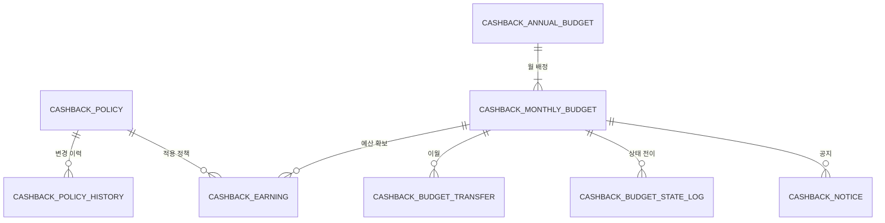

# cashback 도메인 기획 (캐시백·예산·정책)

| 항목 | 내용 |
|---|---|
| 도메인 | 캐시백·예산·정책 (패키지 `cashback`) |
| 작성 | 문환(B) · 2026-11-18 |
| 기준 문서 | 커밋된 [기획서](../project-spec.md), [역할 분담](../team-roles.md) |
| 상태 | 도메인 판단으로 진행 중. 기획서와 달라지는 부분은 [1절](#1-기획서-대비-변경-요약)에 모았다 |

**운영 방식**: 각자 자기 도메인은 본인 판단으로 진행하고, 진행 중 바뀐 기획은 `docs/plan/도메인-이니셜-MMDD.md`로 남겨 공유한다. 이 문서는 cashback 도메인의 개인 기획서이며, 수정할 때마다 파일명의 날짜(MMDD)를 수정일로 바꾼다(`git mv`).

**도메인 방향(초안, 팀 합의 전)**: 캐시백이 얼마나 갈지 미리 보여 주고, 약속한 캐시백은 끝까지 지킨다. 예산은 1원도 초과하지 않고 결제는 멈추지 않는다. 정합성(예산 초과 0원)은 처음부터 지키고, 판단 근거를 먼저 보여 주는 정보(결제 전 미리보기, 확정 영수증, 소진 예측)가 우리 도메인의 특징이다.

**원칙**: MVP 구현이 최우선이다. 구조를 먼저 정하고 숫자(%·금액·배율)는 설정값과 시드 데이터로 둔다.

## 1. 기획서 대비 변경 요약

| 구분 | 항목 | 기획서(커밋본) | 이 문서 | 영향 |
|---|---|---|---|---|
| 변경 | 대비금 크기 | 최근 7일 일평균 지급액 × 5일 | **월 배정의 10% 고정**. 월 시작 시 확정하고 월 중 변경하지 않음 | 운영자 화면, 중단 판정 |
| 변경 | 중단 공지 | 대비금이 소모되기 시작하면 3일 후 00:00에 적립 중단을 공지 | 남은 예산이 대비금에 닿으면 **즉시 공지하고 공지일 + 3일 00:00(KST)에 중단**. 공지에는 날짜만 쓰고 시각은 쓰지 않음 | A(결제 응답), C·D 화면 |
| 변경 | 긴급 중단 기준 | 공지 후 대비금의 10%만 남으면 | **대비금의 절반**에 닿으면 즉시 중단 | 중단 판정 |
| 변경 | 예산 부족 시 적립 | 적립만 0원(또는 남은 만큼) | **전액 또는 0원**. 부분 지급과 안분 없음 | A, C |
| 변경 | 소수점 | 적립·보유·회수는 소수점 유지 | **적립액은 1원 단위 버림**(`floor(데브머니 사용분 × 요율)`). 금액은 원 단위 `long`(BIGINT)으로 저장한다. 소수 유지 지급은 [8절](#8-제외후순위)의 도전 과제로 두고, 필요해지면 컬럼 타입을 바꾼다 | A, C(보유 캐시백) |
| 변경 | 적립 지급 배치 | B가 건별 트랜잭션으로 지급 | **B 배치가 건별 트랜잭션을 열어 C의 입금 API를 호출하고, 같은 트랜잭션에서 상태·예산을 갱신**. 지갑 API는 도메인 중립(`credit`/`debit`)이며 호출자의 트랜잭션에 참여한다([3-3](#3-3-적립-지급-배치와-지갑-연동)) | B, C |
| 유지 | 정책 변경 이력 | 변경자·시각·변경 전후 값 기록 | 그대로 B 범위에 포함(역할 분담 논의에서 제외로 거론됐으나 B 도메인 판단으로 포함) | |
| 추가 | 데이터 투명성 | 없음 | 결제 전 캐시백·한도 미리보기, 확정 영수증 필드, 적립 제외 사유, 정책 변경 예고, 알림·공지 목록 | A, C, D 화면 |
| 추가 | 수요 예측 | 없음 | 소진 예측(예상 소진일 범위, 최소 보장 인원), 정책 저장 전 예측 미리보기, 가정·버전 표시 | D(대시보드 그래프) |
| 추가 | 대시보드 그래프 3개 | 없음 | 예산 현황(실제), 소진 예측, 월별 예산 집행(연간 12개월), 월 배정 입력의 예측 기반 권장 | D |
| 추가 | D용 조회 API | 없음 | 예산·적립 시계열 | D |
| 제외 | **일일 예산 페이싱** | 없음 | 기획에서 제외 | |

## 2. 도메인 범위 (MVP)

기획서 ID는 커밋본의 ID다(CB-01 ~ CB-06). 새 기능에는 이 문서의 번호를 붙였고, API 경로 중 "제안"은 구현하면서 조정한다. 단계는 구현 순서 제안이며 팀 일정이 정해지면 조정한다.

### 2-1. 정합성 코어 (결제·지급)

| 번호 | 기능 | 기획서 | API·형태 | 단계 | 메모 |
|---|---|---|---|---|---|
| C1 | 정책 관리 (요율·기간, 기간 겹침 금지) | CB-03 | `POST·GET /api/admin/cashback/policies` | 1 | 정책은 한 종류(기본 요율)다. 추가 요율(EXTRA)은 [8절](#8-제외후순위)의 MVP 이후 항목. 요율은 소수 비율(3% = 0.03), 기간은 `[시작, 종료)` 반개구간이고 종료가 없으면 무기한 |
| C2 | 정책 변경 이력 (변경자·시각·변경 전후 값) | CB-03 | 이력 조회 (제안) | 1 | 조회만 가능. 입력값·근거까지 남길지는 [9절](#9-개발하면서-판단할-것) |
| C3 | 적립 계산 (정수 버림, 월 한도 차감) | PAY-01 | `CashbackService.reserve` (A가 결제 트랜잭션에서 호출) | 1 | 적립 = `floor(데브머니 사용분 × 접수 시각 요율)`. 적립 대상 가맹점에서만 |
| C4 | 예산 확보(예약) | PAY-01 | `CashbackService.reserve` | 1 | 조건부 UPDATE, 음수 불가. 연 예산과 월 예산을 함께 차감. 중단 판정과 같은 흐름 |
| C5 | 적립 취소·회수 | PAY-03 | `CashbackService.cancel` (A가 취소 트랜잭션에서 호출) | 1 | 지급 전 취소는 확보 예산 반환, 지급 후는 회수(음수 가능, 예산 복구 안 함), 월 한도는 결제한 달에 한 번만 복구 |
| C6 | 이용자 월 적립 한도 조회 | CB-02 | `GET /api/cashback/monthly-limit` | 1 | 결제한 달(최초 접수 시각 기준 한국 시간 월), 적립 예정 포함. 컨트롤러는 B, 화면은 C |
| C7 | 이용자 적립 내역 조회 | CB-05 | `GET /api/cashback/earnings` | 1 | 상태: 예정 / 지급 완료 / 취소 / 회수 / 제외, 음수 상계 표시 |
| C8 | 적립 지급 배치 | CB-01 | 배치, `POST /api/admin/cashback/payouts/run` | 1 | 결제 다음날 00:00 + 3일, 매시간(데모 10초), 건별 트랜잭션(B가 경계를 소유하고 C의 `credit`이 참여). [3-3](#3-3-적립-지급-배치와-지갑-연동)절 |
| C9 | 연/월 예산 관리 (배정, 집행, 예약·차감·복원) | CB-04 | `POST·GET /api/admin/cashback/budget` | 1 | 월 배정 합계 ≤ 연 예산 |

### 2-2. 운영·중단

| 번호 | 기능 | 기획서 | API·형태 | 단계 | 메모 |
|---|---|---|---|---|---|
| O1 | 운영자 월 예산 현황 조회 | 3절 추가 기능 | `GET /api/admin/cashback/budget/monthly` (제안) | 2 | 월별 배정, 이월 유입, 집행, 예정, 잔여. 예산 3칸(완료·확보·남음), 대비금 경고 |
| O2 | 적립 중단 상태 전이 | CB-06 | 결제 시 판정 + 스케줄러 | 2 | [3-1](#3-1-대비금과-적립-중단)절 |
| O3 | 운영자 수동 공지 후 중단 / 긴급 중단 | CB-06 | `/api/admin/cashback/budget` 하위 | 2 | 긴급 중단은 확인 창을 거침 |
| O4 | 예산 이월 | 3절 추가 기능 | 배정, `POST /api/admin/cashback/budget/transfers` (제안) | 2 | 다음 달로만. 이력 INSERT only(`cashback_budget_transfer`). 이월 시점과 마감 후 취소 규칙은 기획서 4절 |
| O5 | 월 시작 시 대비금 확정 | CB-06 | 월 예산이 열릴 때 | 2 | 월 배정의 10% |

### 2-3. 데이터 투명성 (신규)

| 번호 | 기능 | API·형태 (제안) | 단계 | 메모 |
|---|---|---|---|---|
| T1 | 결제 전 캐시백·한도 미리보기 | `GET /api/cashback/preview` | 3 | "예상" 라벨. 중단 중이면 "적립 중단 중" 표시. D의 QR 스캔 조회가 이 기능으로 요율·남은 한도·예상 캐시백을 받는 것을 제안 |
| T2 | 확정 영수증 | 결제 응답·조회에 포함 | 3 | 결제금액, 적립 캐시백, 지급 예정일, 적용요율, 월 한도 차감, "소수점 이하는 버림". **계산식은 제외**. 접수 시각 기준 요율로 확정 |
| T3 | 적립 제외 사유 안내 | 영수증·적립 내역에 사유 코드 | 3 | 예산 소진, 월 한도 초과 |
| T4 | 정책 변경 예고 | 정책 저장 시 공지 등록 | 3 | 앱 "내 캐시백"의 예고 박스, 알림·공지 목록 |
| T5 | 알림·공지 목록 | `GET /api/notices` | 3 | 요율 변경 예고, 소진 예고, 긴급 중단 공지 |
| T6 | D용 조회 API (예산·적립 시계열) | `GET /api/admin/cashback/budget/timeseries` | 4 | D의 대시보드·대사에서 사용 |

### 2-4. 수요 예측·그래프 (신규)

| 번호 | 기능 | API·형태 (제안) | 단계 | 메모 |
|---|---|---|---|---|
| F1 | 소진 예측 (예상 소진일 범위, 최소 보장 인원) | `GET /api/admin/cashback/forecast` | 4 | 수요 = 최근 7일 일평균 × 수요 배율(설정값). 빠름·중앙·느림 범위 |
| F2 | 정책 저장 전 예측 미리보기 | `POST /api/admin/cashback/forecast/preview` | 4 | 요율·기간 입력 → 예상 소진일 변화. 예상 소진이 3일 미만이면 경고 |
| F3 | 예측 가정·버전 표시 | F1·F2 응답에 포함 | 4 | 수요 기준, 수요 배율, 모델 버전 |
| F4 | 예산 현황(실제) 그래프 데이터 | 일별 집행·확보·잔액 | 4 | 적립 건의 생성·지급·취소 시각을 일자별로 합산(새 저장 불필요) |
| F5 | 소진 예측 그래프 데이터 | F1을 그래프용으로 | 4 | 실제 선에서 예상 선과 범위를 이어 붙임 |
| F6 | 월별 예산 집행(연간 12개월) 그래프 데이터 | `GET .../budget/annual-overview` | 4 | 월 배정, 집행, 확보, 예측 소모, 배정 부족 예상 |
| F7 | 월 배정 입력의 예측 기반 권장 | 입력 화면의 "권장 배정 채우기" | 4 | 연 예산 × 계절 지수 ÷ 12. 계절 지수가 없으면 균등 |
| F8 | 계절 지수·특일 시드 (확장) | 시드 데이터 | 4 | 월별 지수 12개 값, 한 해치 특일 CSV. 아래 [9절](#9-개발하면서-판단할-것) |

### 2-5. 화면 구성

팀 전체 와이어프레임의 화면 번호 기준이다. B가 채우는 부분만 적었다.

| 구분 | 화면 | B 구성 | 소유 | 단계 |
|---|---|---|---|---|
| 앱 | ⑪ QR 스캔 · 결제 전 미리보기 | 예상 캐시백, 월한도 잔여, 제외 사유 안내 | A, B, D | 3 |
| 앱 | ⑫ 결제 완료 · 영수증 | 확정 영수증 | A, B | 3 |
| 앱 | 결제 완료 · 적립 제외 | 제외 사유(⑫의 변형) | A, B | 3 |
| 앱 | ⑭ 내 캐시백 | 정책 변경 예고, 월 한도, 최근 적립 | B, C | 1~3 |
| 앱 | ⑮ 캐시백 적립내역 | 상태별 내역, 음수 상계 | B, C | 1 |
| 앱 | 알림·공지 | 변경 예고, 소진 예고, 긴급 중단. 위치는 마이페이지 담당 확정 후 | B, 담당 미정 | 3 |
| 웹(운영자) | ① 운영자 대시보드 | 예산 3칸, 대비금 경고, 그래프 3개, 정책 변경 이력 | B, D | 2(그래프는 4) |
| 웹(운영자) | ② 정책·예산 관리 | 정책 입력과 예측 미리보기, 연/월 예산, 이월, 운영 제어(공지 후 중단·긴급 중단), 적립 지급 배치 현황 | B, C | 1~2 |

## 3. 확정한 설계

### 3-1. 대비금과 적립 중단

월 시작 시 대비금(월 배정의 10%)을 확정한다.

| 상태 | 전이 조건 | 동작 |
|---|---|---|
| `ACTIVE` | 평상시 | 적립 정상 |
| `ACTIVE → NOTICED` | 남은 예산 ≤ 대비금 | 앱 공지 등록, 공지일 + 3일 00:00(KST)에 중단 예약. 적립은 계속 |
| `NOTICED → STOPPED` | 예약한 날짜 00:00 또는 남은 예산 ≤ 대비금의 절반 | 적립 0원, 결제는 정상. 영수증에 사유 |
| `ACTIVE → STOPPED` | 남은 예산 ≤ 대비금의 절반 (공지선을 건너뜀) | 즉시 중단, 긴급 중단 공지 |
| 운영자 수동 | "공지 후 중단"(공지 + 3일 뒤 예약) / "긴급 중단"(즉시) | 위와 같은 상태 전이. 긴급 중단은 확인 창 |
| `STOPPED → ACTIVE` | 새 월 예산 활성화 | 자동 복귀 |

- 판정은 예산 확보(C4) 직후 같은 흐름에서 한다.
- 공지 문구: "남은 예산이 N% 이하이거나 최대 3일 뒤 적립이 중단될 수 있어요. 예산이 더 빨리 소진되면 먼저 종료될 수 있어요. 결제는 정상 이용할 수 있어요". 시각은 쓰지 않는다.
- 운영자와 이용자에게는 % 기준을 보여 주고 금액 계산은 내부에서만 쓴다.

### 3-2. 적립 규칙

- 서버가 **처음 접수한 시각 순**으로 처리한다. 같은 멱등키 재전송은 처음 접수 시각을 쓴다.
- 적립은 **전액 또는 0원**이다. 부분 지급은 없다.
- 예산이 부족해도 **안분하지 않는다**. 확정 영수증으로 약속한 금액을 사후에 바꾸지 않는다.
- 예산 확보는 한 번의 조건부 UPDATE로 해서 초과를 설계상 막는다.
- 받지 못한 경우 영수증과 적립 내역에 사유와 접수 시각을 남긴다.

### 3-3. 적립 지급 배치와 지갑 연동

B가 지급 대상을 고르고, 지갑 반영은 C의 API에 요청한다. 지갑 API는 캐시백을 알지 못하는 **도메인 중립 API**(`credit`/`debit`)로 두고, 캐시백은 거래 type으로만 구분한다.

| 단계 | 담당 |
|---|---|
| 지급일이 된 `PENDING` 적립 선정(스케줄러, 트랜잭션 없음). 지급액은 적립 시점에 확정된 값 | B |
| 건별 트랜잭션 시작 | B (경계를 소유) |
| 지갑 입금과 원장 기록: `credit(walletId, amount, CASHBACK_EARN, earningId)` | C (호출자의 트랜잭션에 참여) |
| 적립 상태 `PENDING → PAID`, 예산 예약 → 차감 | B (같은 트랜잭션) |
| 커밋 | B |

- 같은 DB를 쓰므로 C 반영과 B 상태 변경이 한 번에 커밋되거나 한 번에 롤백된다. C가 예외를 던지면 그 건만 롤백되어 `PENDING`으로 남고 다음 주기에 재시도하며, 나머지 건은 계속 처리한다.
- 건별 처리 메서드는 스케줄러와 다른 빈에 둔다(같은 클래스 안에서 부르면 트랜잭션이 적용되지 않는다).
- 멱등: C 원장에 `(type, refKey)` 유니크 제약을 두어 같은 입금이 두 번 와도 한 번만 반영하고 정상 응답한다. B는 `PENDING`인 건만 조건부로 전환한다.
- 원장에는 type, refKey, 금액, 거래 후 잔액만 남기고 설명(memo)은 없다. 요율 등 적립 상세는 B의 `cashback_earning`이 원본이며 refKey(적립 건 ID)로 연결한다.
- **회수(지급 후 결제 취소)**: A의 취소 트랜잭션 안에서 `CashbackService.cancel`이 `debit(walletId, amount, CASHBACK_CLAWBACK, earningId, allowNegative=true)`를 호출한다. 데브머니와 캐시백은 한 잔액으로 합산하고 회수에서만 음수를 허용하며, 음수는 다음 입금이 더해지면서 상계된다(별도 상계 로직 없음). 지급 전 취소는 B 안에서 끝난다.
- 메서드 이름·시그니처·type 이름은 C가 정하며, C에게 이슈로 요청했다.

### 3-4. 확정 영수증

결제금액, 적립 캐시백, 지급 예정일, 적용요율, 월 한도 차감, "소수점 이하는 버림" 문구. 계산식은 넣지 않는다. 결제 응답에는 `CashbackService.reserve`의 반환값(적립액, 요율, 지급 예정일, 제외 사유, 월 한도 상태)을 A가 담는다.

### 3-5. 예측

- 수요 기준은 최근 7일 일평균으로 시작한다. 수요 배율은 설정값이다(요율을 올릴 때 수요가 몇 배로 늘지에 대한 가정).
- 결과에는 **사용한 가정과 버전**을 함께 표시한다(수요 기준, 수요 배율, 모델 버전). 같은 입력이면 같은 예측이 나와야 한다.
- 계절 지수·성수기·지난해 데이터는 확장이다. 지수가 없으면 1.0으로 계산한다.

### 3-6. 대시보드 그래프 3개

세 그래프는 가로로 길게, 세로로 배치한다.

| 그래프 | 구성 |
|---|---|
| 예산 현황(실제) | 11월 같은 월의 일별 집행·확보·남음, 월 배정선, 대비금선, 오늘 표시. Y축은 잔액이 줄어드는 방식을 기본으로 제안하고 소모가 늘어나는 방식으로 전환 가능 |
| 소진 예측 | 실제 선 끝에서 빠른 경우·중앙값·느린 경우를 점선과 음영으로 이어 붙임. 예측 입력 요소(최근 7일 수요, 수요 배율, 계절 지수, 명절)와 예상 소진일·대비금 도달일 표시 |
| 월별 예산 집행(연간) | 1월~12월을 한 번에. 월 배정과 집행·확보·예측 소모를 나란히 놓고, 배정이 모자랄 것으로 예측되는 달을 표시. 아래에 월 배정 입력(권장 배정 = 연 예산 × 계절 지수 ÷ 12, 입력 배정, 차이) |

## 4. 다른 담당과의 연동

| 상대 | 연동 |
|---|---|
| A (결제) | `CashbackService.reserve / cancel` 호출(C3~C5). 영수증 필드를 결제 응답에 포함(T2). 월 예산 ID를 `payment`에 둘지 `cashback_earning`에 둘지 협의(A의 스키마가 B에 의존하지 않도록 `cashback_earning` 쪽을 제안) |
| C (회원·지갑) | B가 C의 지갑 API(`credit`/`debit`)를 호출한다: 지급 배치(C8)와 지급 후 취소의 회수(C5), [3-3](#3-3-적립-지급-배치와-지갑-연동). 이용자 월 한도·적립 내역 조회(C6, C7)는 B가 `CashbackQueryService`와 컨트롤러까지 제공하고, 지갑 화면 합성은 프런트가 한다. C는 B를 호출하지 않는다(의존 한 방향). 탈퇴 시 남은 캐시백·적립 예정 처리는 B와 합동 |
| D (가맹점·QR·정산·대사) | QR 스캔 조회에 요율·남은 한도(T1). 예산·적립 시계열 API(T6). 대사의 캐시백 잔액 대조에서 B의 적립 합계와 지갑 원장 비교. 수요 예측 차트의 분담 |

## 5. 데이터 모델

DB는 PostgreSQL 기준(11/16 결정, 기획서에는 아직 MySQL 표기)이고, 스키마는 Hibernate `ddl-auto: update`로 만든다. 개발하면서 바뀌는 부분은 이 절을 고치고 [5-4](#5-4-구조-변경-기록)에 남긴다.

**공통 규칙**
- 금액은 원 단위 `long`(BIGINT)이다. 캐시백 금액은 1원 단위 버림 값만 저장한다.
- 요율은 소수 비율(3% = 0.03)이며 `NUMERIC(5,4)`다.
- 시각은 `LocalDateTime`(한국 시간)이다. 기간은 `[시작, 종료)` 반개구간이다.
- 다른 도메인은 ID 값으로만 참조하고(`payment_id`, `wallet_id`) 외래키 제약을 걸지 않는다. 같은 도메인 안에서도 연관관계 매핑 대신 ID 컬럼을 기본으로 한다(제안. 조건부 UPDATE 중심이라 객체 그래프가 필요 없다).
- 이력과 이월 테이블은 INSERT only다.

### 5-1. 테이블 요약

| 테이블 | 용도 | 단계 | 상태 | 기획서 대비 변경 |
|---|---|---|---|---|
| `cashback_policy` | 정책(요율·기간) | 1 | 구현(#28) | 단일 종류(기본 요율), 기간 겹침 금지. 추가 요율(EXTRA)은 MVP 이후 |
| `cashback_policy_history` | 정책 변경 이력 | 1 | 예정 | 신규 |
| `cashback_annual_budget` | 연 예산 | 1 | 예정 | `cashback_budget` 이름 변경(기획서 8절), 예약·지급 합계 추가 |
| `cashback_monthly_budget` | 월 예산 | 1~2 | 예정 | 배정·이월 유입·예약·지급 분리, 상태, **대비금**, 중단 예약 시각 |
| `cashback_budget_transfer` | 이월 이력 | 2 | 예정 | 신규 |
| `cashback_monthly_limit` | 이용자 월 적립 한도 사용량 | 1 | 예정 | 신규 |
| `cashback_earning` | 적립 건 | 1 | 예정 | 상태에 제외(`EXCLUDED`)·회수 추가, 제외 사유 코드. 적립 정보의 기준 테이블 |
| `cashback_budget_state_log` | 중단 상태 전이 이력 | 2 | 예정 | 신규 |
| `cashback_notice` | 변경 예고·소진 예고·중단 공지 | 3 | 예정 | 신규 |
| `cashback_seasonal_index`, `cashback_special_day` | 계절 지수·특일 시드 | 4 | 예정(확장) | 신규 |

### 5-2. 관계

외부 참조(값으로만 보관): 적립 건의 `payment_id`(A), `wallet_id`(C). `cashback_monthly_limit`의 이용자는 `wallet_id`로 식별한다(`ReserveCommand`에 이용자 ID가 없고 이용자당 지갑 1개를 전제).

### 5-3. 엔티티별 구조

**`cashback_policy`** — 정책 (구현)

| 컬럼 | 타입 | 설명 |
|---|---|---|
| `id` | BIGINT PK | |
| `rate` | NUMERIC(5,4) | 요율. 0 초과 1 이하, 소수 넷째 자리까지 |
| `starts_at` | TIMESTAMP | 적용 시작(포함) |
| `ends_at` | TIMESTAMP, null | 적용 종료(미포함). null이면 무기한 |
| `created_at` | TIMESTAMP | |

기간이 겹치는 정책은 등록하지 않는다(서비스에서 검사, DB 제약 없음. 운영자 단독 작업 전제).

**`cashback_policy_history`** — 정책 변경 이력

| 컬럼 | 타입 | 설명 |
|---|---|---|
| `id` | BIGINT PK | |
| `policy_id` | BIGINT | 대상 정책 |
| `action` | VARCHAR | `CREATE` / `UPDATE` |
| `changed_by` | BIGINT | 변경한 운영자 ID(인증 머지 후) |
| `changed_at` | TIMESTAMP | |
| `before_rate`, `before_starts_at`, `before_ends_at` | | 변경 전 값. `CREATE`면 null |
| `after_rate`, `after_starts_at`, `after_ends_at` | | 변경 후 값 |

입력값·근거까지 남길지는 [9절](#9-개발하면서-판단할-것) 7번에서 정한다(남기면 JSON 컬럼 추가).

**`cashback_annual_budget`** — 연 예산

| 컬럼 | 타입 | 설명 |
|---|---|---|
| `id` | BIGINT PK | |
| `budget_year` | INT, unique | |
| `total_amount` | BIGINT | 연 예산 |
| `reserved_amount` | BIGINT | 확보(예약)한 금액. 지급 전 |
| `paid_amount` | BIGINT | 지급 완료 금액 |

불변식: `reserved_amount + paid_amount ≤ total_amount`. 월 배정 합계 ≤ `total_amount`.

**`cashback_monthly_budget`** — 월 예산

| 컬럼 | 타입 | 설명 |
|---|---|---|
| `id` | BIGINT PK | |
| `annual_budget_id` | BIGINT | |
| `budget_month` | 연월, unique | |
| `allocated_amount` | BIGINT | 월 배정 |
| `carried_in_amount` | BIGINT | 이월 유입 |
| `reserved_amount` | BIGINT | 확보(예약). 지급 전 |
| `paid_amount` | BIGINT | 지급 완료 |
| `contingency_amount` | BIGINT | 대비금. 월 시작 시 확정(월 배정의 10%). 예약과 혼동되지 않게 `reserve`가 아닌 이름 |
| `status` | VARCHAR | `ACTIVE` / `NOTICED` / `STOPPED` / `CLOSED` |
| `stop_scheduled_at` | TIMESTAMP, null | 공지 후 중단 예약 시각(`NOTICED`일 때) |

남은 예산 = `allocated_amount + carried_in_amount − reserved_amount − paid_amount`. 확보는 한 번의 조건부 UPDATE로 하며 음수가 되지 않는다. 지급되면 `reserved_amount`가 줄고 `paid_amount`가 같은 만큼 늘어 남은 예산은 변하지 않는다.

**`cashback_budget_transfer`** — 이월 이력 (INSERT only)

| 컬럼 | 타입 | 설명 |
|---|---|---|
| `id` | BIGINT PK | |
| `from_monthly_budget_id`, `to_monthly_budget_id` | BIGINT | 다음 달로만 이월 |
| `amount` | BIGINT | |
| `type` | VARCHAR | `AUTO` / `MANUAL` |
| `created_by`, `created_at` | | 자동이면 `created_by`는 null |

**`cashback_monthly_limit`** — 이용자 월 적립 한도 사용량

| 컬럼 | 타입 | 설명 |
|---|---|---|
| `id` | BIGINT PK | |
| `wallet_id` | BIGINT | 이용자 식별 |
| `limit_month` | 연월 | 결제한 달(최초 접수 시각 기준 한국 시간 월) |
| `used_amount` | BIGINT | 적립 예정 포함 사용량 |

`(wallet_id, limit_month)` 유니크. 한도 금액은 행에 저장하지 않고 설정값으로 둔다(값은 P6에서 확정).

**`cashback_earning`** — 적립 건 (적립 정보의 기준 테이블)

| 컬럼 | 타입 | 설명 |
|---|---|---|
| `id` | BIGINT PK | 지갑 원장의 `refKey`로 쓰는 적립 건 ID |
| `payment_id` | BIGINT, unique | A의 결제. `reserve` 멱등 키 |
| `wallet_id` | BIGINT | C의 지갑 |
| `wallet_used_amount` | BIGINT | 데브머니 사용분(적립 기준) |
| `applied_rate` | NUMERIC(5,4) | 접수 시각 요율(스냅샷) |
| `applied_policy_id` | BIGINT, null | 적용 정책. 제외 건은 null |
| `amount` | BIGINT | 적립액. `floor(사용분 × 요율)`, 제외 건은 0 |
| `status` | VARCHAR | `PENDING`(적립 예정) / `PAID` / `CANCELED` / `CLAWED_BACK`(지급 후 회수) / `EXCLUDED` |
| `exclusion_reason` | VARCHAR, null | `ExclusionReason`. 제외 건에만 |
| `requested_at` | TIMESTAMP | A가 넘긴 최초 접수 시각 |
| `payable_at` | TIMESTAMP, null | 지급 예정 시각. 제외 건은 null |
| `paid_at`, `canceled_at` | TIMESTAMP, null | 지급·취소(회수 포함) 시각 |
| `monthly_budget_id` | BIGINT, null | 확보한 월 예산. 제외 건은 null |
| `limit_month` | 연월 | 월 한도를 차감한 달. 취소 시 이 달에서 복구 |
| `created_at` | TIMESTAMP | |

인덱스: 지급 대상 조회용 `(status, payable_at)`, 이용자 조회용 `(wallet_id, requested_at)`. 제외 건에도 행을 만들어 적립 내역에 "제외"와 사유를 보여 준다([9절](#9-개발하면서-판단할-것) 8번). A의 `payment`에도 적용 요율·적립액이 복사되어 있지만 원본은 이 테이블이다.

**`cashback_budget_state_log`** — 중단 상태 전이 이력 (2단계, INSERT only)

| 컬럼 | 설명 |
|---|---|
| `monthly_budget_id`, `from_status`, `to_status` | 전이 내용 |
| `reason` | 자동 판정(공지선·긴급선), 예약 시각 도달, 운영자 공지 후 중단, 긴급 중단, 새 월 복귀 |
| `remaining_rate` | 당시 남은 예산 % |
| `operator_id`, `occurred_at` | 자동이면 `operator_id`는 null |

**`cashback_notice`** — 공지 (3단계, 세부는 그때 확정)

| 컬럼 | 설명 |
|---|---|
| `type` | 정책 변경 예고 / 소진 예고 / 긴급 중단 / 중단 예정 취소 |
| `content`, `effective_from`, `stop_at`(null) | 문구는 날짜만 쓰고 시각은 쓰지 않는다 |
| `created_at` | |

**`cashback_seasonal_index`, `cashback_special_day`** — 시드 데이터 (4단계, 확장). 월별 지수 12개와 한 해치 특일.

### 5-4. 구조 변경 기록

| 날짜 | 변경 | 이유 |
|---|---|---|
| 11-18 | `cashback_policy`에서 `type`(BASE/EXTRA) 삭제 | 추가 요율은 MVP 이후로 미룸. 도입하면 기본 요율에 합산 |
| 11-18 | 금액 컬럼 `NUMERIC(15,4)` → `BIGINT` | 결제·지갑이 `Long`을 쓰고, 소수 유지 지급은 도전 과제 |
| 11-18 | 월 한도의 이용자 식별을 `wallet_id`로, 적립 상태명을 `PENDING` 기준으로 정리 | `ReserveCommand`에 이용자 ID가 없음 |

## 6. 구현 순서 (제안)

| 단계 | 내용 | 완료 기준 |
|---|---|---|
| 1. 정합성 코어 | C1~C9 | 결제 시 예산 확보·월 한도 차감이 동작하고, 지급 배치를 재실행해도 한 번만 지급 |
| 2. 운영·중단 | O1~O5, 운영자 웹 ①②(그래프 제외) | 대비금 기준 상태 전이와 수동 중단, 월 예산 현황 조회 |
| 3. 투명성 | T1~T5 | 결제 전에 예상 캐시백을 보고, 결제 후 확정 영수증과 제외 사유를 확인 |
| 4. 예측·그래프 | T6, F1~F8 | 정책 저장 전 예상 소진일을 보고, 그래프 3개가 표시됨 |

기획서 5절(주차별 일정)과 비교하면 투명성(3단계)과 예측·그래프(4단계)가 추가되어 4주차가 가장 무겁다. 일정이 빠듯하면 4단계의 F6~F8을 먼저 줄인다.

## 7. 증명할 불변 조건 (테스트)

- 동시 결제에서도 예산 초과 0원
- 확정 영수증 금액 = 실제 지급액
- 정책 변경 경계 시각의 결제에서 요율 오적용 0건
- 지급 배치를 재실행해도 이중 지급 0건
- 공지선·긴급선·월 경계·정시 경계에서의 동시 결제 정합성, 부하 중 중단 전환 지연 측정
- 같은 입력이면 같은 예측(가정과 버전을 저장)

## 8. 제외·후순위

| 항목 | 구분 | 이유 |
|---|---|---|
| 일일 예산 페이싱 | **기획에서 제외** | |
| 추가 캐시백 운영, 탄력 요율 | MVP 이후 | 기획서 3절의 추가 캐시백 운영(이월 예산으로 추가 요율). 도입하면 기본 요율에 **합산**하는 방식으로 한다 |
| 예측 오차 공개, 요율 제안 | MVP 이후 | 예측값 저장이 먼저 필요 |
| 요율별 예상 잔액 비교, 적립 제외 건수 추이, 월한도 도달 분포, 지급 배치 추이 그래프 | MVP 이후 | 그래프는 3개만 우선 |
| 푸시 알림, 가맹점 쪽 소진 예고, 선결제 억제(건당·가맹점당 상한) | MVP 이후 | |
| 소수점 유지 지급 | 도전 과제 | 금액은 `long`이라 필요해지면 컬럼 타입 변경과 함께 도입 |
| AI 예측 | 제외 | 응집성과 일정 부담 |

## 9. 개발하면서 판단할 것

번호는 우선순위가 아니라 식별용이다. 방향은 제안이다.

| 번호 | 고민 | 방향 |
|---|---|---|
| 1 | 공지 후 상태 복귀(결제 취소로 예산이 복원되거나 예산을 늘리면 공지선 위로 올라감) | 공지선보다 조금 더 올라야 `ACTIVE`로 복귀(히스테리시스). 복귀 시 "중단 예정이 취소됐어요" 공지 |
| 2 | 월 경계(중단 중에 월이 바뀜, 정시 중단이 월말에 걸림) | 새 월 예산이 열리면 자동 `ACTIVE`. 월 판단은 접수 시각 기준. 남은 예산은 다음 달로 이월 |
| 3 | 정시가 되었는데 예산이 남은 경우 | 약속을 지키기 위해 중단하고 남은 금액은 이월 |
| 4 | 공지가 이용자에게 닿는가 | 결제 전 미리보기 화면의 배너. 푸시는 MVP 밖 |
| 5 | 상태 전이 이력과 수동 긴급 중단의 해제 규칙 | 전이 이력 테이블, 확인 창 |
| 6 | 폭증 사전 차단 | 정책 저장 전 예측 미리보기가 "예상 소진 3일 미만"이면 경고 |
| 7 | 정책 변경 이력에 입력값·근거(예측 미리보기 결과)까지 남길지 | 필요하면 이력 테이블에 JSON으로 추가 |
| 8 | 제외 건에도 `cashback_earning` 행을 만들지(적립 내역에 "제외"를 표시하려면 필요) | 행을 만들고 사유 코드 저장 |
| 9 | 계절 지수·지난해 데이터 | 자체 지난해 실적이 없으므로 월별 지수 12개를 시드로 둔다. 후보는 인천e음 군구별 업종별 일별 결제금액(공공데이터포털 15067973, CSV). 실제 파일의 컬럼과 기간은 내려받아 확인하고, 캐시백율이 바뀐 날짜를 보도자료에서 모아 정책 효과와 분리. 특일은 한 해치를 CSV 시드로 저장하는 방식 |
| 10 | 수요 배율의 값과 입력 방식 | 설정값으로 시작 |
| 11 | 그래프 Y축 기본 방향 | 잔액이 줄어드는 방식을 기본으로, 전환 가능 |
| 12 | 수요 예측 차트의 B·D 분담 | D가 그래프, B가 계산·데이터로 나누는 것을 제안 |
| 13 | 알림·공지 화면의 위치와 담당 | 마이페이지 담당 확정 후 |
| 14 | 월 배정 입력 방식(연초 일괄, 매달, 지난 달 실제를 반영한 재배분) | 재배분은 수동 이월(`MANUAL`) 활용 |
| 15 | 역할 분담표에 있으나 이번 범위 목록에 없는 "운영자 적립 내역 전체 조회" | 개발하면서 판단 |
| 16 | 대사의 캐시백 잔액 대조 방식(적립 합계와 지갑 원장 비교) | D와 협의 |
