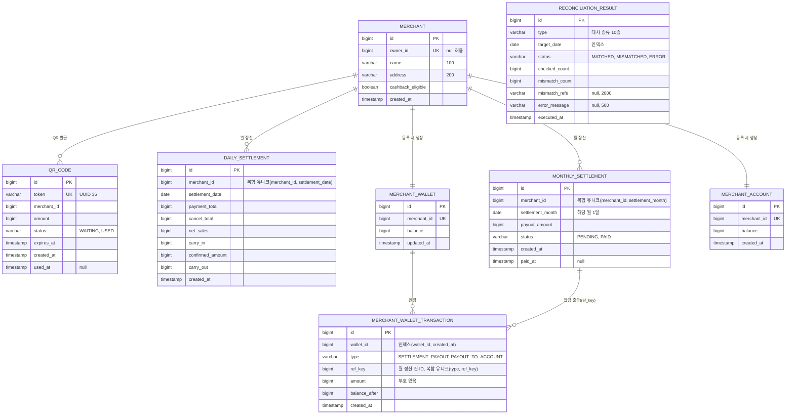

# merchant·qr·settlement 도메인 기획 (가맹점·QR·정산·대사·대시보드)

| 항목 | 내용 |
|---|---|
| 도메인 | 가맹점·QR·정산·대사 (패키지 `merchant`, `qr`, `settlement`, `reconciliation`) |
| 작성 | 경진(D) · 2026-11-18, 2026-11-20에 정산·지급 범위를 갱신, 2026-11-23, 2026-11-24에 진행 상태를 갱신, 2026-11-25에 중간평가 이후 계획(12/7 최종평가까지)을 반영 |
| 기준 문서 | 커밋된 [기획서](../project-spec.md), [역할 분담](../team-roles.md), [cashback 도메인 기획](cashback-mh-1118.md) |
| 상태 | 도메인 판단으로 진행 중. 기획서와 달라지는 부분은 [1절](#1-기획서-대비-변경-요약)에 모았다. 2026-11-20 갱신: QR 구현 현황(Q2~Q5)과 결제 연동 계약(`getPaymentTarget`, `markUsed(qrToken, requestedAt)`) 반영, 정산·지급 범위는 A, B, C와 합의를 마쳤고 개발하면서 판단할 것은 [9절](#9-개발하면서-판단할-것)에 있다. 2026-11-23 갱신: 가맹점 전용 지갑·계좌·원장(#81, PR #89)과 결제의 실제 QR 연동(#55)이 머지되었고 AWS 1차 배포(PR #110)도 끝났다. 일 정산(#114, PR #127)이 머지되었고 월 정산·지급(#115, PR #138)과 정산 대사(#140: 6, 7번과 월 지급)를 구현했다. 두 PR은 머지되었고, 같은 구조에 잔액·원장 대사(1~5번, #146)를 추가했다. 2026-11-24 갱신: 잔액·원장 대사(#146, 예산 대사 포함)와 점주용 조회 API(#173)가 머지되었고, 정산 수동 실행 API(#175)와 프론트 연동(#178: 결제 화면 지갑 잔액, 점주·가맹점 찾기·운영자 정산 화면, 캐시백 조회·미리보기의 토큰 지갑 식별)을 구현했다. 결제 취소(#86)는 머지되어 정산 집계 기준(`canceledAt`, `completedAt`)과 맞는 것을 코드로 확인했다. 2026-11-25 최종 갱신: 중간평가가 끝나 12/7 최종평가까지의 계획을 [10절](#10-중간평가-이후-계획-1125127)에 모았다. 고정 QR은 제외로 확정했고, 공공데이터 12만 건 적재는 추후 과제로 뺐으며, 점주 화면의 정산 계좌는 별도 탭 없이 월 정산 탭의 카드로 대체한다. 운영자 대시보드는 문환님(B)이 구현했으므로 D 범위에서 뺐다. 배포(AWS)도 D가 맡으며 CI/CD와 키를 저장하지 않는 구조로 전환하고 작업은 주말에 모아서 한다. 가맹점 해지(탈퇴) 정책과 구현 계획은 [11절](#11-가맹점-해지탈퇴)에 있고, 이에 따라 D의 기능 동결은 12/1, 테스트 마감은 12/3으로 하루씩 늦췄다. 이슬님(C)과 신영님(A)의 확인이 필요한 항목은 미정으로 남겼다([10-5](#10-5-확인-대기-미정)). 이 갱신을 끝으로 이후에는 이 문서와 일정만 작업할 때마다 갱신한다 |

**운영 방식**: 각자 자기 도메인은 본인 판단으로 진행하고, 진행 중 바뀐 기획은 `docs/plan/도메인-이니셜-MMDD.md`로 남겨 공유한다. 이 문서는 merchant·qr·settlement 도메인의 첫 기획 문서이며, 11/20에는 정산·지급 범위가 한꺼번에 바뀌어 새 파일을 만들지 않고 이 문서를 직접 고쳤다. 11/24까지의 일정은 [kj-mvp-1120](../schedule/kj-mvp-1120.md), 11/25 이후의 일정은 [kj-final-1125](../schedule/kj-final-1125.md)에 있다.

**도메인 방향(초안, 팀 합의 전)**: 사장님은 가맹점을 쉽게 등록하고 금액이 담긴 동적 QR로 결제를 받는다. 이용자는 가맹점을 찾고, QR을 스캔하면 결제 전에 적립 대상 여부를 확인한다. 하루가 끝나면 정산 금액이 장부에 정해지고, 매월 그 금액을 합산해 가맹점 전용 지갑으로 지급한다. 대사로 돈의 흐름이 어긋나지 않았음을 매일 확인한다. 정합성(같은 QR 중복 사용 0건, 정산 중복 생성 0건, 중복 입금 0건, 대사 불일치 탐지)을 먼저 지킨다.

**원칙**: MVP 구현이 최우선이다. 구조를 먼저 정하고, 실제 서류 검증이나 위치 정보처럼 부가적인 부분은 가정과 임시 값으로 두고 후순위로 미룬다.

## 1. 기획서 대비 변경 요약

| 구분 | 항목 | 기획서(커밋본) | 이 문서 | 영향 |
|---|---|---|---|---|
| 변경 | QR 종류 | 고정 QR과 동적 QR | **동적 QR만 사용**. 고정 QR 발급과 고정 QR 결제(QR-04)는 제외(2026-11-25 팀 합의로 확정) | A(결제), 사장님 화면 |
| 변경 | 적립 대상 여부 결정 | 가맹점별 플래그(기준 미정) | **연매출 30억 미만 증빙 서류를 첨부하면 자동 승인되어 적립 대상**. 실제 서류 검증은 하지 않고 첨부했다고 가정. 서류가 없으면 적립 제외 | B(적립 계산), C·D 화면 |
| 변경 | 적립 대상 여부 수정 | 사장님이 수정 가능한 것으로 해석될 수 있음 | **수정 API로는 바꿀 수 없음**. 수정 가능한 항목은 이름과 주소뿐이다 | B |
| 변경 | 정산 단위 | 일 정산만 | **일 정산은 장부, 월 정산은 지급 단위**. 월 정산이 그 달의 일 정산 확정액을 합산해 가맹점 전용 지갑에 입금하고, 지급 직후 계좌로 자동 출금한다([3-5](#3-5-월-정산지급)절) | A |
| 추가 | 가맹점 전용 지갑과 모의계좌 | 없음 | 지갑(`MerchantWallet`)과 계좌(`MerchantAccount`)를 모두 D가 만든다. 기존 `Wallet`, `Account`는 수정하지 않는다([3-6](#3-6-가맹점-전용-지갑과-계좌)절) | |
| 변경 | 점주 기능 경로 | 가맹점 번호를 경로로 받음 | **`/api/merchants/me/...`로 바꾸고 토큰의 회원으로 내 가맹점을 찾는다**. 가맹점을 등록한 회원은 점주(OWNER)로 승격되고, 점주당 가맹점은 1개다(#150) | 프론트 |
| 변경 | 대사 6, 7번 | 일 정산 기준 | 월 지급 입금까지 비교하도록 재정의([3-4](#3-4-원장-대사)절) | D |
| 변경 | 가맹점 상태 관리 | 승인·정지·폐업 상태 | 승인과 정지는 계속 제외한다(등록 시 자동 승인이 전부). 해지(탈퇴)를 위한 `ACTIVE`, `CLOSING`, `CLOSED` 상태만 추가한다(2026-11-25, [11절](#11-가맹점-해지탈퇴)) | A, C |
| 변경 | 가맹점 찾기 | 이름 검색 + 주변 검색 | 이름 검색을 먼저 구현했고, **주변 검색은 위경도를 서버에 저장한 뒤 12/1까지 구현**한다. 지도 화면(OpenStreetMap)은 프론트에 이미 있다 | 프론트 |
| 추후 과제 | 가맹점 공공데이터 적재 | 없음 | 시간이 남을 때 한다(2026-11-25). 데이터에 가게명과 주소만 있어 적립 대상 여부는 가상 값, 좌표는 지오코딩이 필요하고 소유자가 없어 결제에는 쓰지 못한다([10-3](#10-3-시연-데이터와-공공데이터)절). 시연은 60~80개 가맹점과 점주 계정으로 한다 | 지도 이슈 |
| 제외 | 운영자 대시보드 | 없음 | 문환님(B)이 구현했으므로 D 범위에서 뺀다(2026-11-25) | |
| 제외 | 점주 정산 계좌 전용 화면 | 없음 | 별도 탭을 만들지 않고 월 정산 탭 위의 계좌 카드를 그대로 쓴다(2026-11-25) | 프론트 |
| 추가 | 배포(AWS) | 담당 없음 | D가 맡는다. 서버 역할과 SSM 접속, 22번 포트 폐쇄, GitHub Actions 배포 자동화로 전환하며 작업은 주말에 모아서 한다([10-4](#10-4-배포-전환)절) | 전원 |
| 추가 | 가맹점 해지(탈퇴) | 없음 | 해지 신청, 해지 정산, 신청 즉시 차단을 추가한다([11절](#11-가맹점-해지탈퇴)). 재가입 불가와 점주 탈퇴 허용은 C의 가맹점 회원가입 분리와 함께 바뀐다 | A, C, 프론트 |

## 2. 도메인 범위 (MVP)

기획서 ID는 커밋본의 ID다(MER-01, MER-02, QR-01~03, SET-01, SET-02). 새 기능에는 이 문서의 번호를 붙였다. 단계는 구현 순서 제안이며 팀 일정이 정해지면 조정한다.

### 2-1. 가맹점

| 번호 | 기능 | 기획서 | API·형태 | 단계 | 메모 |
|---|---|---|---|---|---|
| M1 | 가맹점 등록 | MER-01 | `POST /api/merchants` | 1 | 증빙 서류(`revenueProof`)를 첨부하면 적립 대상으로 자동 승인. 구현 완료(#9, #17). 서류 첨부 방식으로의 전환은 #18에서 반영([3-1](#3-1-적립-대상-여부)절). 등록할 때 가맹점 전용 지갑과 계좌를 함께 만든다([3-6](#3-6-가맹점-전용-지갑과-계좌)절). 등록하는 회원은 요청이 아니라 토큰에서 정하고, 등록과 함께 점주(OWNER)로 승격한다(#150) |
| M2 | 가맹점 수정 | (신규) | `PATCH /api/merchants/me` | 1 | 이름·주소만 수정. 가맹점은 토큰의 회원으로 찾는다(#150) |
| M3 | 가맹점 이름 검색 | MER-02 | `GET /api/merchants?name=&page=&size=` | 1 | 부분 일치, 대소문자 무시, 이름순·ID순 정렬, 페이지당 최대 50건 |
| M4 | 주변 검색·지도 | MER-02 | `GET /api/merchants?lat=&lng=&radius=` | 후속 | 위경도 저장(M7) 뒤에 구현한다(12/1). 위경도 범위로 후보를 좁힌 뒤 거리순으로 정렬하고, 반경과 페이지 크기에 상한을 둔다. 프론트의 지도(OpenStreetMap)는 이미 있다 |
| M5 | 공공데이터 가맹점 적재 | (신규) | 적재 스크립트 | 추후 | 약 12만 건. 시간이 남을 때 한다(2026-11-25). 가공 가능 여부와 한계는 [10-3](#10-3-시연-데이터와-공공데이터)절에 있다 |
| M6 | 내 가맹점 조회 | (신규) | `GET /api/merchants/me` | 1 | 점주용. 가맹점 번호, 이름, 주소, 적립 대상 여부를 응답한다. 수정 화면의 현재 값과 점주 화면 표시에 쓴다. 가맹점이 없으면 MER-001. 구현 완료(#173) |
| M7 | 가맹점 위경도 저장 | (신규) | `POST·PATCH /api/merchants`와 `/me`에 `latitude`, `longitude`(선택)를 추가하고 응답에 포함 | 후속 | 지금은 지도에서 고른 좌표가 브라우저 `localStorage`에만 남고 서버에는 가지 않는다. `merchant`에 nullable 컬럼을 추가하고(운영은 `ddl-auto: update`) 범위(위도 -90~90, 경도 -180~180)를 검증한다. 11/26 |
| M8 | 테스트용 대량 가맹점 | (신규) | SQL 스크립트 | 추후 | 이름 검색 등 성능 측정용. 로컬 DB에만 만들고 공유 AWS RDS에는 넣지 않는다. 필요 여부와 방식은 테스트 시작 전에 정한다(미정) |
| M9 | 시연 데이터 | (신규) | 스크립트(가입 API 반복 호출) | 후속 | 가맹점 60~80개와 점주 계정, 점주마다 개인 모의계좌. 좌표를 넣어 지도와 주변 검색 시연에도 쓴다. 이슬님의 가맹점 회원가입이 끝난 뒤 만든다(미정). 여러 번 실행해도 중복되지 않게 한다 |
| M10 | 증빙 제출 | (신규) | `PUT /api/merchants/me/revenue-proof` (OWNER) | 후속 | 적립 제외 가맹점이 나중에 증빙을 제출하면 적립 대상(`approveCashback()`)이 된다. 이미 적립 대상이면 같은 결과를 돌려주고 새 에러 코드는 없다. 수정 API(`PATCH /me`)는 계속 적립 대상 여부를 바꾸지 못한다. 제출한 뒤의 결제부터 적용되고 이미 끝난 결제는 소급하지 않는다. 11/26 |

### 2-2. QR

| 번호 | 기능 | 기획서 | API·형태 | 단계 | 메모 |
|---|---|---|---|---|---|
| Q1 | 결제 동적 QR 생성 | QR-01 | `POST /api/merchants/me/qr/dynamic` | 1 | 금액 포함, 생성 시각 + 3분 만료, QR에는 토큰만 담는다 |
| Q2 | QR 스캔 조회 | QR-02 | `GET /api/qr/{token}` | 2 | 만료·사용된 QR이면 에러 코드. 가맹점, 금액, 적립 대상 여부, 만료 시각을 응답한다. 구현 완료(#52). 요율과 이번 달 남은 한도는 프론트가 B의 `GET /api/cashback/preview`를 직접 호출해 보여 준다 |
| Q3 | QR 상태 조회 | QR-03 | `GET /api/qr/{token}/status` | 2 | 대기 / 사용됨 / 만료. 사장님 화면이 폴링. 구현 완료(#35) |
| Q4 | QR 사용 처리 | 결제 연동 | `QrService.markUsed(qrToken, requestedAt)` (A가 결제 T2에서 호출) | 2 | 사용 가능 → 사용됨 조건부 UPDATE로 같은 QR 중복 사용 방지. 구현 완료(#54, #64). 가맹점·금액 검증은 하지 않는다 |
| Q5 | QR 결제 대상 조회 | 결제 연동 | `QrService.getPaymentTarget(qrToken)` (A가 결제 T1에서 호출) | 2 | 가맹점 ID와 금액만 반환. QR 상태는 검사하지 않고, 토큰이 없으면 `QR-001`. 구현 완료(#64) |

### 2-3. 정산·대사

| 번호 | 기능 | 기획서 | API·형태 | 단계 | 메모 |
|---|---|---|---|---|---|
| S1 | 일 정산(장부) | SET-01 | 배치 매일 00:10, `GET /api/merchants/me/settlements/daily` | 3 | 순매출(결제 - 취소) + 전일 이월. 취소는 취소한 날 반영. 음수면 0원 정산하고 이월. 가맹점·날짜별 중복 생성 방지. 구현 완료(#114, PR #127) |
| S4 | 월 정산·지급 | SET-01 확장 | 배치 매일 00:30(전월 대상, 대기 건 재시도). 수동 실행은 S7 | 3 | 전월 일 정산 확정액의 합을 가맹점 전용 지갑에 입금하고 지급 직후 계좌로 자동 출금. 가맹점·정산월별 중복 생성과 중복 입금 방지([3-5](#3-5-월-정산지급)절). 구현 완료(#115) |
| S2 | 원장 대사 7종 | SET-02 | 배치 매일 00:50(일 정산 00:10, 월 정산 00:30 이후), `GET /api/admin/settlements/reconciliation?from&to` | 4 | 종류별 독립 실행, 읽기만 하고 고치지 않음, 결과는 `reconciliation_result`에 실행마다 쌓음. 6, 7번과 월 지급 비교는 구현 완료(#140), 1~5번(3번의 예산 대사 포함)도 구현 완료(#146) |
| S3 | 대사 수동 실행 | SET-02 | `POST /api/admin/settlements/reconciliation/run?date` | 4 | 날짜를 생략하면 어제를 대사한다. 구현 완료(#140) |
| S5 | 월 정산 내역 조회 | (신규) | `GET /api/merchants/me/settlements/monthly?from=yyyy-MM&to=yyyy-MM` | 3 | 점주용. 정산월, 지급액, 상태(대기/지급 완료), 지급 시각을 정산월 순으로 응답한다. 최대 12개월, 기간이 잘못되면 STL-004. 구현 완료(#173) |
| S6 | 정산 계좌 잔액 조회 | (신규) | `GET /api/merchants/me/account` | 3 | 점주용. 월 정산 지급액이 쌓인 가맹점 정산 계좌의 잔액을 응답한다. 가맹점 지갑은 지급 직후 계좌로 출금되어 거쳐 가기만 하므로 잔액 조회를 두지 않는다. 구현 완료(#173) |
| S7 | 일·월 정산 수동 실행 | (신규) | `POST /api/admin/settlements/daily/run?date=`, `POST /api/admin/settlements/monthly/run?month=yyyy-MM` | 3 | 운영자(ADMIN) 전용. 날짜·월을 생략하면 어제·지난달을 실행한다. 같은 날짜·월을 다시 실행해도 정산과 지급이 중복되지 않는다. 구현 완료(#175) |

### 2-4. 운영자 대시보드

문환님(B)이 구현했으므로 D 범위에서 뺀다.

### 2-5. 프론트 연동 현황 (#178)

| 화면 | 연동한 API | 비고 |
|---|---|---|
| 점주: 가맹점 등록·수정·상단 표시줄 | `POST /api/merchants`, `GET`·`PATCH /api/merchants/me` | 등록하면 점주로 승격되므로 다시 로그인하도록 안내한다 |
| 점주: QR 생성·결제 완료 확인 | `POST /api/merchants/me/qr/dynamic`, `GET /api/qr/{token}/status` | 결제 완료 확인은 QR 상태를 2초마다 조회한다 |
| 점주: 일·월 정산, 정산 계좌 | `GET /api/merchants/me/settlements/daily`·`monthly`, `GET /api/merchants/me/account` | 정산 계좌는 별도 탭 없이 월 정산 탭 위의 카드로 보여 준다(2026-11-25 확정) |
| 점주: 결제 내역·취소 | `GET /api/merchants/me/payments`, `POST /api/payments/{id}/cancel` | A가 #202에서 만든 결제 내역·매출 조회 API로 목록과 요약을 보여 주고, 목록에서 바로 취소한다 |
| 이용자: 가맹점 찾기 | `GET /api/merchants?name=` | 서버 응답에 위치·업종이 없어 지도와 업종 필터는 쓰지 않는다 |
| 이용자: 결제 화면 | `GET /api/wallet`, `GET /api/cashback/preview` | 데브머니와 결제 가능 캐시백을 표시하고, 잔액이 모자라면 결제 버튼을 막는다. 지갑은 토큰의 회원으로 찾는다 |
| 운영자: 정산 실행·대사 | `POST /api/admin/settlements/daily/run`·`monthly/run`, `GET`·`POST /api/admin/settlements/reconciliation` | 전체 가맹점의 정산 목록 API가 없어 실행 결과 문구만 표시한다. 서버가 밤에 꺼져 있어 배치가 돌지 않으므로 이 화면에서 낮에 수동 실행하고, 해지 정산 실행 버튼을 추가할 예정이다 |

### 2-6. 가맹점 전용 지갑

| 번호 | 기능 | 기획서 | API·형태 | 단계 | 메모 |
|---|---|---|---|---|---|
| W1 | 가맹점 전용 지갑 | (신규) | `MerchantWallet`, `MerchantWalletTransaction` (내부 서비스) | 3 | 가맹점 등록 시 자동 생성. 정산 지급 입금, 계좌로의 출금 차감, 거래 이력. 같은 월 정산 건의 중복 입금 방지([3-6](#3-6-가맹점-전용-지갑과-계좌)절). 구현 완료(#81, PR #89) |

## 3. 확정한 설계

### 3-1. 적립 대상 여부

- 적립 대상 여부(`cashbackEligible`)는 **가맹점주가 값을 직접 정하지 않는다**.
- 등록할 때 연매출 30억 미만 증빙 서류(`revenueProof`)가 있으면 `true`, 없으면 `false`로 저장한다. 서류의 진위와 매출 규모는 검증하지 않고 "첨부하면 승인된다"고 가정한다. 서비스의 승인 절차를 단순화한 것이며 코드에는 `TODO`로 남긴다.
- 서류가 없는 가맹점도 등록은 가능하며, 결제에는 쓸 수 있으나 캐시백은 적립되지 않는다.
- 수정 API는 이름과 주소만 받는다. 요청에 `cashbackEligible`이 들어와도 무시한다.
- 이후 B가 적립 계산(C3)에서 이 값을 읽는다.

### 3-2. 동적 QR

- QR에는 금액이 아닌 **토큰만** 담고, 금액과 가맹점은 서버에서 조회한다.
- 만료 기준은 생성 시각 + 3분이다.
- 사용 처리는 한 번의 조건부 UPDATE(`토큰 일치 AND 상태 = 대기 AND 만료 시각 > 결제 접수 시각` → `사용됨`)로 하고, 갱신된 행이 0이면 이미 사용됐거나 만료된 QR로 거절한다. 만료는 결제 최초 접수 시각(`requestedAt`) 기준으로 판정한다.
- 결제는 금액을 클라이언트가 아닌 서버 값으로 쓰는 원칙에 따라 `{ walletId, qrToken, cashbackUsed }`만 받는다(`cashbackUsed`는 사용자가 고른 캐시백 사용분이고, 충전금 사용분은 서버가 `금액 − cashbackUsed`로 계산한다). 결제 T1에서 `getPaymentTarget`으로 가맹점과 금액을 받아 저장하고, T2에서 `markUsed(qrToken, requestedAt)`을 지갑 차감 앞에서 호출한다. 그래서 `markUsed`는 가맹점·금액을 다시 검증하지 않고 `QR-004`(`QR_MISMATCH`)도 없앴다.
- 사용 처리 실패 원인은 없음(`QR-001`, 404), 이미 사용됨(`QR-003`, 409), 만료(`QR-002`, 410) 순서로 판별한다. 갱신 실패 뒤 상태 조회는 엔티티가 아닌 값만 읽어 호출한 트랜잭션의 영속성 컨텍스트에 남은 이전 값을 보지 않게 한다.
- 결제 T2에서는 같은 트랜잭션에서 `QrCode` 엔티티를 먼저 읽지 않는다(벌크 UPDATE 뒤 엔티티가 낡을 수 있다).
- 락 순서는 **결제 → QR → 지갑 → 예산**이다. `markUsed`는 QR 행 하나만 갱신하고 지갑을 잠그지 않으므로 이 순서를 지키며, 사용할 수 없는 QR은 지갑 락을 잡기 전에 실패한다.
- DB에는 대기와 사용됨만 저장하고, 만료는 만료 시각과 현재 시각으로 계산한다.

### 3-3. 일 정산

| 항목 | 규칙 |
|---|---|
| 실행 시각 | 매일 00:10 KST |
| 정산액 | 전일 순매출(결제 - 취소) + 전일 이월 |
| 순매출 | 그날 완료된 결제 금액 합(`completedAt` 기준) - 그날 취소된 결제 금액 합(`canceledAt` 기준). 결제 총액(`amount`) 기준이며 `PROCESSING`, `FAILED`는 `completedAt`이 없어 제외된다 |
| 취소 반영 | 취소한 날의 매출에서 차감 |
| 이월 | 정산 확정액 = max(순매출 + 전일 이월, 0), 다음 날 이월 = min(순매출 + 전일 이월, 0). 정산 확정액 + 다음 날 이월 = 순매출 + 전일 이월 |
| 음수 | 0원으로 정산하고 부족분은 이월. 이후 양수 매출에서 먼저 차감(상계)된다 |
| 중복 방지 | `(가맹점, 날짜)` 유니크 제약 + 존재 확인 후 INSERT, 재실행해도 결과가 같다 |
| 정산 이후 늦게 완료되는 결제 | 확정된 정산은 수정하지 않고, 누락은 대사가 탐지한다 |
| 지급 이후 취소 | 취소한 날의 음수 이월로 이어져 다음 지급에서 차감된다 |
| 집계 기준 | A의 사장님 결제 내역과 같은 기준을 쓴다 |

### 3-4. 원장 대사

기획서 7절의 7종을 따른다. 구현한 종류는 10개다(3번을 잔액, 적립 건, 예산으로 나누고, 월 지급을 별도로 둠). 아래는 구현 방침이다.

- 7종을 각각 독립 실행하고, 하나가 실패해도 나머지는 계속 실행한다.
- 6, 7번(정산 관련)은 정산이 끝난 00:30 이후에만 의미가 있다.
- 6, 7번은 월 지급까지 포함한다. 비교식은 "월 지급액 합 = 일 정산 확정액 합 = `MerchantWalletTransaction`의 정산 지급 입금 합"이다.
- 월 지급 비교는 6, 7번과 섞이지 않도록 별도 종류(`MONTHLY_PAYOUT`)로 나눴다. 대상은 기준일까지 끝난 가장 최근 달이다(기준일이 말일이면 그 달). 지급 완료 건만 지갑 원장의 입금·출금과 비교하고, 대기 건은 아직 지급 전이라 원장과 비교하지 않는다.
- 불일치 대상은 `merchantId=1` 형식으로 남기고, 월 지급은 원인을 `:MISSING`(건 없음), `:AMOUNT`(금액 다름), `:LEDGER`(원장 없음 또는 다름)로 구분한다.
- 검사 자체가 실패하면 불일치와 구분해 오류 상태로 기록하고, 나머지 종류는 계속 실행한다.
- 대사는 읽기만 한다. 불일치는 기록하고 자동으로 고치지 않는다.
- 건별 대사(3번 적립 건, 4, 5, 6, 7번)는 기준일에 생기거나 바뀐 것만 본다. 잔액 대사(1, 2번과 3번 잔액)는 매번 전체를 본다. 잔액이 틀어진 원인이 기준일 거래라는 보장이 없고, 지금 데이터 규모에서는 전체를 봐도 부담이 없기 때문이다.
- 잔액 대사는 잔액과 원장 합을 쿼리 하나로 비교한다. 따로 읽으면 그 사이에 커밋된 거래 때문에 실제로는 맞는데 불일치로 잡힐 수 있다.
- 3번은 세 종류로 나눴다. `CASHBACK_BALANCE`는 캐시백 잔액과 캐시백 거래 원장 합을 비교한다. `CASHBACK_EARNING`은 적립 건 상태와 원장 기록을 비교한다(지급 완료: 적립 입금만, 회수: 적립 입금과 회수 차감, 그 밖의 상태: 기록 없음). 이 규칙은 B의 지급·회수 코드에 정해진 기록 방식을 그대로 따른다. `CASHBACK_BUDGET`은 월·연 예산의 확보 금액이 지급 대기 적립 건의 합과, 지급 금액이 지급 완료와 회수된 적립 건의 합과 같은지 비교한다. 예산의 확보·지급 금액을 바꾸는 곳은 확보, 지급 전 반환, 지급 세 가지뿐이고, 지급 후 회수는 예산을 되돌리지 않으며(cashback 기획 C5), 이월과 예산 이동은 이 금액을 바꾸지 않는다. 불일치 대상은 `month=2026-12:RESERVED`, `year=2026:PAID` 형식이다.
- 캐시백의 재원인 예산은 적립할 때 `reserve`로 확보되고 지급 때 차감되며, 캐시백으로 결제할 때는 다시 차감하지 않는다. 가맹점 지급은 결제 총액 기준이라 충전금과 캐시백을 나누지 않으며, 나눠서 볼 때는 지갑 원장의 type을 읽는다.
- 회수로 캐시백 잔액이 음수가 되어도 원장에 `CASHBACK_CLAWBACK`으로 남으므로 잔액 비교에서 오탐이 생기지 않는다. 지급 후 취소가 예산을 복구하지 않는 점(cashback 기획 C5)은 예산을 비교하지 않으므로 3번 대사에 영향이 없다.
- 데브머니와 캐시백 원장은 거래 종류의 `affectsCashback()`으로 나눈다. 4, 5번은 충전·환불 ID를 `ref_key`로 가진 계좌·지갑 원장의 금액과 지갑을 비교한다. 불일치 대상은 `accountId=`, `walletId=`, `earningId=`, `chargeId=`, `refundId=` 형식으로 남긴다.
- 지갑 원장의 `amount`는 부호가 있는 값(입금 +, 차감 −)이다. 결제와 취소 원장의 type은 `PAYMENT_DEVMONEY`(데브머니 차감), `PAYMENT_CASHBACK`(캐시백 차감), `PAYMENT_CANCEL_DEVMONEY`(데브머니 입금), `PAYMENT_CANCEL_CASHBACK`(캐시백 입금)이며, 데브머니(2번)와 캐시백(3번) 원장 합계에 포함한다.

### 3-5. 월 정산·지급

| 항목 | 규칙 |
|---|---|
| 실행 시각 | 매일 00:30(KST). 대상은 전월이며, 지급이 끝난 달은 건을 만들지도 입금하지도 않고 지나간다. 매월 1일에 서버가 꺼져 있었거나 실패한 건은 다음 날 이어서 처리된다 |
| 선행 조건 | 실행할 때마다 먼저 일 정산을 어제까지 채운다(`settleUntil`). 전월 말일 이전 날짜의 일 정산이 실패했으면 전월 합계가 덜 모인 것이므로 새 건은 만들지 않고 대기 건 지급만 한다. 건은 한 번 만들면 금액을 고치지 않기 때문이다 |
| 지급액 | 전월 일 정산 정산 확정액의 합 |
| 생성 제외 | 지급액이 0원이면 월 정산 건을 만들지 않는다 |
| 상태 | 대기, 지급 완료. 실패한 건은 대기로 남겨 다음 실행에서 재시도하므로 별도 실패 상태를 두지 않는다 |
| 중복 방지 | `(가맹점, 정산월)` 유니크 제약 + 존재 확인 후 INSERT |
| 입금 | `MerchantWallet`에 정산 지급 입금. `(타입, 월 정산 건 ID)` 유니크로 중복 입금을 막는다 |
| 트랜잭션 | 가맹점 건마다 건 생성, 입금, 출금과 완료(`PAID`)를 각각 별도 트랜잭션으로 처리한다. 서비스는 트랜잭션을 열지 않고, 건 생성과 출금은 `MonthlySettlementProcessor`가 맡는다. 한 건이 실패해도 다른 건은 유지되고, 실패한 건은 대기로 남아 다음 실행에서 재시도한다 |
| 출금 | 지급 직후 자동으로 `MerchantAccount`로 이동한다. 지갑 차감, 계좌 잔액 증가, 원장 기록(`PAYOUT_TO_ACCOUNT`), `PAID` 변경을 한 트랜잭션에서 처리하고, 같은 월 정산 건의 중복 출금은 원장의 `(타입, 참조 ID)` 유니크가 막는다. 출금이 실패하면 입금은 지갑 잔액으로 남고, 다음 실행에서는 입금을 건너뛰고 출금만 다시 한다 |
| 실행 방식 | 평소에는 배치가 자동 실행한다. 일·월 정산 모두 서비스 메서드(`settle(날짜)`, `settle(월)`)로 월·날짜를 지정해 실행할 수 있고, 재실행해도 결과가 같다. ADMIN 전용 수동 실행 엔드포인트는 `POST /api/admin/settlements/daily/run?date`(생략하면 어제)와 `POST /api/admin/settlements/monthly/run?month=yyyy-MM`(생략하면 지난달)이며 구현 완료(#175)했다. 스케줄러와 같은 순서를 지키도록 `SettlementRunService`를 거친다. 일 정산은 가장 최근 정산일부터 날짜 순서대로 이어서 채우고(`settleUntil`), 월 정산은 그 달 말일까지 일 정산을 먼저 채운 뒤 실패한 날이 있으면 건을 만들지 않고 409(`STL-005`)로 막는다. 월 정산 건은 한 번 만들면 금액을 고치지 않고 지급까지 바로 끝나서, 덜 끝난 합계로 확정되면 부족분을 지급할 방법이 없기 때문이다. 서버가 한 달 넘게 꺼져 있으면 전월보다 앞선 달은 자동 대상이 아니므로 이 수동 실행이 복구 수단이 된다 |

### 3-6. 가맹점 전용 지갑과 계좌

```
사용자 : 결제 <-> 데브머니(Wallet) <-> 실제 계좌(Account, 모의)
가맹점 : 정산 -> 가맹점 전용 지갑(MerchantWallet) -> 실제 계좌(MerchantAccount, 모의)
         └─────────── D ───────────┘└────────────── C ──────────────┘
```

| | 사용자 | 가맹점 |
|---|---|---|
| 돈이 들어오는 사건 | 결제 | 정산 |
| 지갑 | `Wallet` | `MerchantWallet` (D) |
| 지갑 거래 이력 | `WalletTransaction` | `MerchantWalletTransaction` (D) |
| 실제 계좌(모의) | `Account` | `MerchantAccount` (D) |
| 계좌 자체의 이력 | 없음 | 없음 |

- 지갑과 계좌 사이의 이동은 지갑 쪽 이력에만 남긴다. 사용자의 환불은 `WalletTransaction`에 `REFUND`, 가맹점의 출금은 `MerchantWalletTransaction`에 `PAYOUT_TO_ACCOUNT`로 남는다.
- 기존 `Wallet`, `WalletTransaction`, `Account`는 수정하지 않는다. 기존 `Account`는 회원 전용(`user_id` 유니크, 가입 시 초기 잔액 지급)이라 가맹점에 쓸 수 없다.
- 가맹점을 등록할 때 `MerchantWallet`과 `MerchantAccount`를 D가 함께 자동 생성한다. 둘 다 `merchantId`로 연결하고(유니크), 가맹점 등록과 같은 트랜잭션에서 만들어 실패하면 등록도 롤백된다. 지갑과 계좌는 모두 0원으로 시작한다.
- 이 기능 이전에 등록된 가맹점은 없으므로 기존 가맹점 처리는 고려하지 않는다.
- 가맹점 지갑은 결제 수단이 아니라 지급 원장 계정이다. 사용자 쪽과 대칭 구조로 먼저 구현했고, 계좌 자체에는 이력이 없어서 지급 기록과 중복 입금 방지를 지갑 원장이 맡는다. 정산 지급 직후 계좌로 출금하므로 잔액은 평소 0원에 가깝다. **MVP 이후 단순화 후보**: 지갑을 거치지 않고 계좌에 지급 원장을 두어 직접 지급하는 구조.
- 가맹점 쪽 지갑, 계좌, 원장은 모두 D가 담당한다. 지갑에서 계좌로의 출금은 지갑을 가진 D가 주도하며, C의 지갑·계좌 구현과 주고받을 메서드는 없다.
- `MerchantWalletService`는 `createFor`, `deposit`, `withdrawToAccount`를 제공하고 모두 반환값이 없다(`void`). 이용자 쪽 `WalletService`와 같은 형태이며, 결과는 지갑·계좌 잔액과 원장 행(`amount`, `balanceAfter`)으로 확인한다.
- 이용자 쪽과 같게 한 부분: 호출한 쪽의 트랜잭션에 참여하고, 지갑 행을 먼저 잠근 뒤 `(타입, 참조 ID)` 중복을 확인한다.
- 이용자 쪽과 다르게 한 부분: 같은 참조 ID로 금액이 다르게 다시 호출되면 조용히 넘기지 않고 `MWL-005`(`AMOUNT_MISMATCH`)로 거절한다. 그래서 중복 확인에 `existsBy`가 아니라 기존 원장 행을 읽는 `findByTypeAndRefKey`를 쓴다. 또 한 호출이 원장 한 줄만 만들므로 이용자 쪽의 `apply`와 `LedgerLine` 묶음 구조는 두지 않았다.
- 오류 코드는 `MWL-001`(지갑 없음), `MWL-002`(금액 오류), `MWL-003`(잔액 부족), `MWL-004`(계좌 없음), `MWL-005`(같은 참조 ID의 금액 불일치)이다.

## 4. 다른 담당과의 연동

| 상대 | 연동 |
|---|---|
| A (결제) | `QrService.getPaymentTarget(qrToken)`(Q5)와 `QrService.markUsed(qrToken, requestedAt)`(Q4) 제공. 실패 시 `BusinessException`(`QR-001~003`). 결제 쪽의 `QrMockService`는 A가 실제 서비스로 교체를 마쳤다(#55, PR #101). 사장님 결제 내역과 일 정산이 같은 집계 기준을 쓴다. 결제·취소 금액을 정산 입력으로 읽는다. 정산이 `payment`의 `completedAt`·`canceledAt`·`amount`를 직접 조회하므로 결제 쪽에서 가맹점 매출 기록(`recordPayment` 등)을 호출할 필요가 없다(2026-11-22 A에게 확인 답변). 취소는 전액 취소만 구현하므로 취소 금액은 `amount`와 같다. 취소는 `status=CANCELED`로 바꾸면서 `canceledAt`을 채우고 `completedAt`은 지우지 않으며, 두 시각 모두 주입된 Clock(KST)으로 기록한다. 취소 구현(#86)은 머지되었고, 정산 집계 기준과 맞는 것을 실제 코드로 확인했다 |
| B (캐시백) | 가맹점의 `cashbackEligible`을 제공한다. 요율과 남은 한도는 프론트가 B의 미리보기 API(`GET /api/cashback/preview`)를 직접 호출해 보여 준다. 캐시백 대사(3번)에서 B의 적립 건 상태를 읽는다(예산은 비교하지 않음). 가맹점 지급은 결제 총액 기준이며, 캐시백 사용분의 재원은 대사 단계에서 B와 다룬다. 캐시백 회수는 이용자 지갑 쪽 문제이며 가맹점 정산에는 영향이 없다. 해지한 가맹점 손님의 적립 예정 캐시백은 그대로 유지된다 |
| C (회원·지갑) | 점주(OWNER) 권한과 로그인 사용자 ID는 C의 인증으로 처리하며, 점주 기능은 토큰의 회원으로 가맹점을 찾는다(#150). 지갑 원장과 계좌 원장을 대사에서 읽는다(결제·취소 원장 type과 부호는 [3-4](#3-4-원장-대사)). 결제 T2의 락 순서는 결제 → QR → 지갑 → 예산이며, 지갑은 `debitPayment`와 `creditPaymentCancel`을 제공한다. 가맹점 쪽 지갑과 계좌는 D가 만들며, C의 `Wallet`, `Account`는 수정하지 않는다 |

## 5. 데이터 모델

DB는 PostgreSQL 기준이다. 2026-11-24 dev의 엔티티 코드와 맞췄다.

### 5-1. 테이블 목록

| 테이블 | 용도 | 상태 | 변경 |
|---|---|---|---|
| `merchant` | 가맹점 | 구현 | 이름, 주소, 소유자 ID, 적립 대상 여부, 생성 시각. 소유자 ID는 유니크(점주당 가맹점 1개, #150)이고, 공공데이터 적재분을 위해 null을 허용한다. 위경도(M7)와 상태(`status`, 해지용, 기본값 `ACTIVE`)는 nullable·기본값으로 추가할 예정 |
| `merchant_closure` | 가맹점 해지 | 구현 예정 | 신규. 가맹점 ID(유니크), 신청 시각, 해지 완료 시각, 지급액, 차감액, 이체액, 개인 계좌 ID. 구현 때 ERD에 반영한다 |
| `qr_code` | 동적 QR | 구현 | 토큰(UUID, 유니크), 가맹점 ID, 금액(1원~100만원), 상태(DB에는 대기/사용됨만, 만료는 계산), 만료 시각, 생성 시각, 사용 시각 |
| `daily_settlement` | 일 정산 | 구현(#114) | 신규. 가맹점 ID, 정산 날짜, 결제 합, 취소 합, 순매출, 전일 이월, 정산 확정액, 다음 날 이월, 생성 시각. `(가맹점, 날짜)` 유니크 |
| `monthly_settlement` | 월 정산·지급 | 구현(#115) | 신규. 가맹점 ID, 정산월(해당 월 1일), 지급액, 상태(대기/지급 완료), 생성 시각, 지급 시각. `(가맹점, 정산월)` 유니크 |
| `merchant_wallet` | 가맹점 전용 지갑 | 구현(#81) | 신규. 가맹점 ID(유니크), 잔액(음수 불가, DB 제약이 아니라 서비스에서 검사), 갱신 시각 |
| `merchant_wallet_transaction` | 가맹점 지갑 원장 | 구현(#81, #115) | 신규. 지갑 ID, 타입(정산 지급, 계좌로 출금), 부호 있는 금액, 거래 후 잔액, 참조 ID(월 정산 건 ID), 생성 시각. `(타입, 참조 ID)` 유니크, `(지갑, 생성 시각)` 인덱스. 모든 컬럼이 수정 불가(INSERT only) |
| `merchant_account` | 가맹점용 모의계좌 | 구현(#81) | 신규. 가맹점 ID(유니크), 잔액(0원으로 시작), 생성 시각 |
| `reconciliation_result` | 대사 결과 | 구현(#140, #146) | 신규(기획서 8절). 대사 종류(10종), 대상 날짜, 상태(일치/불일치/오류), 검사 건수, 불일치 건수, 불일치 대상 ID(최대 2000자), 오류 메시지(최대 500자), 실행 시각. 같은 날짜를 다시 실행하면 이력으로 쌓으므로 유니크는 두지 않고, 대상 날짜에 인덱스를 둔다 |

### 5-2. 관계



- 외래키 제약은 두지 않고 ID 값으로만 연결한다. 관계선은 코드가 ID를 어떻게 쓰는지를 나타낸다.
- `reconciliation_result`는 다른 테이블과 연결하지 않는다. 불일치한 대상의 ID는 `mismatch_refs`에 쉼표로 이어 붙인 문자열로 남긴다.
- 대사 종류는 `ACCOUNT_BALANCE`, `DEVMONEY_BALANCE`, `CASHBACK_BALANCE`, `CASHBACK_EARNING`, `CASHBACK_BUDGET`, `CHARGE_TRANSFER`, `REFUND_TRANSFER`, `DAILY_NET_SALES`, `SETTLEMENT_CARRY`, `MONTHLY_PAYOUT`이다.
- 외부 참조(값으로만 읽음): 결제는 `payment`의 `merchant_id`, `amount`, `status`, `completed_at`, `canceled_at`(A)를 정산 입력으로 읽고, 가맹점 소유자는 `users.id`(C)를 `owner_id`에 보관한다.

## 6. 구현 순서 (제안)

| 단계 | 내용 | 완료 기준 |
|---|---|---|
| 1. 가맹점·QR 생성 | M1~M3, Q1 | 가맹점을 등록·수정·검색하고, 동적 QR을 만들 수 있다 |
| 2. QR 조회·사용 | Q2~Q4 | 스캔 조회에 요율과 한도가 나오고, 같은 QR을 동시에 결제해도 한 번만 사용된다 |
| 3. 가맹점 지갑, 일/월 정산 | W1, S1, S4 | 같은 월 정산 건으로 입금이 한 번만 일어나고, 배치를 재실행해도 정산이 중복 생성되지 않고, 음수 순매출이 이월된다. W1은 완료(#81), 일 정산(S1)은 완료(#114, PR #127), 월 정산·지급(S4)은 구현 완료(#115), 점주용 조회(M6, S5, S6)와 정산 수동 실행(S7)도 구현 완료(#173, #175) |
| 4. 대사 | S2, S3 | 7종 대사가 매일 실행되고 불일치가 기록·조회된다. 정산 대사(6, 7번과 월 지급)는 구현 완료(#140), 잔액·원장 대사(1~5번, 3번의 예산 대사 포함 10종)도 구현 완료(#146). AWS 배포는 1차를 마쳤고(PR #110), 기능이 머지될 때마다 재배포한다 |
| 5. 프론트 연동 | 점주·가맹점 찾기·결제·운영자 화면 | 화면이 목 데이터 없이 API로 동작한다. 구현 완료(#178, PR #179), 로그인은 #167(PR #182) |
| 후속(11/25~) | M4, M7, M9, M10, X1~X9 | 위경도 저장, 주변 검색, 시연 데이터, 증빙 제출, 가맹점 해지([10절](#10-중간평가-이후-계획-1125127), [11절](#11-가맹점-해지탈퇴)) |
| 추후 과제 | M5, M8 | 공공데이터 적재, 테스트용 대량 데이터 |

## 7. 증명할 불변 조건 (테스트)

- 같은 QR을 동시에 결제해도 사용 처리는 1건이다.
- 만료 직전·직후 경계 시각에서 QR 상태가 일관된다.
- 결제 접수 시각 기준으로 만료 전이면, 사용 처리 시점에 만료가 지났어도 사용 처리된다.
- 사용되고 만료까지 된 QR은 만료가 아니라 이미 사용됨으로 거절된다.
- 결제 대상 조회는 QR 상태와 무관하게 저장된 가맹점과 금액을 돌려주고, 없는 토큰이면 `QR-001`이다.
- 정산 배치를 재실행해도 `(가맹점, 날짜)`당 정산이 1건이다.
- 음수 순매출 날은 0원으로 정산되고, 그 금액이 다음 날로 이월된다.
- 정산 확정액 + 다음 날 이월액 = 당일 순매출 + 전일 이월액이다.
- 월 지급을 재실행해도 `(가맹점, 정산월)`당 월 정산이 1건이고, 입금은 1번만 일어난다.
- 입금이 실패한 건은 지급 완료로 남지 않고 다음 실행에서 재시도되며, 한 가맹점의 실패가 다른 가맹점의 지급에 영향을 주지 않는다.
- 대사 종류 중 하나가 실패해도 나머지 종류의 결과는 저장된다.
- 이름 검색에서 `%`, `_`는 와일드카드가 아닌 문자로 비교되고, 페이지 크기는 50건을 넘지 않는다.
- 수정 API로는 적립 대상 여부를 바꿀 수 없다.
- 위경도는 범위를 벗어나면 거절되고, 위경도 없이 등록해도 된다.
- 주변 검색은 반경 안의 가맹점만 거리순으로 돌려주고, 반경과 페이지 크기에 상한이 있다.
- 시연 데이터 스크립트를 여러 번 실행해도 가맹점과 점주 계정이 중복되지 않는다.
- 증빙을 제출하면 적립 대상이 되고, 이미 적립 대상이면 같은 결과가 나온다.

## 8. 제외·후순위

| 항목 | 구분 | 이유 |
|---|---|---|
| 고정 QR 발급과 고정 QR 결제(QR-04) | **기획에서 제외**(2026-11-25 확정) | 동적 QR만 사용 |
| 가맹점 승인·정지 상태 관리 | **기획에서 제외** | 기획서 4절 범위 밖. 해지(탈퇴) 상태만 11절에서 다룬다 |
| 증빙 서류 실제 업로드·검증 | 제외(가정) | 첨부했다고 가정하고 자동 승인 |
| 주변 검색·지도 | 12/1까지 | 위경도를 서버에 저장한 뒤 구현한다 |
| 공공데이터 적재 | 추후 과제 | 시간이 남을 때 한다. 시연은 60~80개 가맹점으로 한다(2026-11-25, [10-3](#10-3-시연-데이터와-공공데이터)절) |
| 운영자 대시보드 | 제외 | 문환님(B)이 구현했다(2026-11-25) |
| 대사 전체 검사 자동화 | MVP 이후 | 주 1회 또는 수동 실행으로 시작 |
| 점주용 결제 목록 API | 완료 | A가 #202에서 구현했고 점주 화면에 연결되었다 |
| 월 정산 실데이터 확인 | 12/1 이후 | 서버가 낮에만 켜져 배치가 돌지 않으므로 수동 실행으로 확인한다(9절 18, 21번). 지급 흐름은 테스트로 검증했다 |
| 점주 정산 계좌 전용 화면 | 제외 | 월 정산 탭 위의 계좌 카드로 대체한다(2026-11-25) |
| 해지 가맹점 데이터 익명화 | 후속 과제 | 해지 뒤 5년 보존 후 가맹점명·주소·좌표를 익명화한다. 삭제는 하지 않는다. 회원 정보의 익명화는 C가 정한다 |

## 9. 개발하면서 판단할 것

번호는 우선순위가 아니라 식별용이다. 방향은 제안이다.

| 번호 | 고민 | 방향 |
|---|---|---|
| 1 | **확정** 사장님 본인 가맹점만 수정·QR 생성하도록 하는 검사 | 점주 기능 경로를 `/me`로 바꿔 토큰의 회원으로 가맹점을 찾으므로, 남의 가맹점 번호를 요청에 넣을 방법이 없다. 점주당 가맹점 1개 제한과 함께 #150에서 처리했다 |
| 2 | 가맹점 이름 검색 성능(`LIKE '%키워드%'`는 일반 인덱스를 못 탐) | 테스트 단계에서 측정 방식을 정한다(미정). `pg_trgm` 확장과 인덱스는 JPA로 만들 수 없어 SQL로 실행하며, 운영 DB는 데이터가 적어 적용하지 않고 절차만 문서화한다([10-2](#10-2-테스트-계획-미정)절) |
| 3 | 공공데이터 가맹점의 적립 대상 여부 가상 값 | 가맹점 ID로 계산해 일정 비율(예: 70%)만 `true`. 실행마다 값이 같게 한다 |
| 4 | 소유자가 없는 공공데이터 가맹점의 결제 | 소유자가 없어 QR을 만들 수 없으므로 검색·지도 표시 전용. 결제는 직접 등록한 가맹점으로만 한다 |
| 5 | 만료된 QR의 상태 반영 방식 | **확정**: DB에는 저장하지 않고 조회할 때 만료 시각으로 계산한다([3-2](#3-2-동적-qr)절) |
| 6 | 정산 시각 기준 | 결제는 완료 시각(`completedAt`), 취소는 취소 시각(`canceledAt`)의 한국 시간 날짜로 통일. 기존에 정했던 접수 시각 기준에서 바꿨다 |
| 7 | 운영자 대시보드 | **제외**. 문환님(B)이 구현했다(2026-11-25) |
| 8 | **확정** 캐시백 잔액 대사의 비교 방식 | 잔액과 원장 합, 적립 건 상태와 원장 기록, 예산의 확보·지급 금액과 적립 건 합계를 비교한다(#146). 예산 비교식은 예산 코드로 확정했다 |
| 9 | **확정** 지갑에서 계좌로의 출금 구현 방식 | 지갑을 가진 D가 지급 서비스의 한 트랜잭션에서 지갑 차감, 계좌 잔액 증가, 원장 기록을 처리한다. `MerchantAccount`도 D가 만들어 C와 주고받을 메서드가 없다 |
| 10 | **확정** 계좌 입금 메서드와 멱등 | 별도 입금 메서드를 두지 않는다. 중복 출금은 지갑 원장의 `(타입, 참조 ID)` 유니크가 막는다 |
| 11 | **확정** 출금 실패 시 처리 | 지갑 차감, 계좌 증가, 원장 기록을 한 트랜잭션에 묶어 함께 롤백하고, 잔액으로 남겨 다음 실행에서 재시도한다 |
| 12 | 지급 이후 취소로 쌓인 음수 이월이 계속 남는 가맹점(폐업 등) | MVP는 이월 상계만 한다. 해지할 때는 정산 계좌에서 차감하고 갚을 수 없으면 해지 신청을 거절한다([11절](#11-가맹점-해지탈퇴)). 그 밖의 미회수 이월의 회수 정책은 이후에 정한다 |
| 13 | 정산 이후 늦게 완료되는 결제의 누락 | 6번 대사가 다음 실행(00:50)에서 불일치로 탐지하고 자동 보정은 하지 않는다. 00:50 이후에 커밋된 결제는 매일 실행으로는 잡히지 않으므로 수동 실행으로 다시 본다 |
| 14 | **확정** 결제 쪽 매출 기록 호출과 취소 범위 | 정산이 `payment`를 직접 읽으므로 결제에서 매출 기록을 호출하지 않는다. 취소는 전액 취소만 구현한다 |
| 15 | **확정** 월 정산 출금·지급 완료 처리의 동시 실행 (PR #138 리뷰) | 출금 단계에서 정산 건을 `findWithLockById`로 잠그고 읽은 뒤 지급 완료 여부를 확인한다. 뒤에 들어온 처리는 지급 완료를 보고 출금 없이 끝난다. 락 순서는 정산 건 → 지갑이다. 이중 출금은 지갑 락과 `(타입, 참조 ID)` 확인·유니크가 한 번 더 막는다 |
| 16 | **확정** 점주용 결제 목록 API | A가 #202에서 구현했고 점주 화면에 목록, 요약, 취소를 연결했다 |
| 17 | **확정** 캐시백 조회·미리보기의 지갑 식별 | 요청의 `walletId`를 받지 않고 토큰의 회원 지갑으로 찾는다(#178). 로그인한 누구나 다른 회원의 번호로 조회할 수 있던 문제를 막았다 |
| 18 | 월 정산 실데이터 확인 시점 | 배포 서버가 평일 낮에만 켜져 00:30 배치가 돌지 않으므로(21번), 12/1 이후 서버가 켜져 있을 때 운영자 수동 실행(`POST /api/admin/settlements/monthly/run?month=2026-11`)으로 11월분을 만든다. 월 정산은 그 달 말일까지 일 정산을 먼저 채우므로 일 정산도 함께 생긴다. 지급 뒤에는 `MONTHLY_PAYOUT` 대사 결과를 확인한다. 지급 흐름은 테스트로 검증했다 |
| 19 | **확정** 고정 QR | 제외한다(2026-11-25 팀 합의). 명세와 역할 분담 문서에서도 지운다 |
| 20 | **확정** 공공데이터 12만 건 적재 | 추후 과제로 뺀다(2026-11-25). 가게명과 주소만 있어 바로 쓰기 어렵다. 테스트용 적재 여부는 테스트 전에 정한다(미정) |
| 21 | **확정** 서버가 밤에 꺼져 있어 정산·해지 정산·대사 배치(00:10, 00:30, 00:40, 00:50)가 배포 환경에서 돌지 않는다 | 배치는 cron으로만 실행되고 서버가 켜질 때 따라잡는 코드가 없다. 일 정산은 다음 실행 때 `settleUntil`로 빠진 날을 채우지만, 실행 자체가 일어나지 않는다. 받아들이고 운영자 화면에서 낮에 수동 실행한다(일 정산, 해지 정산, 대사 순). 서버를 밤에 켜 두는 방안은 쓰지 않는다 |
| 22 | 부하 테스트 도구와 환경 | 미정. 테스트를 시작하기 전에 정하고 문서에 확정한다([10-2](#10-2-테스트-계획-미정)절) |
| 23 | **확정** 가맹점 해지(탈퇴) | 가맹점 해지 후 회원 탈퇴로 나누고, 해지 정산으로 미지급 정산금 지급, 이월 차감, 남은 돈 이체를 한다. 정책은 [11절](#11-가맹점-해지탈퇴)에 있다 |
| 24 | **확정** 해지 정산 시점 | 신청 다음 날 이후에 실행한다. 일 정산이 오늘 날짜를 정산할 수 없고, 신청 뒤에는 새 결제와 취소가 없어 값이 고정된다. 신청 철회는 없다 |
| 25 | **확정** 해지 중 읽기 조회 | 정산 계좌, 일·월 정산, 결제 내역 조회는 모두 허용한다. 쓰기(QR 생성, 결제, 취소, 검색 노출)만 막는다 |
| 26 | **확정** 해지 정산 세부 | 처리 중(`PROCESSING`) 결제가 남아 있으면 그날은 보류하고 다음 실행에서 이어 간다. 월 정산 로직을 재사용하되 진행 중인 달도 포함한다. 실행은 00:40 배치와 운영자 수동 실행이다. 신청할 때 (정산 계좌 잔액 + 미지급 확정액)이 마이너스 이월 이상인지 확인하고 부족하면 거절한다 |
| 27 | **확정** 해지 가맹점 데이터 보존 | 해지 뒤 5년간 보존하고 삭제하지 않는다. 5년이 지난 뒤 가맹점명·주소·좌표 익명화는 후속 과제이며(`owner_id`는 재등록 불가를 위해 남긴다), 회원 정보의 익명화는 C가 정한다 |

## 10. 중간평가 이후 계획 (11/25~12/7)

중간평가가 끝났으므로 12/7 최종평가까지의 계획을 이 절에 모은다. 큰 틀은 다음과 같다. 12/1까지 남은 기능을 개발하고 동결한다(가맹점 해지 구현이 들어와 당초 11/30에서 하루 늦췄다). 12/3까지 단위·통합 테스트와 부하 테스트를 마친다. 12/4는 통합과 버그 수정에 쓰고(팀의 개발 종료일은 12/4), 12/5~12/6은 문서와 발표를 준비한다. 배포 작업은 주말(11/28~11/29, 12/5~12/6)에 모아서 한다. 일별 체크리스트는 [kj-final-1125](../schedule/kj-final-1125.md)에 있다.

우선순위는 문서 최종 수정, 프론트 수정 반영, 가맹점 해지 구현 순서다. 이 갱신을 끝으로 이후에는 이 문서와 일정만 작업할 때마다 갱신하고, 테스트 계획은 테스트를 시작하기 전에 문서에 확정한다.

### 10-1. 일정

| 날짜 | 기능·테스트 | 배포 |
|---|---|---|
| 11/25(수) | 문서 최종 수정, 프론트 수정 반영(연락처 규칙, 로그아웃 시 QR 정리, 로그인 안내, 일 정산 상세), 해지 이슈와 브랜치, 가맹점 상태와 해지 미리보기 착수 | |
| 11/26(목) | 해지 신청 API 완성, 신청 즉시 차단(QR 생성, QR 스캔 조회, 결제 대상 조회, 검색 노출), 위경도 저장(M7), 증빙 제출 API와 화면(M10), 신영님께 `assertActive` 공유 | |
| 11/27(금) | 가입 분리 반영(이슬님 공유를 받은 뒤, 미정), 해지 정산 1(일 정산 채우기, 미지급 확정액 지급과 출금, 수동 실행 API) | |
| 11/28(토) | | 1일차: 사전 확인, 서버 역할(`plan`에서 제자리 수정 확인), SSM 접속 확인, 운영 역할과 역할 전환, 22번 포트 폐쇄(마지막) |
| 11/29(일) | | 2일차: ECR 저장소, OIDC 역할(`main`만), 이미지 빌드·푸시 워크플로, compose를 ECR 이미지로 전환 |
| 11/30(월) | 해지 정산 2(마이너스 이월 차감, 개인 모의계좌 이체, `CLOSED` 전환, 00:40 배치), 운영자 화면 해지 정산 버튼, 해지 대사, 점주 해지 화면 | |
| 12/1(화) | 주변 검색 API(M4), 프론트 지도 연결, 시연 데이터 60~80개(M9), 문서 갱신, **기능 동결** | |
| 12/2(수) | 단위·통합 테스트 보강과 부하 테스트 준비(계획은 시작 전에 문서에 확정), 11월분 월 정산 수동 실행과 확인 | |
| 12/3(목) | 부하 테스트 실행과 결과 정리, 전체 `gradlew test`, **테스트 마감** | |
| 12/4(금) | 통합과 버그 수정(팀 개발 종료일) | |
| 12/5(토) | 개별 기획서와 일정 최종 갱신, 발표 자료 | 3일차: SSM 배포 자동화, 이전 태그로 되돌리기, 실패 알림 |
| 12/6(일) | 시연 연습, 해지 시연용 가맹점 신청 | 4일차: 배포 실패 점검, 최종 배포, 구성 동결 |
| 12/7(월) | 최종평가(서버를 켠 뒤 일 정산과 해지 정산을 수동 실행해 해지 시연) | |

- 배포 쪽 순서와 확인 절차는 배포 인수인계 노트를 따랐다. 평일에는 배포 작업을 하지 않는다.
- 12/5까지 SSM 배포 자동화가 동작하지 않으면 최종평가는 수동 배포(`deploy.sh`)로 간다(중단 기준).
- 11/30이 무겁다. 해지 정산 2단계가 늦어지면 점주 해지 화면을 12/1 오전으로 넘긴다.
- 서버가 밤에 꺼져 있어 정산·해지 정산·대사 배치가 배포 환경에서 돌지 않는다. 운영자 화면에서 낮에 수동 실행한다(9절 21번).
- 계산 근거 삭제와 월 적립 한도 잔여 정리(프론트)는 신영님이 맡는다.
- 대사 전체 검사 수동 실행은 일정에 넣지 않았다.

### 10-2. 테스트 계획 (미정)

단위·통합 테스트와 부하 테스트의 계획(도구, 환경, 시나리오, 데이터)은 **테스트를 시작하기 전(12/1)에 이 문서에 확정한다.** 지금 정해진 것은 일정(12/2~12/3)과 아래 후보뿐이다.

- 부하 테스트 후보 시나리오: 이름·주변 검색 응답시간, QR 생성·스캔·상태 폴링, 일 정산 집계, 대사 실행 시간, 해지 흐름.
- 단위·통합 보강 후보: 일 정산과 대사의 동시 실행, 위경도와 주변 검색, 증빙 제출, 가맹점 해지 흐름([11-7](#11-7-증명할-불변-조건-테스트)), QR 생성부터 결제, 취소, 일 정산, 월 지급, 대사 일치까지 이어지는 흐름(A와 협의).
- 측정은 같은 데이터와 같은 PC에서 인덱스 전후를 번갈아 비교하는 방안을 검토한다.
- 일 정산 집계 쿼리는 가맹점 조건 없이 `completed_at` 범위만으로 묶는다. 그래서 `payment`의 `(merchant_id, completed_at)` 인덱스는 선두 컬럼 때문에 쓰이지 않을 가능성이 크다. `EXPLAIN ANALYZE`로 확인하고, 필요하면 A와 협의한다.
- 도구(k6 등)와 환경(로컬 또는 배포 서버)은 미정이다. 배포 서버는 팀이 함께 쓰는 시연 환경이고 낮에만 켜져 있다.

### 10-3. 시연 데이터와 공공데이터

**시연 데이터(M9)**: 가맹점 60~80개를 만들고 점주 계정마다 개인 모의계좌를 준다. 그래서 가맹점마다 QR 생성, 결제, 정산, 해지까지 실제 흐름으로 시연할 수 있다. 좌표를 넣어 지도와 주변 검색에도 쓴다. 비밀번호 해시와 계좌 생성이 필요하므로 SQL이 아니라 가입 API를 반복 호출하는 스크립트로 만들며, 이슬님의 가맹점 회원가입이 끝난 뒤에 할 수 있다(미정). 여러 번 실행해도 중복되지 않게 한다.

**공공데이터 12만 건(M5)**: 추후 과제다. 데이터에 가게명과 주소만 있어서 바로 서비스에 쓰기 어렵다.

| 부족한 정보 | 가공 방법 | 한계 |
|---|---|---|
| 적립 대상 여부 | 가게 ID(또는 이름과 주소의 해시)로 일정 비율(예: 70%)만 `true`로 정한다. 재실행해도 같은 값이다 | 가상 값이다 |
| 소유자 | 없는 채로(`owner_id` null) 둔다 | QR을 만들 수 없어 결제는 불가하다 |
| 좌표 | 주소를 좌표로 바꾸는 지오코딩이 필요하다 | 12만 건은 외부 API의 호출 한도와 시간이 부담이라 지도와 주변 검색에는 쓰지 못한다 |
| 적재 | 인코딩 확인, 중복·빈 값 제거, `(이름, 주소)` 유니크로 재실행해도 중복되지 않게 한다 | 12만 건은 RDS micro에도 문제없는 크기다 |

그래서 서비스 안에서는 이름으로 검색되는 결제 불가 가맹점이 된다. 테스트용으로는 로컬 DB에만 적재해 이름 검색 측정에 쓰는 방안이 있고, 필요 여부와 방식(M8)은 테스트 전에 정한다(미정).

### 10-4. 배포 전환

배포(AWS)도 D가 맡는다. 현재는 서버에서 `./deploy.sh`로 직접 빌드하고, 22번 포트(내 IP만)와 `.pem`으로 접속하며, 서버에는 IAM 역할이 없다. 인프라 작업은 내 PC의 팀 IAM 사용자 키로 한다. 이를 두 단계로 바꾼다.

1. **역할 분리와 키를 저장하지 않는 구조**(먼저): 서버 역할(인스턴스 프로파일)을 붙이고, SSM 세션으로 접속하며, 22번 포트와 `.pem`을 없애고, 팀 IAM 사용자가 목적별 역할을 맡아 일한다(세션 이름에 GitHub 아이디를 남긴다). 각 단계를 확인한 뒤 다음으로 가며, SSM 접속을 확인하기 전에는 22번 포트를 닫지 않는다.
2. **GitHub Actions 배포 자동화**(그다음): OIDC로 AWS 역할을 맡아 이미지를 빌드하고 ECR에 올린 뒤, SSM으로 서버에 배포 명령을 보낸다. 저장된 액세스 키와 `.pem`은 쓰지 않는다. Terraform 상태 파일은 S3 버킷 1개로 옮긴다.

주의할 점은 다음과 같다.

- 서버는 평일 09시에 켜지고 18시 이후에 중지되므로, 자동 배포는 켜져 있는 시간에만 성공한다. 실패 알림과 재시도 방침을 정한다.
- `deploy.sh`는 최종평가까지 되돌릴 수단으로 남겨 둔다.
- 서버에 역할을 붙이는 Terraform 변경이 서버 교체로 계획되면 중단한다(서버의 데이터와 설정이 사라진다).
- 중단 기준과 최종 동결 시점: 11/29까지 이미지 빌드와 ECR이 끝나지 않으면 자동화 범위를 줄이고 수동 배포를 유지한다. 12/6 이후에는 배포 구성을 바꾸지 않는다.
- 상세 설계와 운영 절차는 저장소 밖의 배포 인수인계 노트에 있다. 비밀 값은 코드, 문서, 채팅에 쓰지 않는다.

### 10-5. 확인 대기 (미정)

| 상대 | 내용 | 상태 |
|---|---|---|
| 이슬님(C) | 가맹점 회원가입의 API와 등록 흐름(점주 승격 단계를 없앨지), 점주 탈퇴 허용 조건, 개인 모의계좌 입금 메서드. 공유를 받으면 반영한다 | 미정 |
| 신영님(A) | 결제 취소 서비스의 `assertActive` 호출과 `MER-003` 오류 문구. D가 11/26에 메서드를 제공한 뒤 공유한다 | 11/26 공유 |
| 신영님(A) | `payment`의 일 정산 집계 인덱스 필요 여부 | 테스트 단계 |
| 전원 | README의 Infra 행이 "Vercel (프론트엔드)"로 되어 있으나 실제는 프론트도 EC2 컨테이너다. 팀 합의 후 고친다 | 미정 |


## 11. 가맹점 해지(탈퇴)

점주가 가맹점을 해지하고 회원에서 탈퇴하는 흐름이다. C의 정책표(2026-11-25)를 D와 협의해 아래와 같이 정했고, 이름은 2026-11-25에 확정했다.

### 11-1. 확정한 정책

| # | 항목 | 결정 |
|---|---|---|
| 1 | 탈퇴 구조 | **가맹점 해지 후 회원 탈퇴**로 나눈다. 회원 탈퇴는 C의 기존 흐름을 재사용한다 |
| 2 | 못 받은 정산금 | 해지 예정(`CLOSING`) 상태로 두고, **해지 정산**으로 미지급 확정액을 지급한 뒤 해지 완료(`CLOSED`)로 바꾼다. 해지 정산은 신청 다음 날 이후에 실행한다(배치와 운영자 수동 실행). 신청 철회는 없다 |
| 3 | 마이너스 이월 | 정산 계좌에서 차감한다. 신청할 때 (계좌 잔액 + 미지급 확정액)으로 갚을 수 없으면 신청을 거절한다 |
| 4 | 해지 신청 후 결제 취소 | **취소 불가** |
| 5 | 신청 즉시 막을 것 | QR 생성, 결제(이미 만든 QR 포함), 검색 노출, 결제 취소. **읽기 조회(정산 계좌, 일·월 정산, 결제 내역)는 모두 허용** |
| 6 | 가맹점 데이터 | 해지 뒤 **5년간 보존하고 삭제하지 않는다**(결제·정산·대사 기록이 참조). 5년이 지난 뒤 가맹점명·주소·좌표 익명화는 후속 과제이고, 회원 정보의 익명화는 C가 정한다 |
| 7 | 계좌의 남은 돈 | 해지 정산이 점주의 개인 모의계좌로 이체한다. 개인 모의계좌는 가맹점 회원가입 때 만든다(C) |
| 8 | 같은 계정의 재등록 | 불가. 점주당 가맹점 1개 제약과 행 보관으로 이미 막힌다 |
| 9 | 권한 | 가맹점 회원가입이 분리되므로(회원 가입은 `USER`, 가맹점 가입은 `OWNER`) `OWNER`를 `USER`로 되돌리지 않는다(C) |
| 10 | 손님의 적립 예정 캐시백 | 유지(B) |
| 11 | 원장 대사 | 해지 가맹점도 대상에 포함한다 |

점주 탈퇴를 허용하는 C의 변경은 가맹점 회원가입 분리와 함께 이뤄진다(세부는 이슬님의 공유를 받은 뒤 확정, 미정).

### 11-2. 상태 흐름

```
ACTIVE ──(해지 신청)──▶ CLOSING ──(해지 정산 완료)──▶ CLOSED
```

| 상태 | 의미 | 허용 | 차단 |
|---|---|---|---|
| `ACTIVE` | 정상 | 모두 | |
| `CLOSING` | 해지 예정 | 읽기 조회 | QR 생성, QR 스캔 조회, 결제 대상 조회, 검색 노출, 결제 취소 |
| `CLOSED` | 해지 완료 | 읽기 조회 | `CLOSING`과 같다 |

차단 중 결제 취소는 권한(SecurityConfig)으로 막을 수 없다. 해지 예정인 점주도 `OWNER`로 조회는 계속 해야 하고, 해지 여부는 가맹점마다 달라서 경로·역할 규칙으로 구분할 수 없기 때문이다. 그래서 A의 결제 취소 서비스가 `MerchantService.assertActive(merchantId)`로 가맹점 상태를 확인해 거절한다.

### 11-3. 해지 정산 (신청 다음 날 이후)

1. 처리 중(`PROCESSING`) 결제가 남아 있으면 이번 실행은 보류하고 다음 실행에서 다시 한다.
2. 일 정산을 어제까지 채운다(`settleUntil`). 신청 뒤에는 새 결제와 취소가 없으므로 이 값이 마지막이다.
3. 월 정산 건이 아직 없는 달(진행 중인 달 포함)과 대기 중인 건을 지급한다. 월 정산 로직을 재사용하되, 해지 정산은 진행 중인 달도 포함한다.
4. 마이너스 이월을 정산 계좌에서 차감한다. 신청 때 검사했으므로 부족할 일은 없고, 부족하면 오류로 기록하고 운영자가 확인한다.
5. 남은 계좌 잔액 전액을 점주의 개인 모의계좌로 이체한다.
6. 상태를 `CLOSED`로 바꾸고 해지 시각, 지급액, 차감액, 이체액을 `merchant_closure`에 남긴다.

- 가맹점마다 별도 트랜잭션으로 처리하고, 중간에 실패하면 다음 실행에서 이어서 한다. 재실행해도 결과가 같다(이미 `CLOSED`이면 건너뛴다). 기존 월 정산과 같은 방식이다.
- 실행은 매일 00:40(일 정산 00:10, 월 정산 00:30 뒤, 대사 00:50 앞)과 운영자 수동 실행이다. 서버가 밤에 꺼져 있어 배치가 돌지 않으므로, 운영자 화면에서 낮에 일 정산, 해지 정산, 대사 순으로 누른다(9절 21번).
- 신청 때 미지급 확정액은 월 정산 건이 아직 없는 달의 일 정산 확정액 합과 대기 중인 월 정산 건의 합이다.

### 11-4. 구현 범위

| 번호 | 기능 | 내용 | 일정 |
|---|---|---|---|
| X1 | 가맹점 상태 | `merchant`에 `status`(기본값 `ACTIVE`)를 추가한다. 운영 DB에 이미 행이 있어 기본값이 필요하다. `GET /api/merchants/me` 응답에 상태를 포함한다 | 11/25 |
| X2 | 해지 미리보기·신청 | 미지급 확정액, 마이너스 이월, 정산 계좌 잔액, 해지 가능 여부를 보여 주고, 신청하면 `CLOSING`이 된다. 마이너스 이월을 갚을 수 없으면 신청을 거절한다. 철회는 없다 | 11/25~11/26 |
| X3 | 신청 즉시 차단 | QR 생성, QR 스캔 조회, 결제 대상 조회(`getPaymentTarget`), 가맹점 이름 검색에서 `ACTIVE`가 아닌 가맹점을 막는다. 결제 취소는 A의 취소 서비스가 `assertActive`로 막는다 | 11/26 |
| X4 | 해지 정산 | 11-3의 순서. 가맹점마다 별도 트랜잭션 | 11/27, 11/30 |
| X5 | 해지 정산 실행 | 매일 00:40 배치와 운영자 수동 실행 API | 11/27, 11/30 |
| X6 | 해지 대사 | 해지 완료 가맹점의 지갑·계좌 잔액이 0원이고 이체액이 개인 계좌 원장의 입금과 같은지 비교한다(`MERCHANT_CLOSURE`). 기존 대사는 가맹점 상태를 쓰지 않으므로 해지 가맹점도 이미 포함된다 | 11/30 |
| X7 | 점주 해지 화면 | 미리보기, 신청, 해지 예정 안내. 해지 예정이면 QR 생성 화면에 차단 안내를 보여 준다 | 11/30 |
| X8 | 점주 탈퇴 연결 | `CLOSED` 여부를 C가 조회할 수 있게 제공한다 | 11/27 |
| X9 | 운영자 화면 해지 정산 버튼 | 기존 정산 실행 화면에 해지 정산 실행 버튼을 추가한다 | 11/30 |

### 11-5. 확정한 이름

| 구분 | 이름 |
|---|---|
| 상태 | `MerchantStatus { ACTIVE, CLOSING, CLOSED }`, 컬럼 `merchant.status` |
| 해지 기록 | 엔티티 `MerchantClosure`, 테이블 `merchant_closure`(가맹점 ID 유니크, 신청 시각, 해지 완료 시각, 지급액, 차감액, 이체액, 개인 계좌 ID) |
| API | `GET /api/merchants/me/closure/preview`, `POST /api/merchants/me/closure`(OWNER), `POST /api/admin/settlements/closure/run`(ADMIN, 가맹점 번호를 주면 그 가맹점만) |
| 서비스 | `MerchantClosureService`(`preview`, `request`), `ClosureSettlementService`(`settle`), `ClosureSettlementProcessor`(가맹점별 트랜잭션), `ClosureSettlementScheduler`(00:40), `MerchantService.assertActive(merchantId)`(`ACTIVE`가 아니면 `MER-003`을 던진다. D의 QR·검색과 A의 결제 취소 서비스가 호출한다) |
| 대사 | 종류 `MERCHANT_CLOSURE`, 클래스 `MerchantClosureCheck` |
| 에러 코드 | `MER-003 MERCHANT_NOT_ACTIVE`(해지 예정이거나 해지된 가맹점, 409), `MER-004 CLOSURE_ALREADY_REQUESTED`(409), `MER-005 CLOSURE_DEBT_NOT_COVERED`(마이너스 이월을 갚을 수 없음, 409), `STL-006 CLOSURE_NOT_REQUESTED`(해지를 신청하지 않은 가맹점의 해지 정산, 409) |
| 증빙 제출 | `PUT /api/merchants/me/revenue-proof`(OWNER), `Merchant.approveCashback()`, `MerchantService.submitRevenueProof` |
| 운영자 화면 | 기존 정산 실행 화면에 "해지 정산 실행" 버튼 |

### 11-6. 협의 필요

| 상대 | 내용 | 상태 |
|---|---|---|
| 이슬님(C) | 가맹점 회원가입이 개인 모의계좌를 만든다(확정). 점주 탈퇴 허용 조건은 가맹점이 없거나 `CLOSED`인 경우로 한다. 개인 모의계좌 입금 메서드는 이체를 한 번만 반영하고(참조 ID는 해지 기록 ID) 계좌 원장에 남겨 대사 1번이 맞게 한다. 가입 분리 뒤 가맹점 등록 요청에서 점주 승격 단계를 없앨지 정한다 | 공유를 받은 뒤 확정(미정) |
| 신영님(A) | 결제 취소 서비스에서 `assertActive`를 호출해 해지 예정·해지 완료 가맹점의 취소를 거절하고, 결제 화면의 오류 문구(`paymentErrors.ts`)에 `MER-003` 메시지를 추가한다. 결제 대상 조회는 D가 막으므로 결제 쪽 변경은 없고, 조회 API와 SecurityConfig도 그대로 둔다. 해지 정산은 `payment`를 직접 읽어 처리 중 결제를 확인하므로 A 쪽 변경은 이것뿐이다 | D가 11/26에 메서드를 제공한 뒤 공유 |

### 11-7. 증명할 불변 조건 (테스트)

- 해지를 신청하면 QR 생성, QR 스캔 조회, 결제 대상 조회, 검색, 결제 취소가 막히고 읽기 조회는 된다.
- 마이너스 이월을 갚을 수 없으면 신청이 거절되고 상태가 바뀌지 않는다.
- 해지 정산을 재실행하거나 동시에 실행해도 지급, 차감, 이체가 한 번만 일어난다.
- 처리 중 결제가 있으면 해지 정산이 보류되고, 다음 실행에서 이어진다.
- 해지 완료 가맹점의 지갑과 정산 계좌 잔액은 0원이고, 이체액은 개인 모의계좌 원장의 입금과 같다.
- 해지 신청을 철회하는 경로는 없다.

### 11-8. 시연 순서 (12/7)

12/6에 시연용 가맹점으로 해지를 신청한다(미리보기, 신청). 12/7에 서버를 켠 뒤 운영자가 화면에서 12/6 일 정산, 해지 정산, 대사를 차례로 실행해서 `CLOSED` 전환, 정산 계좌 0원, 개인 모의계좌 입금, 대사 일치를 보여 준다.
