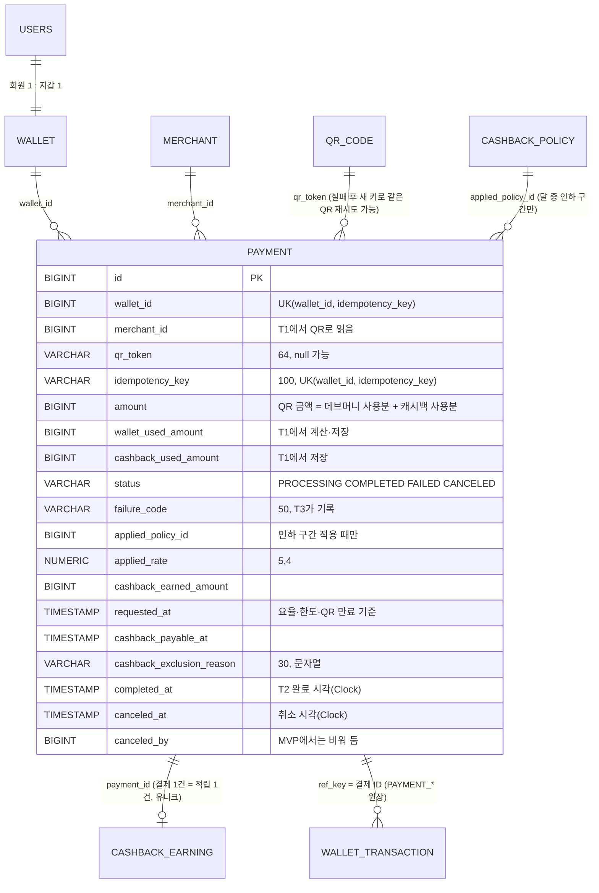

# 결제(Payment) 기획서 — A 신영

> 담당: 결제·동시성 / 개발 11/16 ~ 12/4, 중간보고 11/24, 발표 12/7
> **구현 마감: 11/23(월)까지 사장님 결제 내역을 제외한 전체** (멱등키, 결제, 결제 결과 재조회, 결제 취소) → **달성.** 일정은 [sy-mvp-1124](../schedule/sy-mvp-1124.md)
> 마지막 갱신: 2026-11-24 (**구현 마감 범위 완료**: 취소(#112), 실제 서비스 교체(#101), 인증·인가 소유권 검사(#157), 캐시백 회수 반영(#151) 머지. 결제 전 미리보기는 B의 `GET /api/cashback/preview`(#156)를 프론트가 직접 호출하고 결제 쪽 신규 API는 없음. 남은 일: 사장님 결제 내역, 동시성 테스트·심화, DB 중심 리질리언스, PIN 결제 강제(#187) 대응)

## 1. 한눈에 보기

결제 코어를 맡습니다. 목표는 **돈이 틀리지 않게** 하는 것입니다.

| 기능 | API | 한 줄 요약 |
| --- | --- | --- |
| 멱등키 | 공통(검증) + 결제(중복 판정) | 같은 요청은 한 번만 처리하고, 재전송 시 기존 결과를 반환 |
| 공통 에러 코드 | 공통 | 실패 사유를 `{DOMAIN}-{NNN}` 코드로 통일 |
| 결제 | `POST /api/payments` | QR/가맹점 검증, 지갑 차감, 캐시백 예산 예약, QR 사용 처리를 한 흐름으로 |
| 결제 결과 재조회 | `GET /api/payments/by-key/{key}` | 응답을 못 받았을 때 멱등키로 결과 확인 |
| 결제 취소 | `POST /api/payments/{id}/cancel` | 지갑 환급, 캐시백 적립 취소, 중복 취소 방지 |
| 사장님 결제 내역 | `GET /api/merchants/me/payments` (토큰의 가맹점, OWNER) | 결제·취소·순매출 조회 (구현, #201, 2-15절) |

추가 업무: 리질리언스 패턴(타임아웃·재시도·서킷브레이커·벌크헤드). **지금 시스템에는 외부 호출이 없고 의존 대상이 DB 하나뿐**이라, 서킷브레이커처럼 외부 호출을 전제로 한 패턴은 붙일 곳이 없다. DB 중심(락 대기 타임아웃, 커넥션 풀·쿼리 타임아웃, 제한적 재시도, 요청 제한)으로 범위를 좁히고, 먼저 부하·동시성 측정으로 병목을 보인 뒤 적용해 전후를 비교한다 (4절, 합의 #4).

## 2. 확정된 설계

### 2-1. 금액 타입
- DB `BIGINT` ↔ 자바 `Long`. 캐시백 소수점은 **버림으로 확정** (0.3원 누적 정책 폐지).
- 적립액 = `floor(데브머니 사용분 × 요율)`, 요율만 `NUMERIC(5,4)` ↔ `BigDecimal`.
- 취소 시 회수액은 재계산하지 않고 **저장된 적립액**을 사용합니다.

### 2-2. 멱등키
- 프론트가 UUID를 결제 시도마다 생성해 헤더 `Idempotency-Key`로 전송합니다. 응답을 못 받아 **자동 재전송**할 때만 같은 키를 쓰고, 실패한 뒤 사용자가 **다시 결제**할 때는 새 키를 만듭니다 (같은 키는 아래 표처럼 기존 결과를 돌려주기 때문).
- 서버는 헤더 **형식만** 검증합니다 (`IdempotencyKeys.validate`).
  - 없음/빈 값/공백 → `COM-002`, UUID 형식 아님 → `COM-001`
- 중복 판단은 각 도메인 테이블의 `(wallet_id, idempotency_key)` UNIQUE 제약이 합니다.

결제에서 같은 키로 다시 요청이 오면 다음과 같이 처리합니다.

| 같은 키로 재요청 | 결과 |
| --- | --- |
| 요청 내용(QR 토큰·캐시백 사용분)이 다름 | `COM-003` (409) |
| 내용 같음 + 기존 건이 처리 중 | `COM-004` (409) |
| 내용 같음 + 기존 건이 완료/취소/실패 | 에러 없이 **기존 결과 그대로 반환** (재실행 없음). 실패 건은 `status=FAILED`와 `failureCode`가 담겨 옴 |

- **실패 건 재시도 정책(합의 #5)은 "재시도 없음"으로 확정**했습니다. 같은 키로는 다시 처리하지 않고, 다시 결제하려면 새 멱등키로 요청합니다 (QR은 T2 롤백으로 `WAITING`에 돌아와 있으면 그대로 쓸 수 있음). 이에 따라 `reclaimFailed`(FAILED→PROCESSING)는 삭제했습니다.

### 2-3. 트랜잭션 구조
```
Controller → PaymentFacade (트랜잭션 없음)
  ├ PaymentIdempotencyService  T1: QR 조회(가맹점·금액) + 사용분 계산 → payment INSERT(PROCESSING) 후 즉시 커밋 (선점)
  ├ PaymentTxService T2: 결제 행 락 → QR 사용(markUsed) → 지갑 차감(debitPayment) → 적립 예약(reserve) → COMPLETED
  │                      (락 순서 결제 → QR → 지갑 → 예산. 가맹점 매출 기록 호출은 없음: 정산이 payment 를 직접 읽음)
  └ PaymentFailureService T3: T2 롤백 후 새 트랜잭션에서 FAILED + failure_code 기록
```
- Facade에 트랜잭션을 두지 않는 이유: T1이 먼저 커밋되어 "이 키로 시도했다"는 기록이 남아야 하고, 유니크 위반 후에는 같은 트랜잭션을 쓸 수 없기 때문입니다.
- 서비스는 서로 다른 클래스로 분리합니다 (같은 클래스 내부 호출은 `@Transactional`이 적용되지 않음).
- `BusinessException`은 `RuntimeException`이라 롤백됩니다.

**Facade의 try/catch (T2 실패 → T3)**

| 위치 | 잡는 예외 | 처리 |
| --- | --- | --- |
| T1 `claim` | `DataIntegrityViolationException` (같은 지갑·키의 행이 이미 있음) | 기존 행을 조회해 완료/취소/실패면 결과 반환, 처리 중이면 `COM-004`. T2로 가지 않음 |
| T2 `tx` | `BusinessException` | `COM-004`가 **아니면** 던진 에러 코드를 `failure_code`로 기록(T3) 후 예외를 다시 던짐 |
| T2 `tx` | 그 외 `RuntimeException` | `COM-010`을 기록(T3) 후 다시 던짐 |

- T2 호출은 T1 `try` 밖에 둡니다. 본처리 중 나온 `DataIntegrityViolationException`이 "이미 있는 행"으로 오해되어 T1의 `catch`로 빠지지 않게 하기 위해서입니다.
- `BusinessException`도 `RuntimeException`의 하위 클래스라 `catch`는 `BusinessException`이 먼저입니다.
- `COM-004`("다른 요청이 처리 중")는 이 건의 실패가 아니므로 기록하지 않습니다.
- T3 자체가 실패하면 행은 `PROCESSING`으로 남습니다 (정리 정책은 합의 #6).
- T3는 `PROCESSING`인 건만 `FAILED`로 바꿉니다. 이미 완료/실패한 건에 다시 호출해도 상태와 첫 실패 코드가 바뀌지 않습니다.

### 2-4. 에러 코드
- 형식 `{DOMAIN}-{NNN}`, 인터페이스 `ErrorCode` + 도메인별 enum.
- 공통(COM) 현재 등록: 

| 코드 | HTTP | 의미 |
| --- | --- | --- |
| COM-001 | 400 | 잘못된 요청 |
| COM-002 | 400 | Idempotency-Key 헤더 없음 |
| COM-003 | 409 | 같은 키로 다른 내용 요청 |
| COM-004 | 409 | 이전 요청 처리 중 |
| COM-005 | 401 | 토큰 없음 (JWT 필터 #139) |
| COM-006 | 401 | 위조·형식 오류 토큰 |
| COM-007 | 401 | 만료된 토큰 |
| COM-008 | 403 | 역할 부족 (예: USER가 결제 취소 호출) |
| COM-009 | 404 | 리소스 없음 |
| COM-010 | 500 | 서버 내부 오류 |
| COM-011 | 503 | 외부 서비스 연동 실패 |
| COM-012 | 405 | 지원하지 않는 HTTP 메서드 |

- 결제(PAY) 코드 (`PaymentErrorCode`): 결제 도메인이 직접 판단하는 실패만 정의합니다.

| 코드 | HTTP | 의미 | 비고 |
| --- | --- | --- | --- |
| PAY-001 | 400 | 결제 한도 초과 | **삭제함 (#55).** 결제 금액은 서버가 QR에서 읽은 값이고 D가 QR 금액을 100만원 이하로 제한하므로 결제 쪽에 따로 두지 않음 (합의 #14 해결). 번호는 재사용하지 않음 |
| PAY-002 | 409 | 잔액 부족 | **삭제함 (#55).** 지갑 `WAL-004`(데브머니 부족)/`WAL-005`(캐시백 부족)로 대체 |
| PAY-003 | 404 | 해당 멱등키로 접수된 결제 없음 | 구현·머지 (#83, 재조회 2-8절). 계속 404면 같은 키로 재결제해도 안전 |
| PAY-004 | 408 | 처리 시간 초과 | **MVP 이후로 보류.** PROCESSING 정리 스케줄러가 FAILED로 바꿀 때 기록할 코드 (2-8절) |
| PAY-005 | 503 | 락 대기 초과 | **MVP 이후로 보류.** T2 락 대기 상한(5초)을 넘었을 때 (2-8절) |
| PAY-006 | 409 | 취소할 수 없는 결제 상태 | 구현 (#86). `COMPLETED`만 취소 가능. `PROCESSING`/`FAILED`는 거절, 이미 `CANCELED`는 에러 없이 기존 결과 반환 |
| PAY-007 | 403 | 본인 가맹점의 결제가 아님 | 구현 (#86). 다른 가맹점이 취소하려 할 때 |
| PAY-008 | 400 | 사장님 결제 내역의 조회 기간이 올바르지 않음 | 구현 (#201). 시작이 끝보다 늦거나 31일 초과 |

- 다른 도메인이 던지는 실패는 그 도메인의 코드를 그대로 씁니다 (QR-001~004, 캐시백 CSH-xxx, 가맹점 MER-001 등). T3는 던져진 `BusinessException`의 코드를 `payment.failure_code`에 **그대로 기록**합니다.
- 가맹점·금액은 요청으로 받지 않고 서버가 QR에서 읽으므로, 요청과 QR이 다를 때의 `QR-004`(불일치)는 없어졌습니다 (D의 이슈 #64 / PR #67).

### 2-5. 시간 기준
- 결제가 만드는 시각(`requestedAt`, `completedAt`)은 모두 `Clock`(KST) 기준 `LocalDateTime`입니다. `LocalDateTime.now()`를 직접 부르지 않습니다.
- 엔티티는 시각을 직접 만들지 않고 서비스가 `Clock`으로 만든 값을 인자로 받습니다 (`Payment.complete(..., completedAt)`).
- 적립 요율과 월 한도의 기준은 **최초 접수 시각(`requestedAt`)** 입니다.
- 통합 테스트는 `@IntegrationTest`(테스트 DB + `MutableClock`)를 붙여 시간을 고정합니다 (PR #19).

### 2-6. 결제 응답(영수증 기본 필드)
결제금액, 데브머니 사용분, 캐시백 사용분, 적립 캐시백, 적용 요율, **지급 예정 시각, 적립 제외 사유, 결제 실패 코드(`failureCode`)** 를 응답에 담습니다.
- 지급 예정 시각과 제외 사유는 `CashbackService.reserve`의 반환값(`CashbackReserveResponse`)이며, 재조회해도 같은 영수증이 나오도록 `payment`에 저장합니다 (`cashback_payable_at`, `cashback_exclusion_reason`).
- `failureCode`는 실패 건에만 값이 있습니다. 같은 멱등키로 다시 요청해 기존 실패 결과를 받을 때도 실패 사유를 알 수 있습니다.
- **월 한도 상태(남은 한도)는 아직 없습니다.** 머지된 `CashbackReserveResponse`에 월 한도 필드가 없으므로(제외 사유 `MONTHLY_LIMIT_EXCEEDED`만 있음) 합의 #13에서 정합니다.

### 2-7. 데이터 모델 (`payment` 테이블)

엔티티 `Payment` 기준입니다. DB는 `ddl-auto: update`로 생성합니다. 복합 유니크 `(wallet_id, idempotency_key)`가 중복 요청을 막습니다.

| 컬럼 | 타입 | NULL | 설명 |
| --- | --- | --- | --- |
| `id` | BIGINT PK | N | 결제 ID |
| `wallet_id` | BIGINT | N | 지갑. **토큰의 회원으로 서버가 찾는다**(`walletIdOf(user)`, 2-11절). 요청 본문의 값은 쓰지 않음 |
| `merchant_id` | BIGINT | N | 가맹점 (T1에서 `getPaymentTarget(qrToken)`으로 서버가 QR에서 읽어 저장) |
| `qr_token` | VARCHAR(64) | Y | 이용자가 스캔한 QR 토큰(UUID). T1에서 저장 **(변경: 기존 `qr_id`)** |
| `idempotency_key` | VARCHAR(100) | N | 멱등키 |
| `amount` | BIGINT | N | 총 결제액 = 데브머니 사용분 + 캐시백 사용분 (서버가 QR에서 읽은 값, 요청으로 받지 않음) |
| `wallet_used_amount` / `cashback_used_amount` | BIGINT | N | **T1에서 계산해 저장** (충전금 = 서버 금액 − `cashbackUsed`, 캐시백 = `cashbackUsed`). T2는 저장된 값을 지갑에 그대로 넘김 |
| `status` | VARCHAR(20) | N | PROCESSING / COMPLETED / FAILED / CANCELED |
| `failure_code` | VARCHAR(50) | Y | T3가 기록 (예: `QR-003`, `COM-010`) |
| `applied_policy_id`, `applied_rate`(NUMERIC(5,4)), `cashback_earned_amount` | | Y | 적립 정책·요율 스냅샷, 적립액 (T2). `applied_policy_id`는 **달 중 요율 인하 구간이 적용된 결제에만** 있고, 월 기본 요율이 적용됐거나 적립 제외면 null |
| `cashback_payable_at`, `cashback_exclusion_reason` | | Y | 지급 예정 시각, 적립 제외 사유 (T2) |
| `requested_at` | TIMESTAMP | N | 서버 최초 접수 시각 (요율·월 한도·QR 만료 판정 기준) |
| `completed_at`, `canceled_at`, `canceled_by` | | Y | 완료 시각, 취소 시각(취소 #86에서 구현), 취소한 가맹점주(MVP에서는 비워 둠) |

#### 현재 ERD (결제)

결제 테이블은 `payment` 하나이고, 다른 도메인과는 **외래키 없이 값(ID)으로만** 이어진다. 연결은 서비스가 값으로 조회한다.



| 항목 | 내용 |
| --- | --- |
| 유니크 | `uk_payment_wallet_idempotency (wallet_id, idempotency_key)`: 같은 지갑의 같은 멱등키는 한 행만 만들어져 중복 요청을 막음 |
| 인덱스 | 위 유니크 외에 **`idx_payment_merchant_completed (merchant_id, completed_at)`, `idx_payment_merchant_canceled (merchant_id, canceled_at)`** (#201). 사장님 결제 내역과 일 정산 집계가 가맹점별로 완료·취소 시각 범위를 조회한다 |
| 외래키 | 없음. 지갑·가맹점·QR·적립 건은 ID(토큰)로만 가리킴 (다른 도메인 테이블과 결합하지 않기 위함) |
| 상태 값 | `PaymentStatus` enum(문자열 저장). Hibernate가 enum 컬럼에 CHECK 제약을 만들 수 있고 `ddl-auto: update`는 이를 갱신하지 않으므로, **상태 값을 추가하면 제약을 다시 만들어야 한다** (지갑 원장 type 값을 추가했을 때 겪은 500과 같은 문제) |
| 이어지는 다른 테이블 | `cashback_earning.payment_id`(유니크, 적립 건), `wallet_transaction.ref_key`(결제 ID, `PAYMENT_DEVMONEY`·`PAYMENT_CASHBACK`·`PAYMENT_CANCEL_*`), `qr_code.token`, `cashback_policy.id` |

#### ERD 변경 내용 (project-spec 8절 원안 → 현재)

| 구분 | 내용 | 이유 | 시점 |
| --- | --- | --- | --- |
| 변경 | `qr_id`(BIGINT) → `qr_token`(VARCHAR(64)) | QR 이미지에는 토큰(UUID)만 담기고 결제 요청이 토큰을 받기 때문. 같은 요청 비교와 QR 사용 처리에 토큰을 씀 | 11/19 |
| 변경 | `wallet_used_amount`, `cashback_used_amount`가 채워지는 시점: T2 → **T1** (컬럼은 그대로) | 사용자가 캐시백 사용분을 직접 고르는 합의(2-9절). T1 직후 `PROCESSING` 건에도 사용분이 들어 있고 T2는 저장된 값을 지갑에 그대로 넘김 | 11/20 |
| 추가 | `failure_code` VARCHAR(50) | T3가 실패 사유(예: `QR-003`, `WAL-004`, `COM-010`)를 기록. 같은 멱등키 재요청이나 재조회로 실패 사유를 알려 줌 | 11/19 |
| 추가 | `cashback_payable_at`, `cashback_exclusion_reason` | 재조회해도 같은 영수증이 나오도록 `reserve` 반환값(지급 예정 시각, 제외 사유)을 저장. 제외 사유는 문자열이라 B가 사유를 추가해도 DB 변경이 없음 | 11/18 |
| 추가 | `canceled_at` 사용 시작 / `canceled_by`는 미사용 | 취소(#86)가 `canceled_at`을 `Clock`으로 채움. `completed_at`은 지우지 않음(정산 입력 규칙 2-10절). `canceled_by`는 MVP에서 비워 둠 | 11/22 |
| 미반영 | `payment.monthly_budget_id` (`project-spec` 8절에 "컬럼 추가"로 적혀 있음) | 합의 #10 방향대로 `cashback_earning`(`limit_month`)에 두고 `payment`에는 추가하지 않음. 확정되면 `project-spec` 8절도 맞춰야 함 | - |
| 의미만 변경 | `wallet_id` | 컬럼은 같고 값의 출처만 바뀜: 요청 본문 → **토큰의 회원으로 서버가 찾음**(2-11절, #153). 스키마 변경은 없음 | 11/23 |

- 기존 DB에는 `qr_id` 컬럼이 남아 있을 수 있습니다 (`ddl-auto: update`는 컬럼을 지우지 않음). nullable이라 동작에는 영향이 없고, 깨끗하게 쓰려면 로컬 DB를 다시 만들면 됩니다.
- `project-spec` 8절 "ERD 변경 사항" 표에는 위 `qr_id → qr_token` 행이 아직 없습니다 (팀 공통 문서라 별도로 추가 필요).

### 2-8. 결제 결과 재조회 API (#59)

응답을 받지 못한 결제의 결과를 **같은 멱등키로 다시 확인**하는 읽기 전용 API입니다. 사용자가 직접 누르는 API가 아니라, 결제 요청이 시간 초과되면 앱이 자동으로 호출합니다 (이중 결제 방지). `POST`와 달리 결제를 새로 처리하지 않습니다.

| 항목 | 내용 |
| --- | --- |
| API | `GET /api/payments/by-key/{key}` (지갑은 토큰의 회원으로 서버가 찾음. `walletId` 쿼리 파라미터는 #153에서 제거) |
| 구조 | 컨트롤러 → `PaymentQueryService`(`@Transactional(readOnly = true)`) → `(wallet_id, idempotency_key)`로 `payment` 행 조회 |
| 응답 | 기존 `PaymentResponse` 재사용. `COMPLETED` / `FAILED`(`failureCode`) / `PROCESSING`(상태 그대로) / `CANCELED` |
| 없는 키·다른 지갑의 키 | 404. 지갑까지 함께 찾으므로 다른 사람의 결제는 존재 여부도 드러나지 않음 |

**서버 보강 3가지**

| # | 보강 | 내용 | 이유 |
| --- | --- | --- | --- |
| ① | 캐시 방지 확인 | Spring Security 기본 헤더가 재조회 응답에 `Cache-Control: no-store`를 붙이는지 MockMvc 테스트로 확인 (없으면 `ResponseEntity`로 추가) | 브라우저·프록시가 이전 "처리 중" 응답을 재사용하면 앱이 완료를 영영 못 봄 |
| ② | 응답에 `requestedAt`, `completedAt` 추가 | `PaymentResponse`에 접수·완료 시각 추가 (컬럼은 이미 있음, DB 변경 없음) | 앱이 "접수된 지 오래인데 아직 처리 중"을 판단할 근거 |
| ③ | 404 전용 에러 코드 `PAY-003` | `COM-009` 대신 `PAY-003 PAYMENT_NOT_FOUND`(404) + Swagger 설명 | 404 = "서버가 그 요청을 받은 적 없음". 계속 404면 같은 키로 결제를 다시 보내도 안전하다는 규칙을 문서화 |

**PROCESSING이 끝나지 않는 이유 (분석, 합의 #6과 연결)**

T1(PROCESSING 선점)은 먼저 커밋되지만 T2·T3는 그 뒤에 실행되어 **보장되지 않습니다.** 현재 트랜잭션 타임아웃·락 타임아웃·정리 작업이 없어 다음 경우 `PROCESSING`으로 영원히 남을 수 있습니다.

| 원인 | 설명 |
| --- | --- |
| 서버 재시작·크래시 | T1 커밋 뒤 T2/T3가 실행되기 전(또는 도중)에 프로세스가 죽으면 이어서 처리할 주체가 없음 |
| T2 실패 + T3 실패 | DB 문제로 T2가 실패하면 T3도 같은 이유(커넥션 풀 고갈 등)로 실패하기 쉬움. T3 예외가 그대로 올라가고 FAILED 기록이 사라짐 |
| T2가 멈춤 | 지갑 등 락 대기에서 끝나지 않음 (락 타임아웃 없음). 결과가 결정되지 않은 채 오래 `PROCESSING` |
| 이후에도 해소 안 됨 | 같은 키 재요청은 `COM-004`만, 재조회는 계속 `PROCESSING` (아무 곳도 상태를 바꾸지 않음) |

**MVP 이후(11/24 중간보고 뒤)로 분리했습니다.** 해결 방향: ① T2 트랜잭션·락 타임아웃으로 멈춘 T2를 실패(롤백 → T3)로 끌어내기, ② 오래된 `PROCESSING`을 행 락으로 확인한 뒤 `FAILED` 처리하는 정리 스케줄러. T2는 원자적이라 `PROCESSING`으로 남았다면 돈이 움직이지 않았고, T2가 실행 중이면 행 락 때문에 기다렸다가 상태가 바뀐 것을 보고 건드리지 않으므로 안전합니다.

**구현 현황**: 재조회 API와 서버 보강 3가지는 구현·머지했습니다 (#83, `Cache-Control: no-store`는 Spring Security 기본 헤더로 충족, 테스트로 고정). PROCESSING 정체 해소(락 대기 5초 `lock_timeout`, T2 타임아웃 10초, 정리 스케줄러 60초 기준·30초 간격·100건씩, `PAY-004`/`PAY-005`)는 MVP 범위가 아니라 중간보고 이후로 미룹니다.

**남은 것**
- **보안**: **해결 (#157).** `permitAll`은 없어졌고 `/api/payments/**`는 로그인한 USER만 호출하며(2-11절) 지갑은 토큰에서 찾음
- **프론트** (구현 완료, #111 / PR #113. 토큰 처리와 `walletId` 제거는 #167 / PR #182에서 연동): 응답을 못 받으면 자동 재조회 **2→4→8→16초 간격**, 30초 후 "결제 내역을 확인해 주세요" 안내, 재조회 중 재결제 버튼 숨김, `FAILED`는 사유 표시, 404가 계속되면 같은 키로 재결제 안내

### 2-9. 결제 요청과 사용분 (2026-11-20 구두 합의)

**한 줄 요약**: 사용자가 결제할 때 캐시백 사용분을 직접 고르고, 결제는 충전금·캐시백 사용분을 지갑에 **한 번에** 넘긴다 (`debitPayment`). 관련: 지갑 이슈 #68, Mock 교체 #55, 캐시백 요청 #27, QR 이슈 #64 / PR #67.

**왜 바뀌었나**: 지금 코드는 `debit(walletId, 총액, ...)`을 한 번 부르고 충전금·캐시백 분할은 지갑이 정한다고 가정했다. 그런데 QR 연동 변경(요청은 `{ walletId, qrToken }`만, 금액은 서버가 QR에서 읽음)으로 요청에 사용자의 선택값을 담을 자리가 사라졌다. 그러면 지갑은 총액만 받아 자동 분할해야 하고, 사용자가 고른 사용분과 달라질 수 있으며 분할 순서(캐시백 먼저/충전금 먼저)가 적립액을 바꾼다.

**결정 (② 한 번 호출 + 두 금액)**: 요청에 필드 1개만 추가한다. 금액은 여전히 서버 값이고 클라이언트는 "캐시백을 얼마 쓸지"만 보낸다.

| 항목 | 내용 |
| --- | --- |
| 요청 | `{ qrToken, cashbackUsed }` (`merchantId`, `amount` 제거. **`walletId`는 #157부터 요청에서 받지 않고 토큰으로 정함**, 2-11절). **`cashbackUsed`를 보내지 않으면 0**으로 보고 결제금액 전부를 데브머니로 낸다 (오류가 아님) |
| 검증 | `0 ≤ cashbackUsed ≤ 서버 금액` (0 이상은 `@PositiveOrZero`, 금액 초과는 T1에서 `COM-001`로 거절하며 이때는 결제 행이 만들어지지 않음. 사용 가능 캐시백 초과는 지갑이 `WAL-005`로 막음). 충전금 사용분은 서버가 `서버 금액 − cashbackUsed`로 계산하므로 "두 금액의 합 = 총액" 검증이 필요 없음 |
| T1 | `getPaymentTarget(qrToken)` → 가맹점·금액, 충전금 계산, 결제 행에 `wallet_used_amount`/`cashback_used_amount` **저장** |
| T2 | 결제 행 락 → `markUsed(qrToken, requestedAt)` → `debitPayment(walletId, walletUsed, cashbackUsed, paymentId)`(반환 없음) → `reserve`(저장된 `wallet_used` 전달) → `complete` |
| 같은 키 비교 | `qrToken`과 `cashbackUsed`가 모두 같아야 같은 요청 (다르면 `COM-003`) |

**새 흐름 예시** (QR 금액 3만원, 캐시백 1만원 사용)
```
PaymentRequest { walletId, qrToken, cashbackUsed=10,000 }
 [T1] getPaymentTarget → amount=30,000 / 충전금 = 30,000 − 10,000 = 20,000
      payment 행 { wallet_used=20,000, cashback_used=10,000 } 저장
 [T2] 결제 행 락 → markUsed → debitPayment(walletId, 20,000, 10,000, paymentId) → reserve(wallet_used=20,000) → complete
```

**지갑(C)이 제공하는 메서드**

| 메서드 | 용도 |
| --- | --- |
| `debitPayment(walletId, 충전금사용분, 캐시백사용분, paymentId)` | 결제 차감 (반환 없음) |
| `creditPaymentCancel(walletId, 충전금사용분, 캐시백사용분, paymentId)` | 결제 취소 환급 (낸 칸 그대로) |
| `credit` / `debit` (범용) | B의 캐시백 지급·회수 (변경 없음) |

- 두 금액은 0 이상, 한쪽이 0이면 건너뛰고 **둘 다 0이면 `WAL-003`**. 두 차감은 한 트랜잭션이라 둘 다 성공하거나 둘 다 롤백
- 같은 `paymentId`로 다시 와도 예외 없이 한 번만 반영. A의 T2 트랜잭션에 참여해 지갑 예외가 나면 T2 전체가 롤백
- 금액은 항상 양수로 넘김. 원장 부호(입금 +, 차감 −)는 지갑이 정함. 원장 type: `PAYMENT_DEVMONEY`, `PAYMENT_CASHBACK`, `PAYMENT_CANCEL_DEVMONEY`, `PAYMENT_CANCEL_CASHBACK`
- 에러 코드: `WAL-001`(지갑 없음 404), `WAL-002`(탈퇴한 회원 409), `WAL-003`(금액 0 이하 400), `WAL-004`(데브머니 부족 409), `WAL-005`(캐시백 부족 409). 모두 `BusinessException`이라 `failure_code`에 그대로 기록되고, 호출 실수(`IllegalArgumentException`)는 `COM-010`

**락 순서 변경**: `결제 → 지갑 → QR → 예산` → **`결제 → QR → 지갑 → 예산`**. 취소·충전·환불·탈퇴는 QR을 잡지 않으므로 교착은 생기지 않는다. 만료된 QR은 지갑을 건드리기 전에 걸러지고 지갑 락을 쥐는 시간이 짧아진다.

| 흐름 | 락 순서 | 비고 |
| --- | --- | --- |
| 결제 T2 | 결제 행 → QR(`markUsed`) → 지갑(`debitPayment`) → 예산(`reserve`) | 예산 행은 모든 결제가 같이 잡는 가장 붐비는 행이라 **맨 마지막**에 두어 락을 쥐는 시간을 줄인다 (캐시백 담당 요청) |
| 결제 취소 | 결제 행 → 지갑(`creditPaymentCancel`) → 예산(`cancel`) | QR은 잡지 않음. 지갑 락을 예산보다 먼저 잡아야 같은 지갑의 결제와 취소가 순서대로 처리되고 교착이 없다 |

- 가맹점 매출 기록(D의 `recordPayment`/`recordCancel`)은 **호출하지 않는다** (D 석경진 확정, 11/22). 정산이 `payment`의 `completedAt`·`canceledAt`·`amount`를 직접 읽는다. 대신 결제 쪽이 지킬 것: `completedAt`은 T2 완료 시점에 `Clock`(KST)으로 찍고(`requestedAt` 복사 금지), 취소는 `status=CANCELED` + `canceledAt`(`Clock`)을 채우되 `completedAt`은 지우지 않으며, 금액은 `amount`(전액 취소라 취소 금액도 같음).
- 락 대기에는 지금 상한이 없다 (MVP 이후 `lock_timeout` 5초 < T2 타임아웃 10초 < 정리 스케줄러 60초로 도입 예정, 2-8절).

**A(결제)가 바꾸는 것** (이슈 #55): `PaymentRequest`에 `cashbackUsed`, T1에서 `QrService.getPaymentTarget`으로 가맹점·금액을 읽고 사용분 계산·저장, T2에서 실제 `QrService.markUsed`와 `WalletService.debitPayment` 한 번(`reserve`에는 저장된 `wallet_used`), 취소는 저장된 두 값으로 `creditPaymentCancel` 한 번, `DebitResult`·`WalletMockService`·`QrMockService`·`WalletTxType`·`PAY-001`·`PAY-002` 삭제, 락 순서 문서 반영.

**영향**: T1 직후(`PROCESSING`)에도 `wallet_used_amount`/`cashback_used_amount`가 0이 아니라 계산된 값이다. 재조회 응답의 처리 중 건과 그 테스트 기대값이 이에 맞게 바뀐다 (2-8절).

### 2-10. 정산·대사 입력 규칙 (D 합의, 취소 구현에 적용)

D의 일 정산(매일 00:10)과 사장님 결제 내역(PAY-04)이 결제의 시각 필드를 집계 기준으로 읽습니다.

| 규칙 | 내용 |
| --- | --- |
| 취소 기록 | `status=CANCELED`로 바꾸면서 `canceledAt`을 채우고 **`completedAt`은 지우지 않는다** (결제는 완료한 날로, 취소는 취소한 날로 집계) |
| 시각 기준 | `completedAt`, `canceledAt` 모두 주입된 `Clock`(KST)으로 기록 |
| 집계 기준 | 결제는 `completedAt`의 날짜, 취소는 `canceledAt`의 날짜. `PROCESSING`/`FAILED`는 `completedAt`이 없어 제외 |
| 정산 이후 완료 | 정산이 끝난 날짜의 시각으로 `completedAt`이 찍히는 결제는 정산에서 누락되고 대사가 탐지한다. `completedAt`은 T2 완료 시점의 시각이어야 하며 `requestedAt`을 복사하지 않는다 |
| 지급 이후 취소 | 이미 지급된 달의 결제도 취소할 수 있다. 취소한 날에 반영되고 음수는 다음 지급에서 차감 (가맹점 정산 지급 기준이며, 캐시백 적립이 사용자에게 지급된 뒤 취소하는 경우는 B가 정하는 별개 사안) |

**대사와의 관계**: 지갑 원장의 type은 `PAYMENT_DEVMONEY`/`PAYMENT_CASHBACK`(차감, 음수), `PAYMENT_CANCEL_DEVMONEY`/`PAYMENT_CANCEL_CASHBACK`(환급, 양수)이며 데브머니(2번)·캐시백(3번) 원장 합계에 포함됩니다.

### 2-11. 인증·인가: 소유권 검사 (#153, PR #157)

**한 줄 요약**: 요청의 `walletId`·`merchantId`를 믿지 않고, 로그인한 회원의 토큰으로 서버가 **내 지갑·내 가맹점**을 찾는다. 남의 번호를 보낼 방법 자체가 없어진다.

| 단계 | 내용 |
| --- | --- |
| ① 인증 | JWT 필터(#139)가 `Authorization: Bearer` 토큰에서 `AuthUser(userId, role)`을 꺼냄. 토큰에는 지갑 번호가 없음 |
| ② 컨트롤러 | `@AuthenticationPrincipal AuthUser user`로 받음 |
| ③ 번호 찾기 | `OwnedResources.walletIdOf(user)`, `merchantIdOf(user)` (공용 도구 #142). 지갑이 없으면 `WAL-001`(404), 가맹점이 없으면 `MER-001`(404) |

| API | 이전 | 이후 |
| --- | --- | --- |
| `POST /api/payments` | 본문 `walletId`를 그대로 사용 | 본문의 `walletId`를 **무시하고** `walletIdOf(user)`로 덮어써서 서비스에 넘김. 요청 DTO의 필드는 두되 `@NotNull`을 제거하고 Swagger에서 숨김 |
| `GET /api/payments/by-key/{key}` | `?walletId=` 쿼리 | 파라미터 제거, `walletIdOf(user)` |
| `POST /api/payments/{id}/cancel` | `?merchantId=` 쿼리 | 파라미터 제거, `merchantIdOf(user)`. 소유권은 기존 `PAY-007` 비교(`payment.merchantId == 내 가맹점`)가 그대로 담당 |

- **허용 역할**: 결제 취소는 `OWNER`, 나머지 `/api/payments/**`는 `USER`(`OWNER`도 포함). `ADMIN`은 운영 전용이라 결제 API를 쓰지 못함. 실패는 `COM-005`(토큰 없음)·`COM-006`(위조)·`COM-007`(만료)·`COM-008`(역할 부족)
- **요청 객체에 담아 덮어쓰는 방식을 고른 이유**: 서비스 시그니처와 기존 서비스 테스트(약 50건)를 거의 건드리지 않음. 대신 컨트롤러에서 덮어쓰는 줄을 빠뜨리면 구멍이 되므로 "본문의 남의 `walletId`를 넣어도 내 지갑으로 처리된다"를 컨트롤러 테스트로 고정함. 구조적으로는 내부 전용 명령 객체를 따로 두는 쪽이 더 안전해서 시간이 나면 리팩터링 후보
- **테스트**: 컨트롤러 4건 추가(본문 `walletId` 무시, `cashbackUsed` 전달, 취소가 `merchantIdOf`를 씀, USER가 취소하면 403). 컨트롤러 테스트는 `@WithAuthUser`로 로그인한 회원을 만듦
- **미해결**: 결제 시 PIN 검증은 아직 없음 (2-14절)

### 2-12. 결제 취소와 캐시백 회수 (#86, #137)

**취소 흐름 (한 트랜잭션)**: 결제 행 락 → 본인 가맹점 확인(`PAY-007`) → 이미 `CANCELED`면 에러 없이 기존 결과 반환 → `COMPLETED`가 아니면 `PAY-006` → `creditPaymentCancel`(저장된 두 사용분) → `cashbackService.cancel(paymentId)` → `payment.cancel(canceledAt)`. 락 순서는 결제 → 지갑 → 예산.

**캐시백 회수 반영 (#137, PR #151)**
- 캐시백 담당의 지급 배치와 회수(#128)가 머지되기 전에는 지급된 적립 건을 취소하면 `CSH-010`이 나서, 결제 쪽에 `cashbackService.cancel`을 건너뛰는 **임시 분기**를 두었다. 건너뛰면 지급된 캐시백이 조용히 남기 때문에 #128 머지 후 이 분기를 제거했다.
- 이제 `cancel`이 적립 건 상태에 따라 처리한다: `PENDING`이면 취소하고 확보한 예산을 되돌림, `PAID`면 **회수**(지갑 캐시백 잔액 차감 `CASHBACK_CLAWBACK`, 적립 건 `CLAWED_BACK`, 월 한도 반환, 지급된 예산은 되돌리지 않음).
- 테스트: 적립 210원을 지급한 뒤 취소하면 데브머니 환급, 캐시백 잔액 3,000 − 210, 원장 `CASHBACK_CLAWBACK`, 적립 건 `CLAWED_BACK`.

**알려진 제약**

| 상황 | 결과 | 상태 |
| --- | --- | --- |
| 이미 **탈퇴한 회원**의 결제를 점주가 취소 (탈퇴 이슈 #191, PR #192) | 환급·회수가 `WAL-002`로 거절되어 취소가 계속 실패. 데브머니는 탈퇴 때 모의계좌로 이미 환불됨 | **정책 미정** (합의 #22) |
| 월 마감 뒤 취소 | 마감된 달의 예산으로 돌아오고 다음 달로 다시 이월되지 않음 (캐시백 #136) | 알려진 한계 |
| 부분 취소 | 지원하지 않음 (전액 취소만) | MVP 범위 |

### 2-13. 결제 전 미리보기와 결제 화면

- 화면의 "예상 캐시백·요율·월 한도·제외 사유"는 **캐시백 담당의 `GET /api/cashback/preview`(#156, 머지)** 가 계산한다. 결제 쪽에 새 API를 만들지 않는다 (기획서 합의: 스캔 응답 연동은 D, 계산은 B).
- 사용분은 결제 전에 정해진다. 데브머니 사용분(`walletUsedAmount`) = QR 금액 − `cashbackUsed` (T1이 쓰는 식과 같음). 스캔 시점에는 `cashbackUsed`가 없으므로 **캐시백 사용분을 바꿀 때마다 다시 호출**한다 (입력이 멈춘 뒤 0.3~0.5초 디바운스).
- 응답은 "예상"이고 확정은 결제 때의 `reserve`와 영수증이 기준이다. 중단된 달도 적립 제외 사유는 기존처럼 `BUDGET_EXHAUSTED`로 나감.
- **소유권 구멍(미해결, 합의 #23)**: 현재 dev의 `/api/cashback/preview`와 이용자용 조회(`monthly-limit`, `earnings`, `summary`)는 `walletId`를 쿼리로 받아서, 남의 번호를 넣으면 그 이용자의 한도·적립 내역을 볼 수 있다. 결제와 같은 방식(`walletIdOf(user)`)으로 바꿔야 하며 캐시백 담당에게 요청한다.

### 2-14. 결제 시 PIN 강제 (이슈 #187, C 담당 / 결제 파일 수정 있음)

- 지금은 PIN이 가입 때 저장만 되고 결제는 **토큰만으로** 진행된다. 이슈 #187이 `PinService`와 `POST /api/users/pin/verify`(PR #188, 1/2)를 만들고, 2/2에서 **결제 컨트롤러와 `PaymentRequest`에 `pin`을 추가**해 결제 전에 검증한다 (틀리면 결제 기록도, QR 사용도 일어나지 않음. 5회 틀리면 잠김).
- 결제 쪽이 확인할 것: ① `isSameRequest`(같은 키 비교)에 `pin`을 넣지 않기 ② 요청 DTO의 `toString`에서 `pin`을 가리기 ③ 재조회에는 PIN이 필요 없음 ④ 2/2가 머지되는 순간 PIN 없는 결제는 400이 되므로 프론트와 머지 시점 맞추기.
- 결제 서비스(`PaymentFacade` 등)는 건드리지 않고 컨트롤러·DTO만 바뀐다고 했으므로 2/2 PR을 리뷰해서 확인한다 (합의 #21).

### 2-15. 사장님 결제 내역·매출 조회 (PAY-04, #201)

**한 줄 요약**: 점주가 자기 가맹점의 결제 내역과 매출(결제·취소·순매출)을 기간별로 본다. 가맹점은 토큰의 회원으로 찾는다(`merchantIdOf`).

| 항목 | 내용 |
| --- | --- |
| API | `GET /api/merchants/me/payments?from=yyyy-MM-dd&to=yyyy-MM-dd&page=0&size=20` (OWNER) |
| 기간 | 양 끝 포함, 최대 31일. 모두 생략하면 오늘, `from`만 주면 그날 하루. 시작이 끝보다 늦거나 31일을 넘으면 `PAY-008`(400) |
| 요약 | 기간 안의 결제 건수·금액, 취소 건수·금액, **순매출 = 결제 − 취소** (취소가 더 많은 날은 음수) |
| 목록 | 기간 안에 완료했거나 취소한 결제. 최신순(`completedAt`, `id` 내림차순), 기본 20건·최대 100건. 결제번호(취소에 사용), 상태, 총액, 데브머니·캐시백 사용분, 완료·취소 시각. **결제한 이용자 정보(지갑 번호)는 담지 않음** |
| 집계 기준 | 일 정산과 같다(2-10절). 결제는 `completedAt`의 날짜(상태 `COMPLETED`·`CANCELED`), 취소는 `canceledAt`의 날짜(`CANCELED`). 금액은 결제 총액(`amount`). `PROCESSING`·`FAILED`는 완료 시각이 없어 제외 |
| 구조 | `MerchantPaymentController` → `MerchantPaymentQueryService`(읽기 전용) → `PaymentRepository`의 집계·목록 쿼리 |
| 권한 | `/api/merchants/**` OWNER 규칙. USER 403(`COM-008`), 토큰 없음 401(`COM-005`) |

- **일 정산과 일치하는지**: 서비스 테스트가 일 정산이 쓰는 집계(`MerchantSalesRepository`)와 같은 금액이 나오는지 비교한다.
- **테스트**: 서비스 11건(내 가맹점만, 요약, 미완료 제외, 결제·취소 날짜 기준, 자정 경계, 일 정산 일치, 최신순, 페이징, 기본 기간, 빈 기간, 기간 검증), 컨트롤러 8건(응답 형태, `merchantIdOf` 사용, 파라미터 전달, 기간·형식 오류, 가맹점 없음 404, USER 403, 토큰 없음 401). 순매출 부호를 뒤집으면 테스트가 실패하는 것을 확인함.
- **프론트 (구현, 같은 PR)**: `/merchant/payments`(매출·정산 탭)가 이 API로 기간(오늘·어제·최근 7일·30일) 선택, 순매출·결제·취소 요약, 결제 목록(10건씩, 이전·다음)을 보여 준다. 목록의 **결제 옆 "취소" 버튼으로 바로 전액 취소**할 수 있고(확인 후 실행, 취소하면 목록과 요약이 갱신), 영수증의 결제번호로 직접 취소하는 기존 폼은 접어서 남겨 두었다.

## 3. 진행 현황

| 항목 | 상태 |
| --- | --- |
| 공통 에러 코드·응답·예외 처리 (#4, PR #10) | 완료 (dev 머지) |
| 멱등키 헤더 검증 (#2) | 완료 (PR #13, dev 머지) |
| 결제 요청 접수(멱등 선점) API (#12) | 완료 (PR #15): 엔티티, 리포지토리, DTO, claim/기존 요청 판정, 컨트롤러, 통합 테스트 |
| 결제 본처리 T2 (#16) | 완료 (PR #39) |
| 실패 처리 T3 (#16) | 완료 (PR #56): `PaymentFailureService`, `Payment.failure`, Facade의 try/catch, `PaymentErrorCode`, `failureCode` |
| 요청·T1·T2 변경과 Mock → 실제 교체 (#55) | 완료 (PR #101): `cashbackUsed`, T1 사용분 저장, 실제 QR·지갑 서비스. 가맹점 매출 기록 호출은 필요 없음으로 확정(11/22) |
| 재조회 (#59) | 완료 (PR #83): 서버 보강 3가지(`no-store`, `requestedAt`/`completedAt`, `PAY-003`). PROCESSING 정체 해소는 MVP 이후 |
| 결제 취소 (#86) | 완료 (PR #112): 지갑 환급, 적립 취소, 중복 취소 안전, 본인 가맹점 검증, 정산 입력 규칙(2-10절) |
| 프론트 결제 화면 연동 (#111) | 완료 (PR #113): `cashbackUsed`, 재조회, 취소 화면. 로그인 토큰 연동은 PR #182 |
| 인증·인가 소유권 검사 (#153) | 완료 (PR #157): 2-11절 |
| 캐시백 회수 반영 (#137) | 완료 (PR #151): 2-12절 |
| 결제 전 미리보기 | 결제 쪽 작업 없음. B의 #156 머지, 프론트 연동은 프론트 담당 (2-13절) |
| 지갑 거래 내역 조회 (#169, C 업무 지원) | 완료 (PR #183): `GET /api/wallet/transactions` |
| PIN 결제 강제 (#187, C) | 진행 중 (PR #188 1/2 리뷰). 2/2에서 결제 컨트롤러·DTO 수정 예정 (2-14절) |
| 회원 탈퇴 (#191, C) | 진행 중 (PR #192 1/2). 탈퇴한 지갑의 결제 취소 정책 필요 (2-12절, 합의 #22) |
| 동시성 테스트 (같은 키·같은 QR·같은 지갑 동시) | **미착수.** 결제 도메인에는 동시성 테스트가 아직 없음 (QR만 D의 `QrServiceConcurrencyTest`). 11/27에 진행 |
| 사장님 결제 내역 (#201) | 구현·테스트 완료 (PR 대기). `GET /api/merchants/me/payments`, 2-15절. 프론트 `/merchant/payments` 연동은 프론트 담당 |

## 4. 일정 (계획)

**11/23(월) 구현 마감 범위**: 멱등키 처리, 결제(멱등 선점 + 본처리 + 실패 기록), 결제 결과 재조회, 결제 취소 → **완료**. 같은 키·동시 요청 테스트는 아직 없어서 11/27로 넘김.
**시간되면 추가**: 락 없는 결제로 동시 요청 오류 재현 및 수치 저장 (개선 전후 비교의 기준값이므로, 락 적용 전에 먼저 수행)
**마감 범위 제외(11/25~)**: 사장님 결제 내역, 리질리언스 패턴(서킷브레이커·타임아웃·재시도·벌크헤드), 락 순서 최적화 등 동시성 심화.

| 날짜 | 할 일 | 끝났다는 기준 |
| --- | --- | --- |
| 11/17 (화) | 결제 접수(T1) API 완성·테스트, 멱등키 dev 반영 | PR #13 머지, PR #15 제출 |
| 11/18 (수) | T2 결제 본처리: Mock 서비스 구성, `PaymentTxService`, `Payment.complete(...)`, Facade 흐름 재구성 | 정상 요청이 COMPLETED로 끝남 (완료, PR #39) |
| 11/19 (목) | T3 실패 처리(FAILED + failure_code), PAY 에러 코드, T2 통합 테스트(성공·잔액 부족·QR 사용됨·롤백) | 실패 시 롤백되고 FAILED가 기록됨 (구현 완료, PR #56. 잔액 부족·지갑 롤백 검증은 실제 지갑 연동 후 #55) |
| 11/20 (금) | 결제 결과 재조회 API (멱등키 기반) + 서버 보강 3가지(캐시 방지 확인, 접수·완료 시각, `PAY-003`) | 응답을 못 받은 키로 결과 조회 가능 (완료, PR #83) |
| 11/21 (토) | **연동 방식 변경 반영(2-9절, #55)**: 요청 `cashbackUsed`, T1 사용분 저장, T2 순서·`debitPayment`, 실제 QR·지갑으로 교체, Mock 삭제, 테스트 수정 | 새 요청 형태로 결제가 동작하고 지갑이 실제로 차감됨 (구현·테스트 완료) |
| 11/22 (일) | **결제 취소(이슈 #86)**: 상태 변경(`CANCELED`, `canceledAt`, `completedAt` 유지), `creditPaymentCancel` 환급, `cashbackService.cancel`, 중복 취소 방지, 본인 가맹점 검증, 정산 입력 규칙(2-10절), 취소 테스트 | 취소 후 잔액이 복원되고 중복 취소가 안전함 (완료, PR #112) |
| 11/23 (월) | **구현 마감.** 인증·인가 소유권 검사(#153), 캐시백 회수 반영(#137), 지갑 거래 내역(#169, C 지원), 서버·프론트로 결제·취소 확인 | 위 4개 기능 동작 (완료, PR #157·#151·#183). 동시성 테스트는 11/27로 이월 |
| **11/24 (화)** | **중간보고** (시연 시나리오, 보고 자료 준비). 기획서·일정 문서 갱신(이슈 #195), 탈퇴 지갑의 결제 취소 정책 제기(합의 #22), PIN 2/2 PR 리뷰 준비 | 시연 시나리오 통과 |
| 11/25~26 | 사장님 결제 내역 (`GET /api/merchants/me/payments`, OWNER). 경로를 `/api/merchants/me/**`에 두어 기존 OWNER 규칙과 소유권(`merchantIdOf`)을 그대로 받음. 집계 기준은 2-10절 | 결제·취소·순매출이 일 정산과 같은 기준으로 나옴 |
| 11/27 | **동시성 테스트와 심화**: 같은 키 10개 동시 → 행 1개·차감 1번, 같은 QR 동시 → 한 건만 성공, 같은 지갑 동시 → 잔액 일치, 지급 배치와 취소 동시. 락 순서(결제 → QR → 지갑 → 예산)·데드락 점검. 락 없는 결제로 오류를 재현해 **개선 전 수치를 먼저 저장** | 불변 조건이 테스트로 증명되고 전후 비교 기준값이 있음 |
| 11/28~12/1 | **DB 중심 리질리언스**: 락 대기 타임아웃(PAY-005), 트랜잭션 타임아웃·PROCESSING 정리 스케줄러(2-8절, PAY-004), 커넥션 풀·쿼리 타임아웃, 제한적 재시도, 요청 제한. 외부 호출이 없어 서킷브레이커는 적용 대상이 없음(합의 #4). 11/27의 개선 전 수치와 비교 | 개선 전후 수치와 장애 시나리오 테스트 |
| 12/2~3 | 통합·버그 수정, 코드 정리, 문서화 | |
| 12/4 | 개발 종료 | |
| 12/5~6 | 발표 준비·리허설 | |
| 12/7 | 발표 | |

**일정 위험**
- (해소) 4개 기능은 11/23까지 완료했고 Mock은 모두 실제 서비스로 교체했습니다.
- **동시성 테스트가 중간보고 전에 없습니다.** "돈이 틀리지 않는다"를 보여 줄 증거가 11/27 이후에야 생기므로, 중간보고에서는 단위·통합 테스트와 시연으로 설명하고 동시성은 계획으로 제시합니다.
- **PIN 2/2가 결제 파일을 건드립니다(C 담당).** 머지 시점이 프론트와 어긋나면 결제가 400이 되므로 리뷰와 머지 시점 확인이 필요합니다.
- **탈퇴한 지갑의 결제 취소 정책이 없습니다.** 정해지기 전에 탈퇴 PR(#192)이 머지되면 취소가 막히는 경우가 생깁니다(합의 #22).

## 5. 팀 합의가 필요한 사항

| # | 내용 | 대상 |
| --- | --- | --- |
| 1 | 지갑·QR·캐시백 호출 시그니처. 금액 인자는 `long`. **캐시백(B, 머지 완료)**: `reserve(CashbackReserveRequest) → CashbackReserveResponse(적립액, 요율, 정책ID, 지급 예정 시각, 제외 사유)`(저장된 `wallet_used`를 넘김), `cancel(paymentId)`. **QR(D, 이슈 #64 / PR #67)**: `getPaymentTarget(qrToken)`(가맹점·금액만, 상태 미검사, 없으면 QR-001), `markUsed(qrToken, requestedAt)`(없음 QR-001 → 이미 사용됨 QR-003 → 만료 QR-002, `requestedAt` 기준). **지갑(C, 이슈 #68)**: `debitPayment(walletId, 충전금, 캐시백, paymentId)`(반환 없음, 같은 paymentId는 한 번만 반영), `creditPaymentCancel(...)`, 에러 WAL-001~005. **2026-11-20 구두 합의로 확정** (2-9절) | C, D |
| 2 | ~~적립액이 0원인 경우의 `reserve` 처리~~ → **해결**: 예외 없이 0원과 제외 사유를 반환 (PR #23) | B |
| 3 | 락 순서: **결제 행 → QR → 지갑 → 예산** (2026-11-20 변경: QR 사용을 지갑 차감 앞으로, 예산은 가장 붐비는 행이라 마지막). 결제·취소·환불·지급 배치·탈퇴가 같은 순서를 지킴 (취소는 QR을 잡지 않아 **결제 → 지갑 → 예산**, 지급 후 회수가 지갑 락이 필요하면 예산보다 먼저). **B와 확정 완료 (2026-11-20/21).** `debitPayment`, `markUsed`는 호출한 쪽 트랜잭션에 참여(`REQUIRED`)해야 T2 롤백 시 함께 롤백됨. QR은 결제에서만 잠가 교착 위험 없음 | 전원 |
| 4 | 리질리언스 적용 경계. **현재 외부 호출이 없고 DB 하나뿐**이라 외부 호출용 패턴(서킷브레이커 등)은 대상이 없음. DB 중심(락 대기·트랜잭션 타임아웃, 풀·쿼리 타임아웃, 제한적 재시도, 요청 제한)으로 범위를 좁히고, 먼저 측정해 병목을 보인 뒤 적용·전후 비교하는 방향 제안 (4절) | C |
| 5 | ~~FAILED 건을 같은 키로 재요청할 때 정책~~ → **확정(A): 재시도 없이 기존 실패 결과 반환.** 다시 결제하려면 프론트가 새 멱등키로 요청 (2-2절). 팀에 공유 필요 | 전원 |
| 6 | PROCESSING에서 멈춘 건(서버 중단, T2와 T3가 모두 실패한 경우)의 정리 정책. 지금은 같은 키로 재요청하면 계속 `COM-004`만 받고, 새 키로는 결제됨 (돈이 새지는 않음). 선택지: 일정 시간 뒤 스케줄러가 FAILED 처리 / 재요청 시점에 오래된 건 정리 / 만료 시각 컬럼 | 전원 |
| 7 | ~~결제 요청의 `walletId`는 JWT 연동 전까지 본문으로 받음~~ → **해결 (#153, PR #157):** 본문의 `walletId`는 무시하고 토큰의 회원으로 서버가 찾음 (2-11절) | C |
| 8 | ~~COM-005~008 매핑, 임시 SecurityConfig~~ → **해결 (#139):** JWT 필터와 401/403 응답(`RestAuthenticationEntryPoint`, `RestAccessDeniedHandler`)이 들어옴. 새 경로를 만들면 `SecurityConfig`에 허용 역할을 추가해야 함(`SecurityRuleCoverageTest`가 확인) | C |
| 9 | PAY 에러 코드: 결제가 직접 정하는 건 `PAY-003`(재조회 없음, 구현), `PAY-004`(처리 시간 초과)·`PAY-005`(락 대기 초과)(둘 다 MVP 이후, 코드값(enum)은 만들어 둠, 던지는 곳은 아직 없음), 취소용 `PAY-006`(취소 불가 상태)·`PAY-007`(본인 가맹점 아님)(#86)뿐. `PAY-001`·`PAY-002`는 삭제했고 지갑 `WAL-004`/`WAL-005`를 씀 (#55). 다른 도메인의 실패는 그 도메인 코드를 그대로 기록 (2-4절) | 전원 |
| 10 | 월 예산 ID 위치: B 제안대로 `cashback_earning` 쪽에 두고 `payment`에는 추가하지 않는 방향 (A 스키마가 B에 의존하지 않도록). 이견 없으면 확정 | B |
| 11 | 기획서·역할분담 문서와 현재 설정 불일치 정리 (DB: PostgreSQL 확정, 일정 4주/3주, 소수점 누적 정책 문구) | 전원 |
| 12 | 금액 컬럼 타입: 캐시백 기획서는 `NUMERIC(15,4)` 유지, 결제는 `BIGINT`/`Long`(정수 원). `reserve` 계약이 `long`이므로 컬럼 타입을 맞출지 | B |
| 13 | ~~영수증의 월 한도 상태~~ → **방향 확정:** 결제 응답에는 넣지 않고 별도 조회로 해결. 결제 전 한도·예상 적립은 `GET /api/cashback/preview`(#156), 이번 달 사용량은 `GET /api/cashback/monthly-limit`. `PaymentResponse` 주석의 TODO 정리는 코드 쪽 후속 (2-13절) | B, C |
| 14 | ~~결제 1회 한도(100만원)~~ → **해결**: 결제 금액은 서버가 QR에서 읽은 값이고 D가 QR 금액을 100만원 이하로 제한하므로 결제 쪽에 따로 두지 않음. `PAY-001` 삭제 (#55) | 전원 |
| 15 | ~~`/api/payments/**` 인증~~ → **해결 (#139, #157).** 컨트롤러 테스트는 `@WithAuthUser`로 로그인한 회원을 만들어 호출 | C |
| 16 | PROCESSING 정체 해소(2-8절 분석): T2 트랜잭션·락 타임아웃, 오래된 PROCESSING 정리 스케줄러. 합의 #6의 해결책. **MVP 범위 밖이라 중간보고(11/24) 이후로 보류.** 락 대기 상한은 T2 전체에 하나(5초)로 합의 | 전원 |
| 17 | **정산 입력 규칙** (2-10절): 취소 시 `canceledAt`을 채우고 `completedAt`은 유지, 두 시각 모두 `Clock`(KST), 집계 기준은 결제 `completedAt`·취소 `canceledAt`, 지급 후 취소 허용. 정산 마감 시각(날짜 경계를 넘는 결제)을 정산 담당과 확인 | D |
| 18 | 가맹점 매출 기록(D `recordPayment`/`recordCancel`) 호출: **필요 없음, 확정(11/22)**. 정산이 `payment` 필드를 직접 읽으므로 T2·취소의 TODO와 락 순서 문구에서 제거함 | D |
| 19 | QR 사용 이력에 결제 ID를 남길지: D의 이슈 #54에서 "사용 이력 저장 방식 확정 후 추가"로 미뤘고 현재 `markUsed(qrToken, requestedAt)`로 확정되어 결제 ID는 저장하지 않음. `payment`가 `qr_token`을 갖고 있어 대사는 역방향 연결이 가능함. 필요하면 `markUsed(qrToken, paymentId, requestedAt)` | D |
| 20 | 적립 제외 사유 추가: 적립액이 내림으로 0원이면 `AMOUNT_TOO_SMALL`, 충전금 사용분이 0원(전액 캐시백)인 경우는 별도 사유 (이름은 B가 확정). `payment.cashback_exclusion_reason`은 문자열이라 스키마 변경 없음, 프론트 영수증 문구와 `Payment` 주석에 반영 | B |
| 21 | **PIN 결제 강제(#187, C):** 2/2 PR이 결제 컨트롤러와 `PaymentRequest`에 `pin`을 추가함. 같은 키 비교에서 `pin` 제외, 로그 마스킹, 프론트 머지 시점 (2-14절) | C, 프론트 |
| 22 | **탈퇴한 지갑의 결제 취소(#191):** 탈퇴한 회원의 결제를 점주가 취소하면 환급·회수가 `WAL-002`로 거절되어 취소가 막힘. 선택지: ① 탈퇴 전에 취소 가능한 결제가 있으면 탈퇴를 막기, ② 탈퇴한 지갑으로의 환급은 모의계좌로 보내기, ③ 점주 취소는 허용하고 환급·회수만 건너뛰기 (2-12절) | C, B |
| 23 | **캐시백 이용자 API의 소유권 검사:** `/api/cashback/preview`, `monthly-limit`, `earnings`, `summary`가 `walletId` 쿼리를 받음 → `walletIdOf(user)`로 변경 필요 (2-13절). 프론트도 `walletId` 전달을 제거해야 함 | B, 프론트 |

## 6. 테스트 계획

- 같은 키 재요청: 새 키 → PROCESSING, 같은 키+같은 요청(처리 중) → COM-004, 같은 키+다른 요청 → COM-003, 완료 건 재요청 → 기존 결과 반환 (구현·통과, PR #15)
- 같은 키 + 실패 건 재요청: 재시도 없이 기존 FAILED 결과 반환 (구현·통과, `@Disabled` 해제하고 정책 #5에 맞게 변경)
- 시각 검증: 시계를 고정(`MutableClock`)하고 접수·완료 시각이 그 값으로 저장되는지 (구현·통과)
- 결제 본처리: 성공(COMPLETED, 충전금·캐시백 두 칸 차감), QR 처리 실패 시 롤백, **지갑 차감 뒤 캐시백 처리가 실패하면 차감도 롤백**, 충전금 부족 `WAL-004`·캐시백 부족 `WAL-005`가 `failure_code`로 기록되고 한쪽 부족 시 다른 쪽도 롤백 (구현·통과, #55. QR은 `@MockitoBean`, 지갑은 실제 `WalletService`, 준비는 `PaymentTestFixture`)
- 요청·T1: 캐시백 사용분이 있으면 충전금 사용분 = 금액 − 캐시백 사용분 저장, 사용분이 금액 초과면 `COM-001`이고 결제 행이 없음, 같은 키에 캐시백 사용분만 다르면 `COM-003` (구현·통과, #55)
- 실패 처리 T3 (`PaymentFacadeFailureTest`, `PaymentTest`, 구현·통과):
  - T2가 `BusinessException`이면 FAILED + 그 에러 코드, 일반 예외면 FAILED + `COM-010`
  - `COM-004`는 실패로 기록하지 않고 PROCESSING 유지
  - T2 롤백 뒤에도 T1 행이 남음, 같은 키 재요청은 기존 FAILED 결과 반환(QR 처리는 1번만)
  - T2와 T3가 모두 실패하면 PROCESSING으로 남음, T2 성공이면 T3 호출 안 됨
  - 이미 COMPLETED/FAILED인 건에 T3를 호출해도 상태·첫 실패 코드 유지, `Payment.failure` 단위 테스트(처리 중만 허용, 빈 코드 거부)
- 결제 취소 (구현·통과, #86·#137): 중복 취소는 기존 결과 반환, 남의 가맹점 취소 거절, 이미 FAILED/PROCESSING 건 취소 거절, 지급 전 적립 취소, **지급된 캐시백은 취소 시 회수**(데브머니 환급, 캐시백 잔액 차감, 원장 `CASHBACK_CLAWBACK`, 적립 건 `CLAWED_BACK`)
- 소유권·인증 (구현·통과, #153): 본문 `walletId`를 남의 값으로 보내도 내 지갑으로 처리, `cashbackUsed` 전달, 취소가 `merchantIdOf` 결과를 사용, USER 역할의 취소는 403, 토큰 없음 401
- 같은 키 동시 요청: 행이 1개만 생성되는지 (**미착수**, 11/27)
- 같은 지갑 동시 결제, 같은 QR 동시 결제, 같은 예산 동시 예약: 최종 잔액이 기대값과 일치하는지
- 실패 시 롤백(일부만 반영되는 상태가 없어야 함), 지급 배치와 취소 동시 실행 (동시성 항목은 모두 **미착수**, 11/27)
- 락 없는 결제로 오류를 먼저 재현하고 수치를 저장한 뒤, 락 적용 후 같은 조건으로 비교 (개선 전후 증명)
